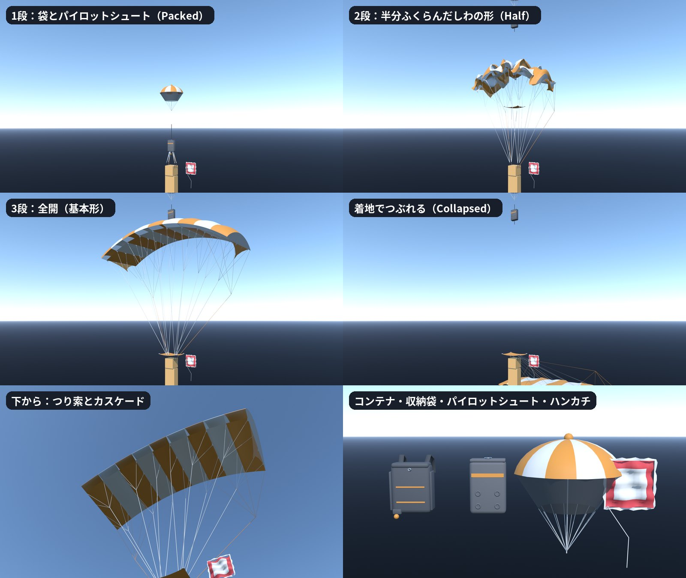

# パラシュート一式と水柱（chute / splash）

サドンデス「ひらけ！パラシュート」（`docs/sudden_death_v2/parachute.md` 6.4節）のパラシュート一式（布・つり索・スライダー・ライザー・
パイロットシュート・ブライドル・収納袋・背中のコンテナ・ハンカチ）と、敗者が海へ落ちたときの水柱。
ライブの Blender で手続きで作った（3D 生成・クレジットは使っていない）。2026-10-18 作成。



## 形と作り込み

| 部品 | 内容 |
|---|---|
| 布（`Canopy`） | 9 セルのラムエア。幅 7.2 m（弧 70°）、翼弦 2.6 m、厚さ 0.52 m（翼厚 20%、下面は平ら寄りの翼形）、中央のセルの高さ 6.3 m。前縁は空気の取り込み口として開き、中のリブが見える。上下の布はセルの間でふくらむ。リブ 10 枚、つり索のつけ根のタブ、両端の安定板。セルはプレイヤーの色と白の交互（中央は色） |
| つり索（`Lines`） | A〜D の 4 列 × リブ 10 枚。カスケードで束ねて 4 本のリンクへ。ブレーク索（色）は後縁からトグルへ |
| スライダー（`Slider`） | 0.95 × 0.75 m、四隅にはとめ。全開ではリンクの上（肩から 0.62 m）まで下りている |
| ライザー（`Risers`） | 4 本の帯、金属のリンク、後ろのライザーのトグル（色） |
| パイロットシュート（`PilotChute`） | 直径 1.1 m、12 枚のゴア（色と白）、網のすそ、頂点のキャップ、中心の索。原点＝ブライドルのつけ根（ドームの 0.6 m 下） |
| ブライドル（`Bridle`） | 帯。原点から +Y へ 1 m（Godot が長さに合わせて伸ばす） |
| 収納袋（`DeployBag`） | 0.34 × 0.18 × 0.5 m、フタとはとめ、ゴムの留め 4 つ、色の帯 |
| コンテナ（`Container`） | 背中のパラシュートのコンテナ。0.36 × 0.16 × 0.46 m、予備のフタ、横のフタ、縫い目の帯（色）、肩のヨーク、引き手（色の玉）。原点＝背中に当たる面の中心、本体は −Z（後ろ）へ |
| ハンカチ（`Hanky`） | 敗者の「予備」。0.45 m 四方、波打つ折り目、赤い縁取り、レースのふち、小さな輪とひも。原点＝ひものつけ根 |
| 水柱（splash.glb） | 柱（高さ 11 m、でこぼこ）、クラウン（王冠形のしぶき、とげ 14 本と先の水滴）、飛び散る水滴 46 粒、泡の輪（半径 3.6 m、ふちがぎざぎざ）、波紋（半径 1 の輪）。原点＝水面の中心 |

## 段ごとの形（形の切り替え）

`Canopy`・`Lines`・`Slider`・`Risers` に同じ名前の形の切り替え（glTF のモーフターゲット）がある（`Risers` は `Grounded` だけ動く）。基本形が全開。`Collapsed` は今は使っていない。

| 名前 | 形 | 使うところ |
|---|---|---|
| `Packed` | 布は袋の中（袋の位置＝肩から 1.3 m 上）、つり索はライザーから袋へまっすぐ | 1 段（袋とパイロットシュートだけが見える） |
| `Half` | 幅 0.53 倍・高さ 0.74 倍に縮み、しわがよる。スライダーは上 | 2 段 |
| `Collapsed` | 空気が抜けて、後ろ（−Z）へ平らに落ちる | 着地のあと |
| `Breath` | ふくらみが少し抜ける | ばたつき（2 段で大きく、3 段で少し） |
| `Grounded` | 床に落ちた形。原点＝床。布は後ろ 0.95〜2.15 m に幅 2.9 m の低い山、つり索は床をはって山の下へ、スライダーとライザーも床に寝る | 着地のあと（`drop_to()`。`Risers` もこの形だけ持つ） |

開く動き（`scripts/world/sudden_death/games/parachute_canopy.gd`）：段が上がると重みを少し行き過ぎながら寄せる。全開になる瞬間は 0.35 秒で、
`Half` の重みが一度 −0.1 まで下がって（ふくらみすぎて）から 0 に決まる（スナッチ）。しぼむときは 0.3 秒でまっすぐ戻す。

## ファイル

| ファイル | 内容 |
|---|---|
| `chute.glb` | パラシュート一式。三角形 10,408（布 5,920）、形の切り替え 4 つ |
| `splash.glb` | 水柱。三角形 5,160 |
| `chute_layout.json` | 寸法（布の上面の高さ・袋の中心・スライダー・リンクの高さ・形の切り替えの名前） |
| `source/blender/build_parachute.py` | ビルダー（ライブの Blender で runpy）。部品を作り、形の切り替えを付け、GLB 2 つ・layout・確認レンダー・報告を書き、`.blend` を保存する |
| `source/blender/parachute.blend` | 編集用の原本（Blender 5.1）。`PC_EXPORT`・`SP_EXPORT`（書き出し）、`REF_Review`、`CAMERAS`、`LIGHTING` |
| `source/blender/SCENE_PASSPORT.md` | 作り方の約束 |
| `source/previews/pc_01〜09.png` | 確認レンダー（全開・半分・袋・つぶれた形・呼吸・下から・小物・水柱・床に落ちた形） |
| `source/build_report.json` | 三角形の数・形の切り替え・布の上面の高さ |

`source/` は `.gdignore` で Godot の取り込みから外してある。

## ゲーム側の約束（Godot）

- パラシュートは `ParachuteCanopy`（`scripts/world/sudden_death/games/parachute_canopy.gd`）が読み込み、`place()` で肩に合わせる。
  ローカル：原点＝肩のライザーのつけ根、+Y＝体の上、+X＝体の横、+Z＝前
- 材質は名前で探す。`PC_Accent` をプレイヤーの色（P1 オレンジ、P2 青）に塗り替える。布は両面
- 背中のコンテナは `ParachuteCanopy.container_node()` で写して、人形の背骨の (0, 0.22, −0.12) に付ける
- パイロットシュート・収納袋・ブライドルの置き場所は、段の重みから毎フレーム決める（1 段は袋の上、2・3 段は布の上）
- 着地のあとは `drop_to(床の置き場所)` を渡し、`collapse`（0〜1）で置き場所を肩から床へ移しながら `Grounded` の重みを上げる。
  床の置き場所は原点＝着地面の上・人の 0.45 m 後ろ、+Z＝人の前（着地台が揺れるので毎フレーム渡し直す）
- 置き場所の向きは右手系のまま（+X＝体の横、+Y＝上、+Z＝体の前）。裏返しに付けると、布の前後と `Grounded` の向きが逆になる
- 水柱は `WaterSplash`（`water_splash.gd`）。`play()` から 2.4 秒、柱が伸びて崩れ、クラウンが開いて沈み、水滴が飛んで落ち、泡と波紋が広がって消える
- 確認：`tests/sudden_death_v2/chute_check.gd`（形の切り替えがあること・段ごとの重み・スナッチの行き過ぎ・色の塗り替え・部品を確かめ、本物の空と海で撮る）

## 作り直し方

1. ライブの Blender で `source/blender/parachute.blend` を開き、次を実行する
   ```python
   import runpy, sys
   sys.argv = ["blender", "--"]      # 試すときは "--no-export", "--no-render", "--no-save"
   runpy.run_path(r"C:/AIQUIZ/AIQUIZ-Godot/assets/sudden_death/parachute/chute/source/blender/build_parachute.py", run_name="__main__")
   ```
2. Godot で取り込みを更新し、確かめる
   ```powershell
   ./Godot_v4.7.2-stable_win64_console.exe --headless --path . --import
   ./Godot_v4.7.2-stable_win64_console.exe --path . --resolution 1600x900 --script res://tests/sudden_death_v2/chute_check_bootstrap.gd
   ```
