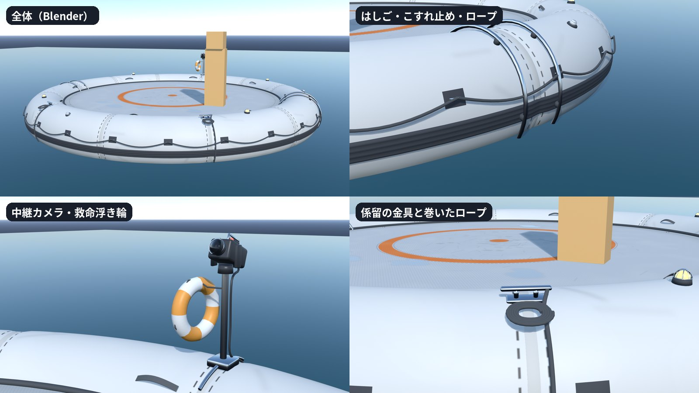

# 着地台（landing_float）

サドンデス「ひらけ！パラシュート」（`docs/sudden_death_v2/parachute.md`）で、勝者がパラシュートで降りて踊る、海に浮かぶ着地台。
遠く（真上の高い所）からはオレンジの輪が目印として読め、近く（勝者が踊る 3〜8 m）では作り込みが見えるようにした。
ライブの Blender で手続きで作った（3D 生成・クレジットは使っていない）。2026-10-18 作成。
同じ日に「デザインが奇抜すぎる」とのユーザーの指示でシンプルにした（オレンジと白の部屋・「？」の印・紺の帯・市松・目盛り・矢じり・
中心のクッション・旗をやめ、明るいグレーにオレンジの輪 1 本）。部品の作り込みは残した。



## 形と作り込み

| 部品 | 内容 |
|---|---|
| 浮き輪 | 輪の中心の半径 3.55 m、管の半径 0.52 m（外径 8.13 m、喫水線から上面まで 0.80 m）。明るいグレー 1 色の 12 の部屋に分かれ、境目で 3% くびれる。溶着の継ぎ目と点線の縫い目、しわ、喫水線の汚れ、日焼けのむら（テクスチャ） |
| 着地面 | 半径 3.15 m、平ら（中心で喫水線から 0.572 m）。グレーのマットに着地の目印のオレンジの輪（半径 1.45〜1.62 m）と中心の小さな丸。すべり止めの菱形の溝、縫い目、すり傷、足あと、水たまり（粗さが低い） |
| こすれ止めの帯 | 外側の赤道の少し下をひと回り。溝 3 本のゴム |
| 溶着テープ | 部屋の境目 12 か所。管をひと回り |
| ロープ | 外側に当て布と D リング 24 か所、その間を垂れた濃いグレーのロープ |
| 空気弁 | 3 か所（ゴムのつば・ふた・ふたのひも） |
| 取っ手 | 内側の上に 8 か所（濃いグレーの帯の輪） |
| 標識灯 | 4 か所（斜め 45° の位置。台・黄色く光るドーム・ガード） |
| はしご | 2 本（±X）。管の上を越えて水の中へ。ステンレスの手すり、水の中の踏み板 2 段、管との当て物 |
| 中継カメラ | 奥（Godot の −Z）の管の上。U 字のクランプ・柱・雲台・本体・取っ手・レンズとフード・赤い灯（光る）・ケーブル。中心を 20° 見下ろす |
| 救命浮き輪 | 中継カメラの柱に掛けてある（白とオレンジ、ロープ付き） |
| 係留 | 金具 2 つ、横に巻いたロープ、管をなでて海へ下りる係留ロープ |
| 縁取り | 着地面のふちの濃いグレーのパイピング、水抜きのはとめ 12 個 |
| 底 | 半径 3.5 m（水の中） |

## ファイル

| ファイル | 内容 |
|---|---|
| `landing_float.glb` | ゲームで使う着地台。三角形 75,022、メッシュ 15（材質ごとにまとめた。`Lamps`・`Tally` は光らせるので別）、テクスチャ 4 枚 |
| `landing_float_lf_*.png` | GLB から Godot が取り出したテクスチャ（`.import` は VRAM 圧縮・高品質（BC7）・ミップマップ） |
| `landing_float_layout.json` | マーカー（Godot の座標）と寸法（着地面の高さ・半径・外径・喫水線） |
| `source/make_float_textures.py` | テクスチャを描く（PIL。2 倍で描いて縮める）。`source/textures/lf_*.png`（着地面・浮き輪とそれぞれの ORM）を書く |
| `source/blender/build_landing_float.py` | ビルダー（ライブの Blender で runpy）。部品を作り、材質ごとにまとめて GLB・layout・確認レンダー・報告を書き、`.blend` を保存する |
| `source/blender/landing_float.blend` | 編集用の原本（Blender 5.1）。`LF_PARTS`（部品ごと・非表示）、`LF_EXPORT`（書き出し）、`REF_Review`（海面と大きさ比較の箱）、`CAMERAS`、`LIGHTING` |
| `source/blender/SCENE_PASSPORT.md` | 作り方の約束（寸法・部品・確かめ方） |
| `source/previews/lf_01〜07.png` | Blender の確認レンダー |
| `source/build_report.json` | 三角形の数・材質・寸法・マーカー |

`source/` は `.gdignore` で Godot の取り込みから外してある。

## ゲーム側の約束（Godot）

- 原点：浮き台の中心 × 喫水線。海に浮かべるときは `position.y = 海面の高さ`（波に合わせた上下・傾きは Godot で付ける）
- 着地点：`MK_LandCenter`（着地面の中心、喫水線から 0.572 m）。プレイヤーの足の裏をここに合わせる
- はしご：`MK_Ladder_PX` / `MK_Ladder_NX`（管の上）。勝者の迎え（縄ばしご）の位置決めに使える
- 中継カメラ：`MK_TvCamera`（レンズの前）。`Tally`（赤い灯）は撮っている間だけ点ける
- 標識灯：`Lamps`（材質 `LF_LampAmber`、発光）。点滅は発光の強さを変える
- 材質は名前で探す（`LF_*`）。粗さは `lf_tube_orm` / `lf_pad_orm` の G
- 確認：`tests/sudden_death_v2/landing_float_check.gd`（部品・テクスチャ・発光・マーカーを確かめ、本物の海に浮かべて撮る）

## 作り直し方

1. テクスチャ：`python assets/sudden_death/parachute/landing_float/source/make_float_textures.py`
2. ライブの Blender で `source/blender/landing_float.blend` を開き、次を実行する（GLB・layout・確認レンダー・報告を書き、`.blend` を保存する）
   ```python
   import runpy, sys
   sys.argv = ["blender", "--"]      # 試すときは "--no-export", "--no-render", "--no-save"
   runpy.run_path(r"C:/AIQUIZ/AIQUIZ-Godot/assets/sudden_death/parachute/landing_float/source/blender/build_landing_float.py", run_name="__main__")
   ```
3. Godot で取り込みを更新し、確かめる
   ```powershell
   ./Godot_v4.7.2-stable_win64_console.exe --headless --path . --import
   ./Godot_v4.7.2-stable_win64_console.exe --path . --resolution 1600x900 --script res://tests/sudden_death_v2/landing_float_check_bootstrap.gd
   ```
