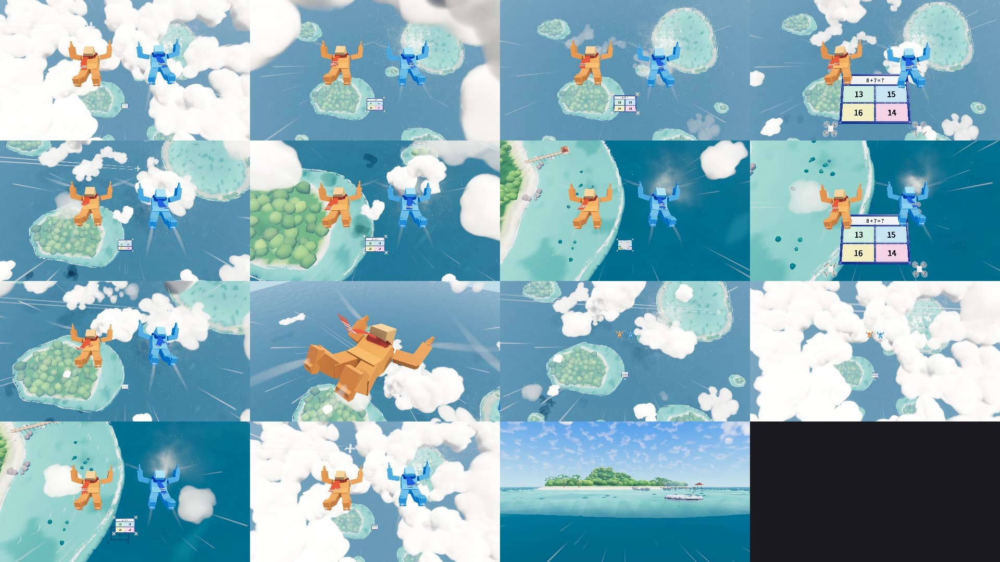

# スカイゲートの空の演出（sky_fx、W7）

サドンデス「つきやぶれ！スカイゲート」の本戦の見下ろしの画で見える空：高さで移り変わる雲（雲海 → 雲を抜ける → 点々の雲と島々 → 近い島と着地台）、風切り、2 色のマフラー、見下ろしの島、海鳥と飛行機雲、海のサングリント。
仕様は `docs/sudden_death_v2/sky_fx.md`、作業の分け方と約束は `skygate_build_plan.md` の W7・4.8 節。2026-10-19 作成。



上の段から：雲海と穴の下のボード（C）／雲を抜ける（F：入る・中・出る）／点々の雲と島々（A：ふだん・ゲートが近い）／近い島と着地台（E）／延長戦／マフラーの寄り／高い所から（雲の層・雲海）／海鳥／飛行機雲。画質「低」は `source/previews/godot_contact_low.jpg`。

## ユーザーの指示（2026-10-19、この作業の途中）

| 指示 | したこと |
| --- | --- |
| 「雲はやっぱりいらない」→ そのあと「雲も復活させて。UE の VolumeCloud（レイマーチの体積雲）のような雲を作りたい。作れるなら作って、無理なら無料素材を。リアリティを完璧に追求」 | 自分で作った（素材は使っていない）。参考と同じ方式：雲の形を 3D の濃さに焼き、レイマーチで光の弱まり（Beer）・前と後ろへの散乱（Henyey-Greenstein の 2 つの山）・多重散乱の近似・空の光を積む。最初の平らな板の雲（板 56 枚）はやめた |
| 「キャラの体から出ている風切りもわずかに見えるくらいに弱めて」 | 手足の風の筋の濃さ 0.16（前は 0.55〜0.75）、水滴も薄く。頭の筋はやめた（真上から見ると点に縮む） |
| 「海は今のゲームステージのようなきれいな海を用意して、太陽のライティングもリアリティを追求」 | 海はステージと同じ海（`StageEnvironment.create_ocean_surface`・画質ごとの `OceanDetail`）のまま、空・空の光・トーンマップ（ACES）・グローもステージと同じにした本戦用の環境（`SkyFallScenery.venue_environment`）を作った。太陽はステージの天気の周期の太陽を雲・海・サングリントに渡す。空撮で目立つ 2 つを足した：太陽が映る所のまわりのなめらかな光の帯（サングリント、GGX の鏡面・Cox-Munk の波の斜面）と雲が海と島に落とす影。ステージの水平線の霧は高い所から見ると海を白く濁らせるので、空撮の薄い霞（1000 m で約 2 割）に替えた |

**`docs/sudden_death_v2/sky_fx.md` の更新が要る**（自分の担当のフォルダの外なので書き換えていない）：雲は写実の体積雲、風の筋は「わずかに見える」程度、海はステージの海＋サングリント。計画書第4章（4.8 節）の約束は変えていない（関数を足しただけ）。

## ファイル

| ファイル | 中身 |
| --- | --- |
| `scripts/world/sudden_death/sky_fx/sky_fall_scenery.gd` | `SkyFallScenery`（まとめ役。約束 4.8 節の関数と、足した関数） |
| `…/sky_fall_clouds.gd` | `SkyFallClouds`：体積雲（雲海・ふちの塔・中の雲・近い雲・薄い雲）と雲の影。1 つの MultiMesh に入れて毎フレーム遠い順に並べる |
| `…/sky_fall_sea.gd` | `SkyFallSea`：海のサングリント（海面のすぐ上に足す板） |
| `…/sky_fall_islands.gd` | `SkyFallIslands`：着地台のまわりの島（高い所は軽い作り、近づくと細かい作り）・白波・桟橋と小舟・帆船と航跡 |
| `…/sky_fall_wind.gd` | `SkyFallWind`：画面のふちの速さの線・手足の風の筋・水滴 |
| `…/sky_fall_flyers.gd` | `SkyFallFlyers`：海鳥の群れ・飛行機と飛行機雲 |
| `…/sky_fall_scarf.gd` | `SkyFallScarf`：マフラー（P1 オレンジ・P2 青）。人形とアバターの両方に付く |
| `…/sky_fx_debug.gd`・`sky_fx_debug_bootstrap.gd` | デバッグの入口（下の「確かめ方」） |
| `…/tools/sky_fx_cloud_import.gd` | 焼いた雲の体積を Godot の 3D テクスチャ（`.res`）にする |
| `shaders/sky_fx_cloud_volume.gdshader` | 体積雲（レイマーチ） |
| `shaders/sky_fx_cloud_shadow.gdshader` | 雲が海と島に落とす影（雲の形を真上から見た濃さ） |
| `shaders/sky_fx_sea_glint.gdshader` | 海のサングリント |
| `shaders/sky_fx_island.gdshader`・`sky_fx_surf.gdshader` | 島（頂点色・距離のかすみ・水面下の礁湖の色）・白波 |
| `shaders/sky_fx_screen.gdshader`・`sky_fx_streak.gdshader`・`sky_fx_droplet.gdshader` | 速さの線・風の筋（飛行機雲と航跡も）・水滴 |
| `shaders/sky_fx_scarf.gdshader`・`sky_fx_bird.gdshader` | マフラーの毛糸・海鳥の羽ばたき |
| `sky_fx_cloud_shapes.res`・`sky_fx_cloud_detail.res` | 雲の形（R8、96×96×(64+4)×6）とふちを削るノイズ（RG8、64³、くり返す） |
| `sky_fx_cloud_shadows.png`・`sky_fx_cloud_volumes.json` | 影の形（形ごとに横へ並べた 96×96）・形の縦横比などの説明 |
| `sky_fx_islands.glb`・`sky_fx_boats.glb`・`sky_fx_layout.json` | 島（ライブの Blender で作った）・小舟と帆船・島の並び |
| `source/blender/build_sky_fx.py`・`sky_fx.blend` | 島のビルダー（スタジアムの遠景 `aqs_backdrop.py` の道具を読むだけで使う） |
| `source/clouds/bake_cloud_volumes.py` | 雲の体積を焼く（Python・numpy） |
| `source/previews/` | Blender の確認画・雲の形の確認画・Godot の実画面 |
| `source/godot_check_<画質>.json` | デバッグの入口が測った数（描く回数・GPU の時間・数） |

`source/` は `.gdignore` で Godot の取り込みから外してある。

## 使い方（W4・W6）

```gdscript
var sky := SkyFallScenery.new()
parent.add_child(sky)
sky.global_position = 落ちる点                       # 2 人の真ん中（W4 の _fall_center()）
sky.build(quality, 着地台の位置（海面）, 画面の上の向き)  # W4 は前＝+Z なので Vector3(0, 0, 1) を渡す（省くと −Z）
sky.set_camera(camera)
sky.configure_sea(空のセットの海, ステージの太陽)        # 描く順と太陽（1 回）
sky.set_sun(ステージの太陽)                           # 雲とサングリントの太陽（1 回）
# 見せ方の environment() で SkyFallScenery.venue_environment(quality) を返す（監督がカメラに当てる）

# 毎フレーム
sky.set_progress(p)                 # ラウンドの落下の進み 0〜1
sky.set_overtime(延長戦か)
sky.set_wind(強さ)                  # 0〜1.4（ふだん 1.0、ゲートの後半 0.5、通過で 1.4）
sky.set_landing_point(着地台の位置)   # 海を上げ下げするとき（深さのおすすめ SkyFallScenery.sea_depth(p)）
sky.advance(落ちた m, delta)

sky.gate_emerge(board)              # ゲートの頭（雲海の穴をボードの真上に開く）
sky.track_body(player, parts)       # 手足の風の筋（人形の parts か StagingPuppet.parts()）

var scarf := SkyFallScarf.new(); parent.add_child(scarf)
scarf.attach_doll(parts, player)    # または attach_puppet(puppet, player)。外すとき detach()
```

| 約束（4.8 節） | 中身 |
| --- | --- |
| `build(quality, landing_point)` | 3 つ目の引数 `forward`（画面の上の向き、省くと −Z）を足した。島は着地台のまわりに置く。着地台は島 Main の礁の外の深い青の上（礁の縁から約 40 m） |
| `set_progress(p)`・`set_overtime(on)` | 帯：雲海 c（0〜0.27）、雲を抜ける f（0.13〜0.26）、点々の雲と島々 a（0.17〜0.92）、近い島と着地台 e（0.82〜1）。延長戦は a だけ |
| `advance(fall_distance, delta)` | 中の雲・近い雲・水滴を落ちた分だけ上へ流す。雲海の高さは進みで決まる（進み 0 で 240 m 下、0.19 で 2 人の高さ。ROUND 1 の毎秒 40 m とそろう） |
| `set_wind(strength)` | 速さの線の本数と速さ、風の筋と水滴の濃さ、マフラーのはためき（`SkyFallScarf.wind`） |
| `gate_emerge(board)` | 雲海の穴の中心をボードに合わせ、半径 18 m から 52 m へ 1.4 秒で開く（ボードが横へ動けば穴も追う） |
| `set_camera(camera)` | 速さの線の板をカメラの子に置く。雲の前後の並べ替えと島の細かさの切り替えにも使う |
| `SkyFallScarf.attach_doll`・`attach_puppet`・`detach` | 首の輪（首の部位の子）と背中の結び目から出る 2 本の端（10 点の列を Verlet で揺らす） |

足したもの：`set_landing_point`・`configure_sea`・`set_sun`・`venue_environment`（static）・`sea_depth`（static）・`band_weights`（static）・`track_body`／`untrack_body`・`stats`。
`SkyFallScarf` の調整：`air_velocity`（体に対する空気の流れ、ふだん上向き 30 m/秒。着地台の上では小さく）・`trail_back`（足の側へなびかせる速さ）・`wind`・`time_scale`（スロー）・`auto_advance`。

**礁のふち（2026-10-19、W4 の着地の画で見つかった）**：海面近くの低い視点から、礁の外の急な斜面と面の切れ目が海越しにまっすぐな線に見えた（ゲームの海は「水面とその奥の面の高さの差」で透け方を決めるため）。
島のシェーダーで 7 m より深い面を描かないようにして直した（`sky_fx_island.gdshader` の `deep_discard`）。海は底なしの深い色になり、浅瀬のふちは礁の形に沿った曲線になる。確かめの画は `source/previews/godot_15_landing_low_<画質>.png`（デバッグの入口のカメラ 4 番目）。
ビルダーは礁の外を 90 m（軽い作りは 110 m）かけてなだらかに落とすように直した。glb は 2026-10-19 02:14 に W6（メインのセッション）がライブの Blender で作り直した（浅瀬のふちの外に柔らかい色の移り（約 25 m）が出る）。

**注意（W4・W6）**
- 空のセットの巡航の雲（`SuddenDeathSkySet.clouds`、StagingClouds）は本戦では隠す（雲は体積雲だけにする）。
- 半透明の描く順：海 −10（`configure_sea` が設定）→ サングリント −9 → 白波・航跡・雲の影 −8 → 体積雲 −5 → ほか（ボードの紙・文字・風の筋）。体積雲は深さを書かないので、ボードの紙（半透明）より先に描く必要がある。
- 雲は不透明なもの（島・人形・ボードの枠）の手前で止まる（深さのテクスチャ）。カメラが雲の中に入っても描く。

## 帯と高さ

海までの深さのおすすめ `sea_depth(p) = 75 + 1075 × (1 − p)^1.35` m（進み 0 で 1150 m、0.25 で 805 m、0.85 で 158 m、1 で 75 m。延長戦は 520 m）。帯の見え方はこの深さで作った。

| 帯 | 見えるもの |
| --- | --- |
| 雲海（c） | 平たい塊を敷きつめた雲海（92 個、画質「低」は外側を減らして 75 個）。真ん中に穴、穴の下にボードと島。雲海より上を飛行機が横切り、飛行機雲を引く |
| 雲を抜ける（f） | 穴のふちの高い積雲（12 個）が 2 人のまわりの壁になり、穴が少し細くなる。カメラが雲の中を通る所は体積雲そのもので白くかすむ |
| 点々の雲と島々（a） | ゲートの高さの積雲（2 人の 14〜340 m 下、下の端で現れる）が海に影を落とす。カメラの近くを抜ける小さな雲は画面のふちだけ。はるか下（海の 60〜140 m 上）にうすい雲。環礁・緑の島・小島、帆船と航跡 |
| 近い島と着地台（e） | 島 Main の細部（木・ヤシ・砂浜・サンゴ・波打ち際と礁の白波・桟橋と東屋・小舟）、礁の外の着地台、海鳥の群れ（2 人と海の間を横切る）。雲は画面のふちに少し |

## 体積雲の作り

1. 形を焼く：`source/clouds/bake_cloud_volumes.py`（numpy）。積雲は大きな球の上に小さな球を 3 段重ね（もくもく）、符号付き距離のなめらかな和で 1 つにして、低い周波数のノイズでゆがめ、底を平らに切る。形は 6 つ（tower 縦横比 1:0.85・cumulus 1:0.6・deck_a 1:0.32・deck_b 1:0.3・small 1:0.6・wisp 1:0.45）。ふちを削るノイズは Perlin-Worley（R）と Worley の重ね（G）をくり返すように焼く。真上から見た濃さを影の形（png）にする。
2. Godot の 3D テクスチャにする：`tools/sky_fx_cloud_import.gd`（画面ありで実行。`--headless` では中身が保存されない）。
3. 描く：`sky_fx_cloud_volume.gdshader`。箱（雲 1 つ）の中を、カメラの側から深さのテクスチャの所まで進む。1 歩ごとに形の濃さをノイズで外側から削り、太陽へ数歩進んで途中の濃さで光を弱め（Beer）、位相関数（前 0.62・後ろ −0.18）と多重散乱の近似（吸収を弱めた光）と空の光（上は青空、下は海の照り返し）を、エネルギーを保つ式（Hillaire 2015）で積む。光が 1.5% まで弱まったら打ち切る。

| 画質 | 雲の数 | 1 本の光線の歩数 | 太陽への歩数 | 細かいノイズ |
| --- | --- | --- | --- | --- |
| 低 | 106（雲海 75・塔 12・中 9・近い 4・薄い 6） | 16 | 2 | なし |
| 標準 | 約 125 | 30 | 3 | あり |
| 高 | 141（雲海 92・塔 12・中 18・近い 7・薄い 12） | 42 | 4 | あり |
| 最高 | 141 | 60 | 5 | あり |

## 画質と負荷

Godot の実画面（1600×900、RTX 5070、Forward+）。描く回数は空の演出を見せたときと隠したときの差（`RENDERING_INFO_TOTAL_DRAW_CALLS_IN_FRAME`）、GPU の時間は `viewport_get_measured_render_time_gpu`（30 フレームの平均、空の演出ありの全体／なしの全体）。

| 帯 | 描く回数（低／高） | GPU の時間 ms・低（あり／なし） | GPU の時間 ms・高（あり／なし） |
| --- | --- | --- | --- |
| 雲海 C | 16 ／ 16 | 1.41 ／ 0.45 | 3.58 ／ 0.99 |
| 雲を抜ける F | 15 ／ 15 | 1.17 ／ 0.45 | 1.93 ／ 0.98 |
| 点々の雲と島々 A | 16 ／ 16 | 0.58 ／ 0.45 | 1.79 ／ 0.94 |
| 近い島と着地台 E | 11 ／ 12 | 0.51 ／ 0.43 | 1.28 ／ 0.89 |
| マフラー 2 本 | 4 | | |

- 体積雲は何個あっても描く回数は 1（＋影 1）。重さは画面の中で雲が占める広さと歩数で決まる（いちばん重いのは雲海を見下ろす C）。
- 粒・数：水滴 低 20／高 40、風の筋 8 本（手足、1 本 11 点）、海鳥 低 10／高 16、帆船と小舟 低 3／高 5（遠い船と航跡は描かない、650 m）、つないだ小舟 2（桟橋が見えるときだけ）、雲の影 低 15／高 30。
- 島：軽い作り 1〜4 千三角形、細かい作り 7 千〜9 万三角形（Main 92,690）。カメラから島の中心までが島ごとの距離（240〜520 m）より近いと細かい作り（行き来しないよう 40 m の余裕）。白波はすべての島で 1 つ。
- CPU：`advance` 1 フレーム 低 0.9〜1.0 ms・高 1.1〜1.3 ms（雲の並べ替えを含む）、マフラー 2 本 0.5 ms。
- 海のサングリントは板 1 枚（足すだけ）。海の照り返しの点（画質「標準」以上の `glint_*`）は空撮向けに減らした（`AERIAL_GLINTS`）。

## 確かめ方（デバッグの入口）

```powershell
./Godot_v4.7.2-stable_win64_console.exe --path . --resolution 1600x900 --script res://scripts/world/sudden_death/sky_fx/sky_fx_debug_bootstrap.gd -- low
./Godot_v4.7.2-stable_win64_console.exe --path . --resolution 1600x900 --script res://scripts/world/sudden_death/sky_fx/sky_fx_debug_bootstrap.gd -- high shots
```

- 引数は画質（`low` / `balanced` / `high` / `ultra`）。`shots` を付けると決まった高さの画を撮り、数を測って終わる（`source/previews/godot_*_<画質>.png`・`godot_contact_<画質>.jpg`・`source/godot_check_<画質>.json`）。
- 操作（`shots` なし）：←→ 進み（押し続けで動く）・下のつまみ・Space 自動で落ちる／止める・1〜4 高さへ飛ぶ・W 風の強さ（自動→0→0.5→1.0→1.4）・O 延長戦・C カメラ（見下ろし／マフラーの寄り／高い所／着地台の高さの横）・H 文字を消す・A／D で P1 が傾く。
- 中身：ステージと同じ空・太陽（天気の周期）・本戦用の環境、空のセットの海、着地台（`LandingFloat`）、問題のボード（`SkyGateBoard`、W5）、人形 2 人（`DropMotion` の腹ばい）にマフラーと風の筋。ボードはゲート 8 秒で 320 m 下から上がる（進み 1 で 4 枚目を通る）。カメラは 2 人の上 6.5 m・少し後ろから 75° で見下ろす（P1 が画面の左）。

## 作り直し方

- 島：ライブの Blender で `source/blender/sky_fx.blend` を開き（`artifacts/sudden_death_v2/BLENDER_IN_USE.txt` を確かめて書く）、
  ```python
  import runpy, sys
  sys.argv = ["blender", "--"]      # "--no-export" / "--no-render" / "--no-save"
  runpy.run_path(r"C:/AIQUIZ/AIQUIZ-Godot/assets/sudden_death/sky_fx/source/blender/build_sky_fx.py", run_name="__main__")
  ```
  約 6 秒で glb・layout・確認画・`build_report.json` を書き、`.blend` を保存する。そのあと Godot のファイルの再走査。
- 雲：`python -I assets/sudden_death/sky_fx/source/clouds/bake_cloud_volumes.py`（約 1 分）→ `tools/sky_fx_cloud_import.gd` を画面ありで実行 → 再走査。
