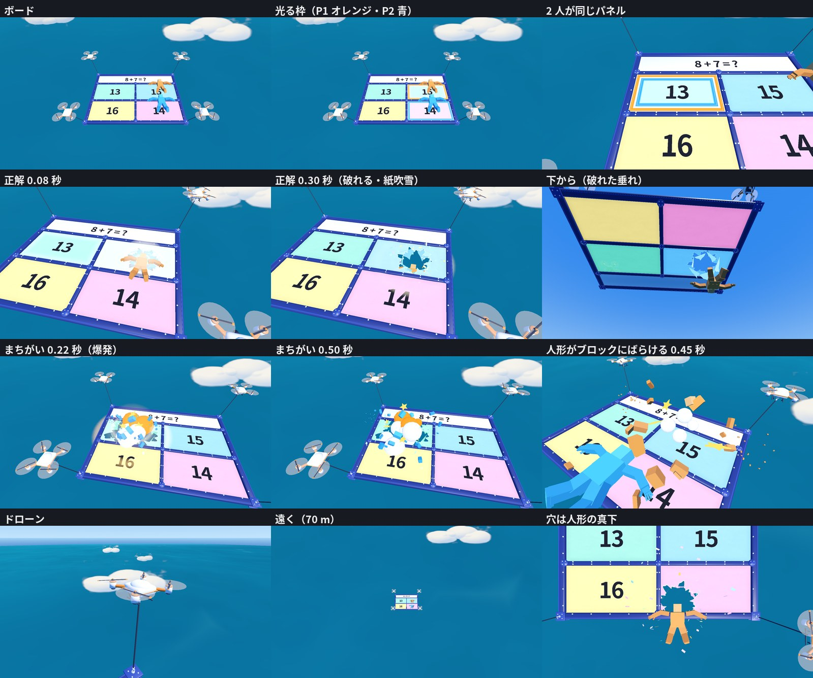

# スカイゲートの問題のボード（gate_board）

サドンデス「つきやぶれ！スカイゲート」（`docs/sudden_death_v2/sky_gate.md`）の、ドローン 6 機で吊った横向きの問題のボード（奥に大きな問題文の看板）と、その効果（紙が破れる・パネルの爆発・人形がブロックにばらける）。

> 2026-10-19：問題文の帯 `QuestionStrip` を、ボードより大きな看板 `QuestionSign`（17 × 6 m、看板の奥の 2 隅をドローン 2 機で吊る）に替えた（`sky_gate.md` 第8章の決定。W6 のセッションがライブの Blender で作り直した）。
作業の分け方の W5（`docs/sudden_death_v2/skygate_build_plan.md` 第3章・4.6節）。2026-10-18 作成。
ライブの Blender（5.1.2）で手続きで作った（3D 生成・クレジットは使っていない）。見た目は絵コンテ（`artifacts/sudden_death_v2/sky_gate/panels/panel_04〜06.png`）とユーザーの手描き（`refs/user_sketch_gate.png`）に合わせた。



## 形

| 部品 | 内容 |
|---|---|
| 板 | 14 × 10 m の横向き。原点＝板の中心 × 紙の面 |
| 枠 | 濃紺の太い枠（外 0.46 m 幅・0.34 m 高、中の仕切り 0.30 m 幅・0.26 m 高）。角の板と吊り金具（目のついたボルト・シャックル）、仕切りの交わる所の丸い押さえ板とボルト、紙を留めるピン |
| 問題文の看板 `QuestionSign`・`SignFrame` | ボードの奥に載せた 17 × 6 m の看板（ボードより広く、奥へ 3.64 m はみ出す）。白い面 `QuestionSign` は 16.28 × 5.28 m（上面は紙の面から +0.39 m、材質 `GB_Strip`）。紺の台と縁・オレンジの線・下の骨・角の吊り金具は `SignFrame`。前の帯のあった所は枠の紺の板でふさいだ |
| 紙のパネル `Panel_0〜3` | 6.39 × 3.34 m。少し透ける紙（不透明度 0.9）、真ん中が 5 cm たわむ。色はミント `#8FE3B5`・水色 `#8CCDF5`・レモン `#FBE878`・ピンク `#F9A9C8`。番号は **0＝奥の左・1＝奥の右・2＝手前の左・3＝手前の右**（ルールの選択肢の番号と同じ） |
| ドローン `Drone_0〜5` | 吊る角から外へ 0.75 m（手前と奥の角はさらに 0.62 m 外）、上 3.2 m。白い丸い体・オレンジの帯と 4 本の腕・白いモーター・前のカメラの目・緑と赤の灯・そり・下のウインチとフック。**0・1＝看板の手前の角（左・右）、2・3＝ボードの手前の角、4・5＝看板の奥の角** |
| ローター `Rotor_<ドローン>_<0〜3>` | 2 枚羽根（先がオレンジ）。半径 0.55 m。ドローンの子。Godot のローカルの +Y まわりに回す |
| 回る羽根の円 `RotorDisc_<ドローン>` | うすい半透明の円 4 つ（ドローンの子）。羽根が速く回るときのぼけ |
| 吊りケーブル `Cable_0〜3` | 角の金具からドローンのフックまで。原点＝角の金具、ローカルの +Y がドローンへ向く |

文字は素材に入れていない（Godot の `Label3D` で書く）。色は頂点色（材質 `GB_Body` 1 つ）で、描く回数を減らした。

## ファイル

| ファイル | 内容 |
|---|---|
| `gate_board.glb` | ゲームで使うボード。三角形 35,772（枠 8,640・看板の台 2,512・看板の面 44・ドローン 2,472 × 6・ローター 250 × 24・パネル 672 × 4・ケーブル 72 × 6・羽根の円 104 × 6）。テクスチャなし |
| `gate_board_layout.json` | 寸法（Godot の座標）：パネルの中心と大きさ・看板（`question_sign`）・ドローンの中心とフック・ケーブルの付け根と長さ |
| `shaders/gate_paper.gdshader` | 紙のパネル：少し透ける紙・繊維とたわみの濃淡・破れた穴（ぎざぎざ、ふちは白い）・光る枠のときの明るさとにじみ・ひらめき・裏からの光 |
| `shaders/gate_highlight.gdshader` | 光る枠の帯 |
| `shaders/gate_bits.gdshader` | 紙吹雪・紙のかけら・破れた紙の垂れ（裏からも光る） |
| `shaders/gate_puff.gdshader` | 漫画の煙と火の玉（トゥーンの陰） |
| `shaders/gate_glow.gdshader` | 光の輪とひらめきの玉（足し算） |
| `check/gate_board_check.gd`（と `_bootstrap.gd`） | Godot の実画面での確認（撮る・描く回数・粒の数・計算の時間・fps による差） |
| `source/blender/build_gate_board.py` | ビルダー（ライブの Blender で runpy）。部品を作り、GLB・layout・確認レンダー・報告を書き、`.blend` を保存する |
| `source/blender/gate_board.blend` | 編集用の原本（Blender 5.1）。`GB_EXPORT`（書き出し）、`REF_Review`（はるか下の海と大きさ比べの人形）、`CAMERAS`、`LIGHTING` |
| `source/previews/gb_*.png` | Blender の確認レンダー |
| `source/previews/godot_*_<画質>.png`・`godot_contact_<画質>.jpg` | Godot の実画面（`check/` が撮る） |
| `source/build_report.json`・`source/godot_check_<画質>.json` | 三角形の数・寸法／Godot での数（下の表） |

`source/` は `.gdignore` で Godot の取り込みから外してある。

## ゲーム側の約束（Godot）

座標：原点＝ボードの中心 × 紙の面。**+X が右、−Z が奥（問題文の看板）、+Y が上**。ルールのボードの座標（x＝右、y＝奥、m）はローカルの (x, 0, −y)。
ROUND 3 以降の小さいボード（10 × 7 m）は、`SkyGateBoard` ノードの `scale` で縮める（`size()`・`panel_center()` は縮めた値を返す）。
選手の番号は **1＝P1（オレンジ）、2＝P2（青）**。

### `SkyGateBoard`（`scripts/world/sudden_death/games/sky_gate_board.gd`）

計画書 4.6 節の関数：

| 関数 | 中身 |
|---|---|
| `build(quality := "") -> bool` | GLB を読み、材質を作り直す（頂点色・紙のシェーダー）。文字・光る枠・効果（`effects`）を作る。画質を省くと `GameManager.graphics_quality` |
| `set_question(text, choices)` | 看板に問題文、4 枚のパネルに選択肢を `Label3D` で書く（大きさは枠に合わせる。長いと真ん中に近い区切りで 2 行に分ける）。看板が一瞬光る。`choices` は `Array[String]` でも `Array` でもよい |
| `set_highlight(panel, player, on)` | 真下のパネルを自分の色の光る枠で光らせる。紙が少し明るくなり、ふちに自分の色がにじむ。2 人が同じパネルなら 2 色（P1 が外、P2 が内） |
| `burst(panel, at := Vector3.INF)` | 正解：紙が破れる（半径 1.2 m の穴が 0.14 秒で開き、ふちの紙が下へ垂れる）・紙吹雪・光の輪・ひらめき・選択肢の文字が消える |
| `boom(panel, at := Vector3.INF)` | まちがい：パネルの漫画の爆発（オレンジの火の玉から白い煙・黄色い星・紙のかけら・オレンジの輪・ひらめき）。穴は半径 2.5 m。ボードが 0.7 秒ゆれる |
| `advance(delta)` | ローター・ドローンの浮き沈みとゆらぎ・ケーブル・穴・光る枠の脈・ゆれ・効果を進める。スローのときは小さい delta を渡す。ボードが横へ動くと（ROUND 2）ドローンがその向きへ傾く |
| `panel_center(panel) -> Vector3` | パネルの中心（ワールド、紙の面） |
| `size() -> Vector2` | ボードの大きさ（m、縮めた値） |

`burst`・`boom` の `at`（ワールド）は省いてよい（パネルの中心）。渡すと、その位置に穴を開ける（パネルのふちから 0.7 m 内に収める）。

足したもの（約束は変えていない）：

| もの | 中身 |
|---|---|
| `effects: SkyGateEffects` | ボードの子の効果。ボードと一緒に動く。`player_burst` もここで呼べる |
| `reset()` | 穴・垂れ・効果・光る枠を消して、次のゲートに使い回す |
| `static panel_rect(panel) -> Rect2` / `static panel_at(p: Vector2) -> int` | ボードの座標（縮める前）のパネルの四角／点の真下のパネル（帯・枠・外は −1）。ルールの判定に使える（`build` 不要） |
| `board_point(p: Vector2) -> Vector3` | ボードの座標の点のワールドの位置 |
| `PANEL_CENTERS`・`PANEL_SIZE`・`SIGN_CENTER`・`SIGN_SIZE`・`SIGN_OUTER`・`SIGN_TOP`・`BOARD_SIZE` | 寸法の定数（`gate_board_layout.json` と同じ。`STRIP_CENTER`・`STRIP_SIZE` は看板と同じ値の別名） |
| `sign_corners() -> Array[Vector3]` | 看板の 4 隅（ワールド）。本戦の見下ろしのカメラが看板ごと画に入れる |
| `question_label`・`choice_labels` | 文字の `Label3D`（色や大きさを変えたいとき） |

### `SkyGateEffects`（`scripts/world/sudden_death/games/sky_gate_effects.gd`）

| 関数 | 中身 |
|---|---|
| `player_burst(parts: Dictionary, at: Vector3)` | 人形（`EmoteBlockmanPreview.build_player_skeleton` の parts）の体を、色ごとのブロックにばらして飛び散らせる（白い煙・星・ひらめきつき。血や怖さはなし）。人形は隠す（`parts["pelvis"].visible = false`）。**戻すのは呼んだ側**。大きい箱は画質「高」で 4 つ、「標準」で 2 つに割る |
| `build(quality := "")` / `advance(delta)` / `clear()` / `is_playing()` | 作る・進める・消す・出ているか（垂れを除く） |

- 粒の位置は「効果が出てからの時間」の式（空気の抵抗つきの放物線）で決める。30／60／120fps で同じ時刻まで進めた差は 0.000000004 m（`check/` で確かめた）。
- 座標は `SkyGateEffects` ノードのローカル。ボードの子（`board.effects`）なら、ボードが上がっていくと効果も一緒に上がる（アウトの人のブロックはボードのところに残る）。

### 注意

- `gate_board.glb` をそのまま置くと、Godot の取り込みは頂点色を材質に使わないので白く見える。**必ず `SkyGateBoard.build()` を通す**（材質を作り直す）。
- 文字は `Label3D`（NotoSansJP-Bold の MSDF、上から見て読める向き、裏からは見えない）。

## 画質と負荷

`GraphicsQuality.particle_amount`（高 1.0・標準 0.6・軽量 0.35）で粒を減らす。破れた紙の垂れは 1 つの穴に 低 6・標準 8・高 10 枚。

| 粒の数（1 回あたり） | 低 | 標準 | 高 |
|---|---|---|---|
| 正解の紙吹雪 | 56 | 96 | 160 |
| 爆発の煙と火の玉 | 9 | 16 | 26 |
| 爆発の星 | 5 | 8 | 14 |
| 爆発の紙のかけら | 20 | 34 | 56 |
| 人形のブロック（今の人形） | 45 | 58 | 76 |
| 人形の煙・星 | 4・3 | 7・5 | 12・8 |
| 一番重いとき（正解・まちがい・人形が同時）の粒の合計 | 161 | 247 | 379 |

描く回数（Godot の実画面、1600×900、`RENDERING_INFO_TOTAL_DRAW_CALLS_IN_FRAME` でボードを見せたときと隠したときの差）：

| | 低（影なし） | 標準（影あり） | 高（影あり） |
|---|---|---|---|
| ボードだけ | 39 | 52 | 52 |
| 光る枠 2 つ | 41 | 54 | 54 |
| 一番重いとき | 46 | 59 | 59 |
| 描いた三角形（ボードだけ） | 17,940 | 52,950（影の分を含む） | 52,950 |
| `advance` の計算（一番重いとき、1 フレーム） | 0.31 ms | 0.37 ms | 0.54 ms |

- ボードだけの 39 回＝枠 1・帯 1・パネル 4・ドローン 4・ローター 16・羽根の円 4・ケーブル 4・文字 5。光る枠は 1 枚 1 回。
- **2026-10-19 の看板とドローン 6 機のあと（標準）**：ボードだけ 73 回・光る枠 2 つ 75 回・一番重いとき 80 回、描いた三角形 63,414（影の分を含む）、`advance` 0.37 ms（`source/godot_check_balanced.json`）。増えた分はドローン 2 機（体・ローター 4・羽根の円・ケーブル）と看板の台・面と、その影。上の表は看板の前の数。
- 効果は種類ごとに MultiMesh 1 つ（紙のかけら・煙・星・ブロック・垂れ・輪・ひらめき）。何回破れても、出ている種類の数だけ（最大 +7）。
- 遠いと描かない：ローターと羽根の円 110 m、ケーブル 170 m、文字 260 m（遠くのゲートが何枚も見えるときに軽くなる）。
- 影：画質「低」では落とさない。「標準」以上は枠とドローンだけ落とす（`GraphicsQuality.gameplay_shadow_enabled`）。紙・文字・効果は落とさない。
- 測ったパソコン：RTX 5070、Forward+。

## 確かめ方

```powershell
./Godot_v4.7.2-stable_win64_console.exe --path . --resolution 1600x900 --script res://assets/sudden_death/sky_gate/check/gate_board_check_bootstrap.gd -- low
./Godot_v4.7.2-stable_win64_console.exe --path . --resolution 1600x900 --script res://assets/sudden_death/sky_gate/check/gate_board_check_bootstrap.gd -- high
```

引数は画質（`low` / `balanced` / `high` / `ultra`）。

空と海はゲームの空のセット（`SuddenDeathSkySet`、海は 70 m 下）。撮る画：ボード・光る枠（1 人ずつ／2 人が同じパネル）・正解（0.08／0.30／0.75 秒、下から）・まちがい（0.06／0.22／0.50／1.00 秒、人形がブロックにばらける）・人形のブロック（近く）・ドローン・遠く 70 m・ずらした位置の穴。

## 作り直し方

1. ライブの Blender で `source/blender/gate_board.blend` を開き、次を実行する（GLB・layout・確認レンダー・報告を書き、`.blend` を保存する）
   ```python
   import runpy, sys
   sys.argv = ["blender", "--"]      # 試すときは "--no-export", "--no-render", "--no-save"
   runpy.run_path(r"C:/AIQUIZ/AIQUIZ-Godot/assets/sudden_death/sky_gate/source/blender/build_gate_board.py", run_name="__main__")
   ```
2. Godot のエディタで取り込みを更新し（ファイルの再走査）、上の確かめ方を通す。
3. 寸法を変えたら、`sky_gate_board.gd` の `PANEL_CENTERS`・`PANEL_SIZE`・`STRIP_CENTER` も合わせる（`build` が layout とちがうと警告を出す）。
