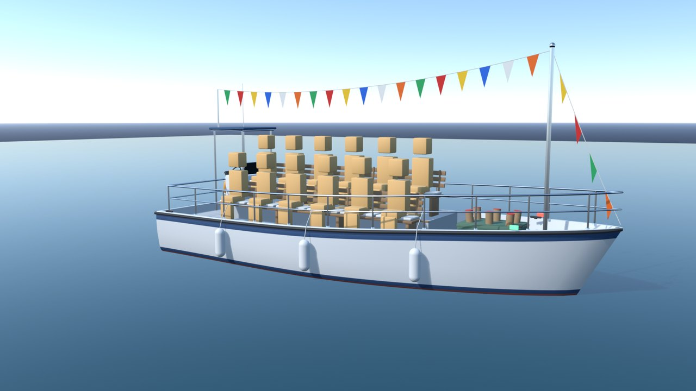
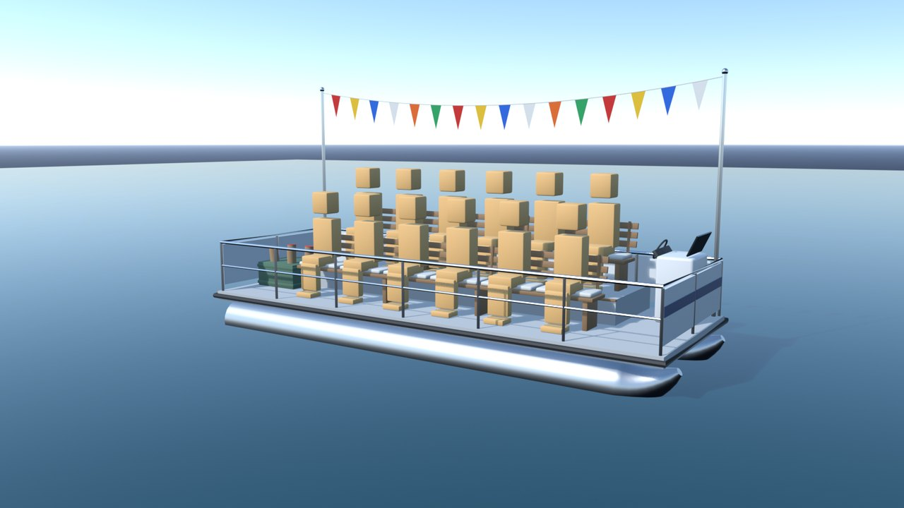

# 観客船（spectator_boats）

サドンデス「つきやぶれ！スカイゲート」の着地台のまわりに浮かべる、観客を乗せた船（`docs/sudden_death_v2/sky_gate.md` 第9章）。
着地すると観客がクラッカーを鳴らし、船の打ち上げ筒から花火を上げる。ライブの Blender で手続きで作った（3D 生成・クレジットは使っていない）。2026-10-21 作成。





確認レンダーの座った人の箱（オレンジ）は書き出さない。ゲームではゴールの観客と同じ座った観客（`SeatedSpectatorKit`）を座らせる。

## 2 種類の船

| 船 | 形 | 座席 | 三角形 |
|---|---|---|---|
| `SB_Launch`（観覧船） | 全長 10.2 m・幅 3.9 m（こすれ止めを含む）。白い船体（キール・デッドライズ・チャイン・フレアの断面をロフト、船首は前へ傾く）、舷の下の色帯と喫水線の帯、赤茶の船底。手すり、こすれ止め、船尾の操舵台（風防・ハンドル・T トップの紺の屋根・アンテナ）、船首のマスト、マストから船尾の柱と船首へ旗の綱（小旗 22 枚）、舳先の打ち上げ筒の箱（筒 6 本）、フェンダー 3、救命浮き輪、航海灯、クリート 4 | 2 列 × 6 席（前の列は甲板の上、後ろの列は 0.38 m の台の上） | 22,868 |
| `SB_Pontoon`（パーティー船） | 全長 7.6 m・幅 2.7 m。アルミの浮き筒 2 本（船首は上へ反る）、甲板、柵（観客の前は手すりだけ、ほかは白い板に色帯）、船首の操舵台、船尾の打ち上げ筒の箱（筒 4 本）、旗の綱（小旗 16 枚） | 2 列 × 6 席 | 10,070 |

## ファイル

| ファイル | 内容 |
|---|---|
| `spectator_boats.glb` | 2 隻ぶん。根 `SB_Launch`・`SB_Pontoon`（原点）の子に、材質ごとにまとめたメッシュ（`Launch_Teak` など）。船体 `Launch_Hull` は色の帯ごとに 4 つの材質。小旗 `*_Flags` は頂点の色で、UV の v が付け根 0 → 先 1 |
| `spectator_boats_layout.json` | 座席（座面の上の中心と列）・打ち上げ筒の口・甲板の高さ・船の箱。Godot の座標 |
| `source/blender/build_spectator_boats.py` | ビルダー（ライブの Blender で runpy）。部品を作り、材質ごとにまとめて GLB・layout・確認レンダー・報告を書き、`.blend` を保存する |
| `source/blender/spectator_boats.blend` | 編集用の原本（Blender 5.1）。`SB_PARTS_Launch`・`SB_PARTS_Pontoon`（部品ごと・非表示）、`SB_EXPORT`（書き出し）、`REF_Review`（海面と座った人の箱）、`CAMERAS`、`LIGHTING` |
| `source/blender/SCENE_PASSPORT.md` | 作り方の約束（寸法・部品・確かめ方） |
| `source/previews/sb_01〜07.png` | Blender の確認レンダー |
| `source/build_report.json` | 三角形の数・材質・大きさ・座席の数 |

`source/` は `.gdignore` で Godot の取り込みから外してある。

## ゲーム側の約束（Godot、`SkyGateFlotilla`）

- 原点：船の中心 × 喫水線。船首は +X、観客は +Z を向く。海に浮かべるときは `position.y = 海面の高さ`（波の上下・傾きは Godot で付ける）
- 座席：layout の `seats` は `[x, 座面の上の高さ, z, 列]`。座る人の腰は座面の中心より `hip_behind`（0.06 m）後ろ（-Z）。座面の高さは床から 0.50 m（ゴールの観客の骨：もも 0.40・すね 0.43・足 0.10 で、足の裏が床に着く）
- 打ち上げ筒：layout の `launch`（筒の口）から花火を上げる
- 色帯：材質 `SB_Stripe` を船ごとの色に塗り替える
- 小旗：`*_Flags` に `assets/sudden_death/sky_gate/shaders/boat_flags.gdshader` を当ててはためかせる
- 材質は名前で探す（`SB_*`）。テクスチャは使っていない（色と粗さだけ）
- 確認：`tests/sudden_death_v2/flotilla_check.gd`

## 作り直し方

1. ライブの Blender で `source/blender/spectator_boats.blend` を開き、次を実行する（GLB・layout・確認レンダー・報告を書き、`.blend` を保存する）
   ```python
   import runpy, sys
   sys.argv = ["blender", "--"]      # 試すときは "--no-export", "--no-render", "--no-save"
   runpy.run_path(r"C:/AIQUIZ/AIQUIZ-Godot/assets/sudden_death/sky_gate/spectator_boats/source/blender/build_spectator_boats.py", run_name="__main__")
   ```
2. Godot で取り込みを更新し、確かめる
   ```powershell
   ./Godot_v4.7.2-stable_win64_console.exe --path . --resolution 1280x720 --script res://tests/sudden_death_v2/flotilla_check_bootstrap.gd -- case=finale
   ```
