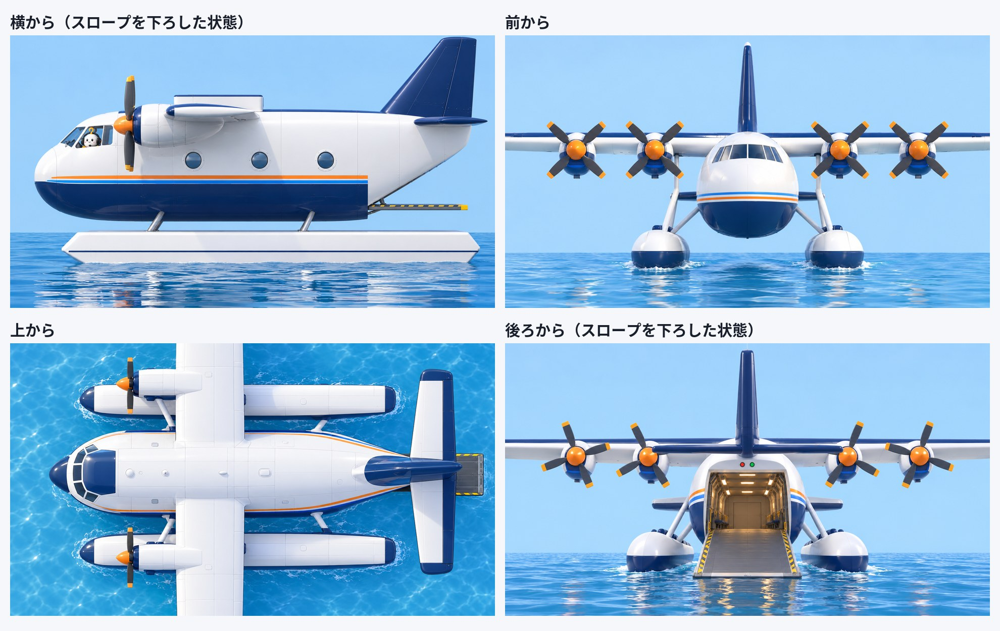
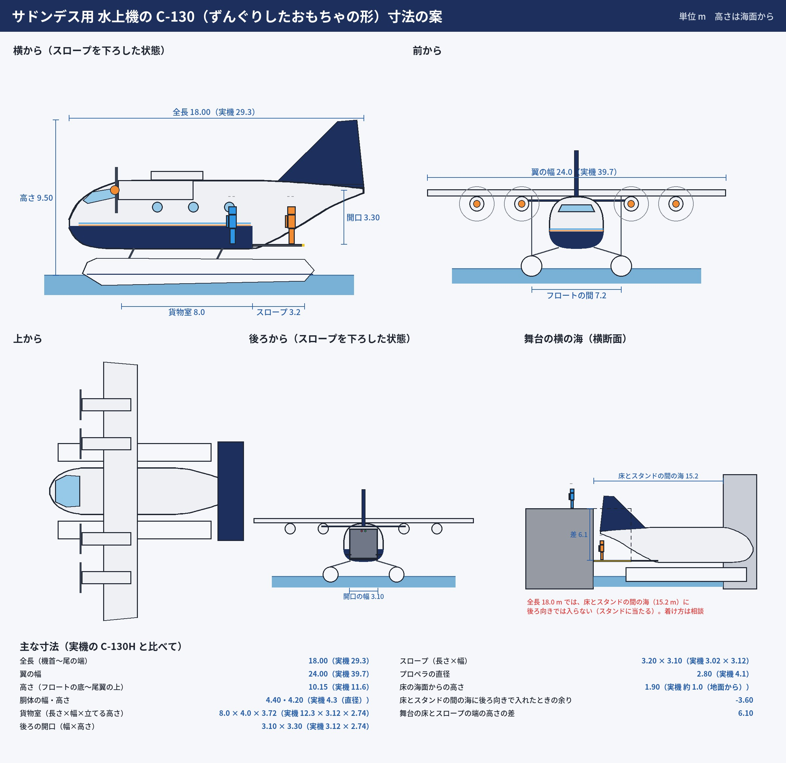
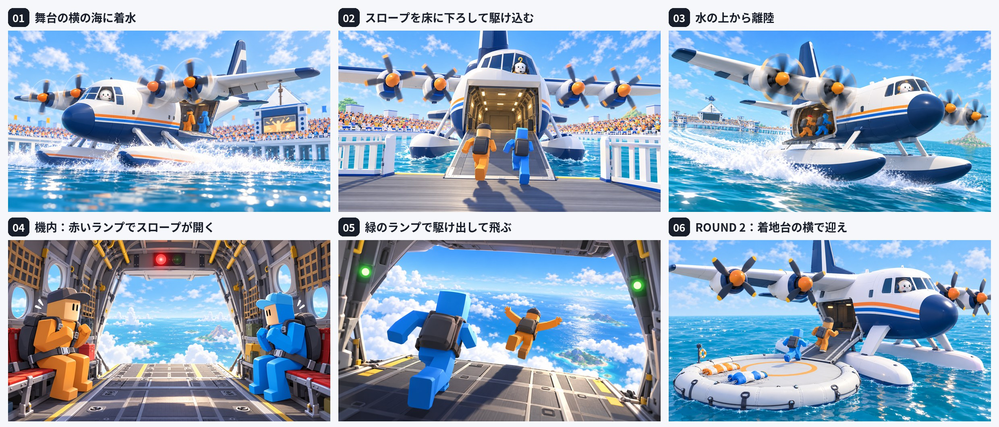
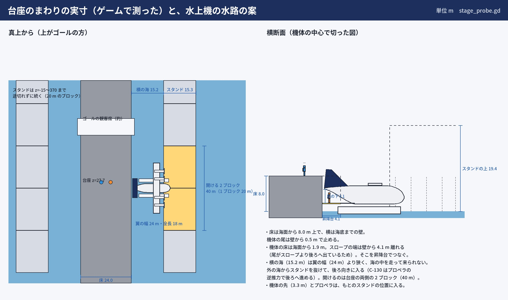
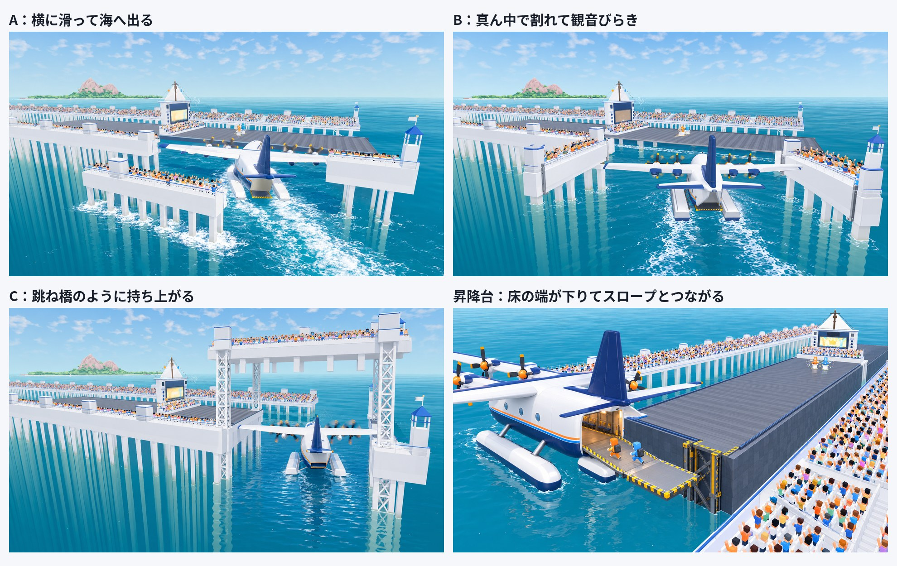
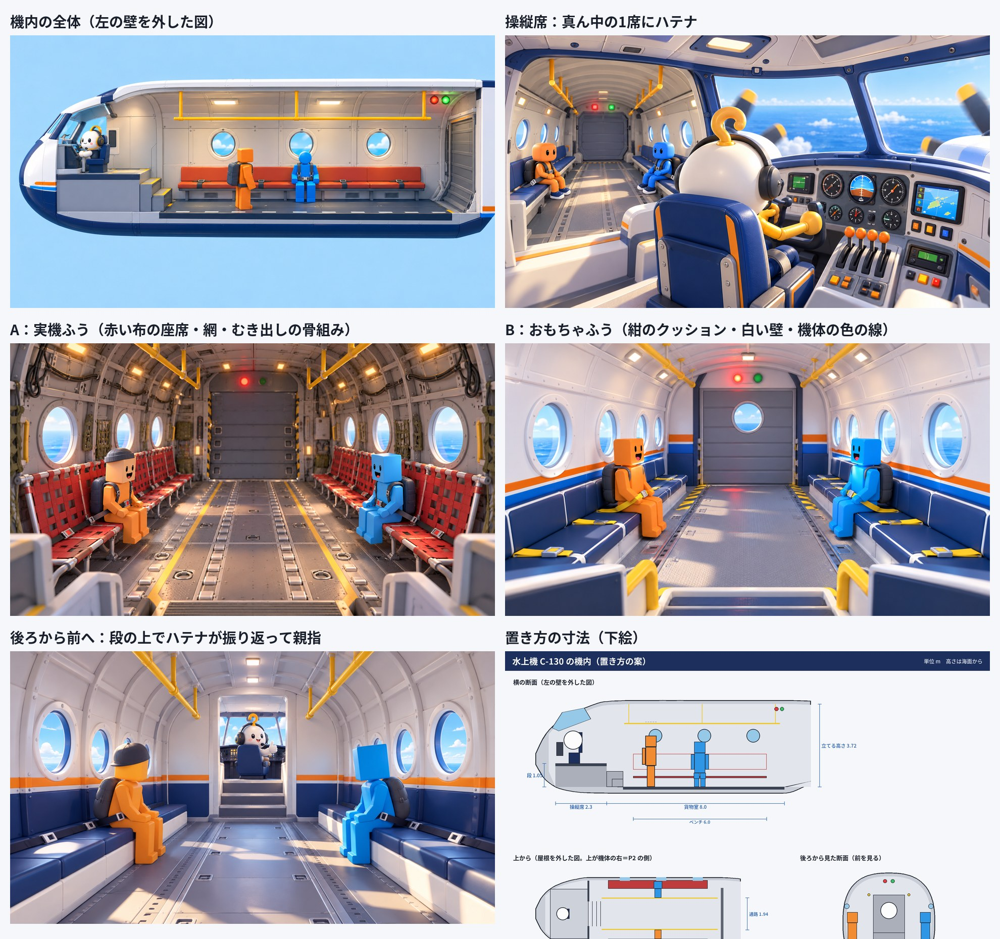
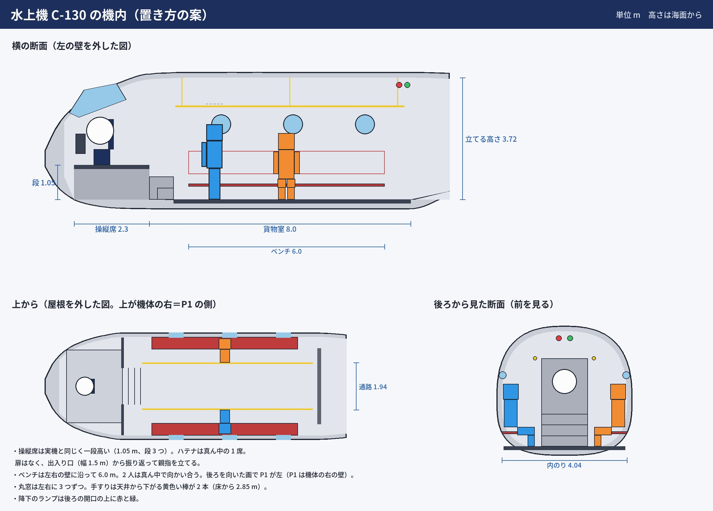
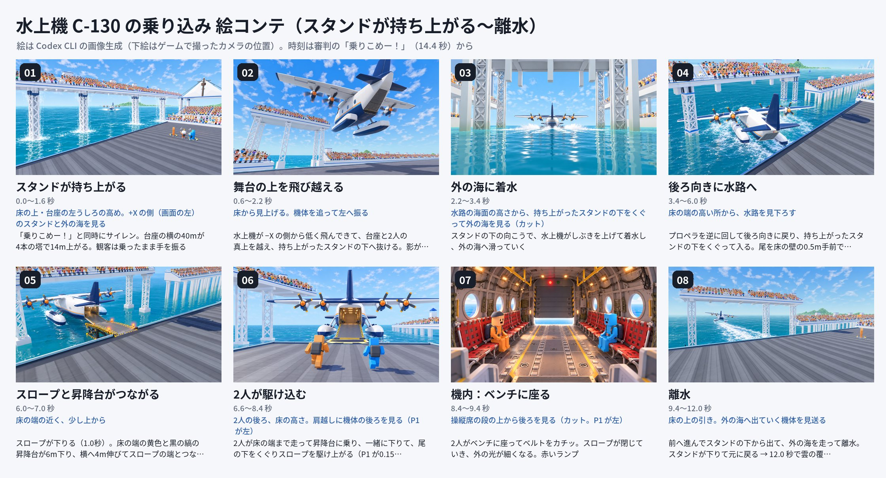

# サドンデスの水上機 C-130（設計メモ）

2026-10-18作成。サドンデス「つきやぶれ！スカイゲート」（`sky_gate.md`）で2人を運び、後ろのスロープから飛び出させる機体を決める。最初は3人乗りのヘリ（`heli_drop.md`）で考えていたが、ユーザーの指示で **Call of Duty: Warzone の降下と同じ C-130 をモデルにした水上機** に変えた。降り方（基本の降り方と15%の特別な8種類・Space で飛ばせる・ROUND 2 以降は短い版）と、機内の座り方（横向きのベンチで向かい合う）は `heli_drop.md` で決めたとおり。

> 作り方（並行で作るための分け方と受け渡しの約束）は `skygate_build_plan.md`。

## 1. 決まったこと（ユーザーと決定）

| 項目 | 決定 |
| --- | --- |
| モデル | C-130 ハーキュリーズ（Warzone の降下で使われる輸送機）。止まって浮いていられないので **水上機**（フロート付き。実機でも MC-130J の水上機版が研究されている） |
| 乗せ方 | 海に着水し、後ろのスロープを下ろして2人が駆け込む（案①） |
| スロープ | **尾の下**（実機と同じ。胴体の下面が後ろへはね上がり、その斜めの面が床ごと下りる） |
| 大きさ | **もう少し大きく、細長く**：全長 18.0m・翼の幅 24.0m（実機は 29.3m・39.7m） |
| 尾 | 大きな尾翼のまま（C-130 らしさ） |
| エンジン | 4つのまま |
| 舞台での着け方 | **台座の横のスタンドが跳ね橋のように持ち上がって水路が開き**、水上機が後ろ向きにその下をくぐって入る。床（海面から 8.0m）とスロープ（1.9m）の段差は、床の端の昇降台でつなぐ（第4章） |
| 形 | 下の4つの図の形でよい |







## 2. 寸法（`artifacts/sudden_death_v2/c130_float/c130_design.py`）

| 項目 | この機体 | 実機 C-130H |
| --- | --- | --- |
| 全長・翼の幅・高さ | 18.0・24.0・10.15（フロートの底から） | 29.3・39.7・11.6 |
| 胴体の幅・高さ | 4.40・4.20 | 直径 約4.3 |
| 貨物室（長さ×幅×立てる高さ） | 8.0 × 4.0 × 3.72 | 12.3 × 3.12 × 2.74 |
| 後ろの開口（幅×高さ） | 3.10 × 3.30 | 3.12 × 2.74 |
| スロープ（長さ×幅） | 3.20 × 3.10 | 3.02 × 3.12 |
| プロペラの直径 | 2.80 | 約4.1 |
| フロート | 2本、長さ 14.2・直径 1.7、間 7.2、喫水 0.65 | — |
| 貨物室の床 | 海面から 1.90 | 地面から 約1.0 |

- 立てる高さ 3.72m は、いちばん高い帽子の人（2.92m）が立って歩ける高さ。開口 3.30m も同じ。
- 舞台の床は海面から 8.0m、床の横の海は幅 15.2m（床の端 x=12、横のスタンド x=27.2）。全長 18m は横の海に後ろ向きで入らないので、スタンドが割れて水路を開ける。

## 3. 流れ（案）

```
DRAW! → 種目発表 → 台座の横のスタンドが跳ね橋のように持ち上がり、水路が開く → 水上機が外の海に着水し、後ろ向きにスタンドの下をくぐって入る
→ 床の端が昇降台になって下り、スロープとつながる → 2人が駆け込み、ベンチに座る → スロープが閉じて離水
→ 降下（機内の赤いランプ → スロープが開く → 緑 → 駆け出して飛ぶ。heli_drop.md）→ ゲート
→ 2人とも着地台へ着いたら：水上機が着地台の横に着水し、スロープを着地台の床に下ろして2人が駆け込む → 2回目の降下
→ 決着：勝者は着地台でダンス → 水上機が迎えに来て、勝者が駆け込む
→ 帰還：水上機が舞台の上を低く通り、勝者がスロープからパラシュートで自分の台へ降りる
```

## 4. 台座の横の水路と昇降台（2026-10-18、ユーザーと決定）

ゲームで実際に測った（`tests/sudden_death_v2/stage_probe.gd`、引き分けの台座が出たところ。出力は `artifacts/sudden_death_v2/c130_float/stage_probe/`）。

| 項目 | 実寸 |
| --- | --- |
| 台座の中心 | x=0、z=27.7、床の上面 y=−1.2（海面 −9.2 から 8.0m 上）。床の横は海底までの壁 |
| 床の幅 | 24.0m（x=±12） |
| 横の海 | 床の端（x=±12）〜スタンドの内側（x=±27.2）で 15.2m。翼の幅 24m より狭く、海の中を走って来られない |
| 横のスタンド | x=27.2〜42.5（幅 15.3m）、上端は海面から 19.35m。z=−15〜370 まで 20m のブロックが途切れずに続く |
| ゴールの観客席 | 床の上、z≒50〜58、x=±13.5 |





| 項目 | 決定 |
| --- | --- |
| 開き方 | **C：跳ね橋のように持ち上がる**。台座の横の 2 ブロック（z=5〜45、40m）が、4 本の白い格子の塔で約 14m まっすぐ上がる。観客は乗ったまま上から見下ろす。水上機はその下をくぐって入る（ほかの案：A 横に滑って海へ出る、B 真ん中で割れて観音びらき） |
| 入り方 | 外の海から、プロペラの逆推力で後ろ向きに入り、尾を床の壁から 0.5m で止める。機体の先とプロペラは、もとのスタンドの下に入る |
| 昇降台 | **床の端の一部（黄色と黒の縞）がエレベーターのように 6.1m 下り、横へ 4.1m 伸びてスロープの端とつながる**。2人は乗ったまま下り、尾の下（すき間 3.1m）をくぐってスロープへ駆け込む |
| どちら側 | 台座の +X の側（画面の左、P1 のスタンドの側）。−X の側は開けない（案。決まるまでは片側だけ作る） |

- 持ち上げたスタンドの柱の下端と尾翼の上（海面から 9.5m）のすき間は、柱の長さで決まる。実装のときにスタンドの床と柱の寸法を測って、上げる高さを決める（最低でも 2m あける）。
- 昇降台の絵（`gates/lift.png`）は機体が床と平行に描かれているが、実際は尾を床へ向けた後ろ向きで止める。

## 5. 機内（2026-10-18、ユーザーと決定）

置き方の寸法は `artifacts/sudden_death_v2/c130_float/c130_design.py` の「機内」、下絵は `make_cabin_sheet.py`、絵は `make_cabin_prompts.py`（Codex CLI）。





| 項目 | 決定 |
| --- | --- |
| 雰囲気 | **A：実機ふう**。赤い布（ナイロンのベルト）の座席をアルミの管の枠に張ったもの、壁の網とつなぎ止めの輪、むき出しの骨組みと配線、灰色のリブの壁、ローラーのレールと黄色い線の床、暖かい色の照明（ほかの案：B おもちゃふう＝紺のクッション・白い壁） |
| 貨物室 | 長さ 8.0m・幅（内のり）4.04m・立てる高さ 3.72m |
| ベンチ | 左右の壁に沿って 6.0m。2人は真ん中（機首から 7.4m）で向かい合う。通路（座った2人のひざの間）1.94m |
| 座る側 | **飛び出す画（機内から後ろを向く）で P1 が画面の左**。P1 は機体の右の壁、P2 は左の壁に座る（本戦の「P1 は常に画面の左」とそろえる） |
| 窓 | 丸窓を左右に3つずつ（座った頭の少し上、床から 2.3m） |
| 手すり | 天井から下がる黄色い棒が2本（床から 2.85m、通路の両側） |
| 降下のランプ | 後ろの開口の上に赤と緑 |
| 操縦席 | **実機と同じく一段高い床（貨物室の床から 1.05m、段3つ）の真ん中の1席にハテナ**。扉はなく、幅 1.5m の出入り口から貨物室が見える。ハテナは振り返って親指を立てる |

## 6. 乗り込みの時刻表とカメラ（2026-10-18、ユーザーと決定）

時刻は審判の「乗りこめー！」（決着演出の 14.4 秒。common.md 4.2）を 0 とした秒。0〜14.4 秒（DRAW!・タワーが沈む・種目発表）は今のまま。今のヘリ2機の迎えと縄ばしご（common.md 第5章）は使わない。
カメラの下絵はゲームで撮った位置（`tests/sudden_death_v2/stage_probe.gd` の `BOARDING_SHOTS`）、絵は `artifacts/sudden_death_v2/c130_float/make_boarding.py`（Codex CLI）。



| # | 時刻 | 内容 | カメラ |
| --- | --- | --- | --- |
| 01 | 0.0–1.6 | サイレン。台座の横（+X）のスタンド 40m が 4 本の塔で 14m 上がる。観客は乗ったまま手を振る。遠くの海に水上機 | 床の上・台座の左うしろの高め（目 (−7, 7, z−29.7)、+X の側のスタンドと外の海を見る） |
| 02 | 0.6–2.2 | 水上機が −X の側から低く（床の 20m 上）飛んできて、台座と2人の真上を越え、持ち上がったスタンドの下の上空を抜ける。影が床を走る | 床から見上げ、機体を追って左へ振る |
| 03 | 2.2–3.4 | 外の海に着水。しぶきを上げて外へ滑っていく | **カット**：水路の海面の高さから、持ち上がったスタンドの下をくぐって外の海を見る |
| 04 | 3.4–6.0 | プロペラの逆推力で後ろ向きに戻り、スタンドの下をくぐって水路へ。尾を床の壁の 0.5m 手前で止める（機体の中心 z≒25） | 床の端の高い所から水路を見下ろす |
| 05 | 6.0–7.0 | スロープが下りる（1.0 秒）。床の端の昇降台が 6.1m 下り、4.1m 伸びてスロープの端とつながる。黄色い回転灯 | 床の端の近く、少し上から |
| 06 | 6.6–8.4 | 2人が床の端まで走り（P1 が 0.15 秒先）、昇降台で一緒に下りて、尾の下をくぐりスロープを駆け上がる | 2人の後ろ・床の高さから肩越し（P1 が左） |
| 07 | 8.4–9.4 | 機内。2人がベンチに座ってベルト。スロープが閉じて外の光が細くなる。赤いランプ | **カット**：操縦席の段の上から後ろを見る（P1 が左） |
| 08 | 9.4–12.0 | 前へ進んでスタンドの下から外の海へ出て（床と直角に）、走って離水。スタンドが下りて元に戻る。12.0 秒で雲の覆い（common.md 5.3）→ 空のセット | 床の上の引き。外の海へ出ていく機体を見送る |

| 項目 | 決定 |
| --- | --- |
| 長さ | 「乗りこめー！」から離水まで **約 12 秒**（8 コマすべて見せる。今のヘリの縄ばしごは雲まで約 5.6 秒） |
| 飛ばす | **Space キーで飛ばせる**。どこで押しても雲の覆いへ移り、2人は機内の座席へ |
| カメラ | カットは 03（着水）と 07（機内）の 2 回だけ。ほかは切らずに振る・寄せる |

- 演出を飛ばすキーは、乗り込みも降下も **Space** にそろえた（2026-10-18、ユーザーの指示。降下は前に Enter と決めていた）。ルールカードを閉じる Enter はそのまま。

## 7. 次に詰めること

- 実機ふうの内装の作り込み（Blender）：座席の布と枠、網、骨組み、配線、床のレール。おもちゃのような体の2人と並べたときの見え方を、Godot の画面で確かめる。
- ~~ROUND 2 の迎え（着地台の横に着水してスロープを下ろす）と、勝者の迎え・帰還の時刻表。~~ → 第8章（W6 で作って決めた。ユーザーの確認を待つ）。

## 8. 作ってみて決めた時刻表（2026-10-19、W6。ユーザーの確認を待つ）

ユーザーが寝ている間に「残りを仕上げて」と任されたので、絵コンテで相談する代わりに、実際のゲームで動かして決めた。
作りは `scripts/world/sudden_death/floatplane/floatplane_staging.gd`（`FloatplaneStaging`）。数字はその先頭の定数。
確かめは `tests/sudden_death_v2/skygate_runtime.gd`（画は `artifacts/sudden_death_v2/skygate_runtime/<case>/`）。

### 8.1 乗り込み（第6章を作ったときに変えた所）

> 進入・着水・後ろ向きに寄せる・離水の動きと時刻は、第9章（2026-10-19）で現実の動きに作り直した。この節の秒と高さは古い。

| 項目 | 第6章 | 作ったもの | 理由 |
| --- | --- | --- | --- |
| 飛んでくる高さ | 床の 20 m 上 | 台座の上を床から約 5.8 m、そのまま**持ち上がったスタンドの下（海面から 14 m のすき間）をくぐって**外の海に着水 | 床の 20 m 上だと、持ち上げたスタンド（上端は海面から 33 m）にぶつかる。下をくぐる方が見せ場になる。尾翼の上と持ち上げたスタンドの下端のすき間は 2.7 m |
| 着水・すべる・戻る | 2.2–6.0 秒 | 着水 2.35 秒 → 外へすべって 3.4 秒に止まる（x=76）→ 逆推力で 6.6 秒に水路へ止まる | 外へすべった分を戻るので、少し長くした |
| 駆け出し | 6.6 秒 | 4.9 秒（P1）・5.05 秒（P2）。2 人とも昇降台に乗ったら 0.75 秒で下りる | 台座から床の端まで 11〜16 m あり、機体が止まるのを待つと長すぎる。機体が下がってくる間に走る |
| 06 のカメラ | 2人の後ろ・床の高さから肩越し（P1 が左） | 床の端の外（水路の上）の高めから、一緒に下りる 2 人とスロープへ駆け込む 2 人 | 昇降台が下りると、床の高さのカメラからは床の縁に隠れて見えない。機内の座席にそろえて P1 は機体の右の壁へ走る（この画では P1 が奥） |
| 長さ | 約 12 秒 | 約 13 秒（「乗りこめー！」→ 雲の覆い） | |
| Space | どこでも雲の覆いへ | そのとおり（機内の座席でベルトを締めた姿で空へ） | |

### 8.2 機内の巡航と降下（heli_drop.md 3.1）

- 巡航：空のセットの下の雲の層の少し上（落ちる点の 24 m 上）を飛ぶ。初めの 2.6 秒は外から（雲の上を飛ぶ機体）、そのあと機内（操縦席の段の上から後ろを見る、P1 が左）。準備が長いときは 9 秒ごとに外と中をくり返す。海は 200 m 下に下げる。
- 降下（初めの 1 回、約 7 秒）：0.0 赤いランプ → 1.0 ハテナが振り返って指さす → 1.6–2.8 スロープと上のふたが開く → 2.55 ベルトを外して立つ（1.4 倍の速さ）→ 2.8 緑のランプとブザー → 3.7 先の人が通り道へ出て走り、スロープの端で飛ぶ（基本 85%・特別 15%。heli_drop.md 2.2）→ 0.4 秒後にもう 1 人 → 腹ばいで雲の層をつき抜けて本戦の位置（`presenter.sky_spawn`）へ寄る → 本戦の見下ろしへ（カメラは切らずに寄せる）。
- 短い版（ROUND 2 から、約 3.5 秒）：スロープが開いて 2 人が立っているところから。0.3 緑 → 0.45 先の人が走る。
- カメラ：機内から背中を追って機外へ出て、下を向く（自分でなめらかに寄せ、機内にいる間は貨物室の中に収める）。2 人が飛び出して腹ばいになる間に、海を本戦の初めの深さ（900 m 下）へ下げる。
- Space：本戦の見下ろしへすぐ（0.3 秒の白い閃光）。

### 8.3 ラウンドの間の迎え（REBOARD、約 6.5 秒 → 雲の覆い → 短い降下）

> **2026-10-20、ラウンドの間の迎えはやめた（ユーザーの指示）。** 2 人が着地台に着いて「ROUND n」を見せたら（着地から 2.2 秒）、
> 0.6 秒で暗転し、真っ黒の 0.4 秒の間に機体を空の降下の位置へ置き直して、0.6 秒で明ける。明けた画は機内（操縦席の段の上から後ろを
> 見る、P1 が左）で、2 人は座席に座っている。そこから短い降下（ベルトを外して立つ → スロープが開く → 緑 → 駆け出して飛ぶ）。
> 暗転のあとは操縦席の窓へ向き直さず、機内の画から始める（`FloatplaneStaging._short_cut`）。暗転では雲の風の音は鳴らさない。
> 監督の場面 `REBOARD` は消した（`VENUE` → 暗転 → `DROP`）。下の表は迎えがあったときの記録。勝者の迎え（8.4）は同じ道すじのまま。

| 秒 | 内容 | カメラ |
| --- | --- | --- |
| 0.0–1.4 | 水上機が着地台の上を約 10 m で越えて（進む向きは +X から 25°。ハシゴとテレビカメラをよける）、先に着水 | 飛ぶ道すじの横（−Z の側。着地台の画と同じ側）の 34 m から、機体を追う |
| 1.4–2.3 | すべって止まる（着地台から 40 m 先） | 同じ |
| 2.3–4.7 | 逆推力で後ろ向きに戻る。止まるとスロープの端が着地台の浮き輪の上（中心から 3.6 m、海から 0.8 m）に載る | 同じ |
| 4.1–4.9 | スロープを浮き輪まで下ろす（床から 20° 下。`SuddenDeathFloatplane.RAMP_GROUND`）。「ROUND 2」の見出しは迎えが始まって 1.2 秒で下げる | |
| 4.85 / 5.0 | 2 人（P1 が先）が着地台からスロープを駆け上がって機内へ | 着地台の横の近くから |
| 2 人が付け根を越えたら | 雲の覆い → 機体は空の降下の位置へ、2 人はスロープの近くに立つ → 短い降下 → `begin_round` | |

- Space：本戦の見下ろしへすぐ（短い降下も飛ばす）。

### 8.4 勝者の迎え（EXTRACT）

決着のあと、勝者は着地台でダンス（3.6 秒。`presenter.extract_delay`）。そのあと水上機が 8.3 と同じ道すじで来て、スロープを下ろしたら勝者だけが駆け込む（それまでダンスを続ける）。2 人目の席は空。雲の覆い → 帰還。

### 8.5 帰還（HOME、約 8 秒）

| 秒 | 内容 | カメラ |
| --- | --- | --- |
| 0.0–2.6 | 水上機がゴールの観客席の上空から下りてきて、台座の上を床から約 2 m（スロープは床から 4 m）で通る。機首はコース（−Z）を向き、スロープはゴール（+Z）を向く | 床の横の海の上（翼の端より外、ゴールの側）から |
| 3.0 | 勝者がスロープの上で待っていた所から端へ駆け出す | |
| 3.4 | 端を離れて飛び降りる（`SD_Land_Hero`・`SD_Land_Roll`・`SD_Land_Stick` の 3 通りからランダム。heli_drop.md 2.3） | |
| 約 4.5 | 自分の台のゴールの側（台から 1.6 m）に着地 | |
| 着地のクリップが終わったら | **カット**して今までの帰還の画（台座の前）。振り返って台に跳び乗り、決着演出の人に替わる（common.md 10.1 と同じ）。機体は上がりながらコースの方へ去る | 今までどおり |
| 約 4.5〜 | 敗者は幽霊で飛んできて沈んだ台へ（今までどおり） | |

- 向きの理由：機首をゴールへ向けて通ると、飛び降りたあとすぐ前にゴールの観客席（床の 22 m 先）があり、よけられない。ゴールの側から入れば、飛び降りたあとは長いコースの上へ抜けられる。そのかわり、勝者は台のゴールの側に着地して、振り返って台に跳び乗る。


## 9. 離着水を現実の動きに（2026-10-19、ユーザーの指示「離着陸が低クオリティーすぎるので現実レベルに」）

前の動きは、決めた線の上を滑るだけだった：19° で下りるのに機首は ±5° に固定、着水で速さが 63 → 49 m/秒へとび、約 4.8 G で 26 m で止まり、
機首が −5° → +4° へ一瞬で替わる。後ろ向きに最大 24 m/秒で水路へ入り、離水は 1.8 G で 1.5 秒で浮いて、縦に 12 m/秒² で上がっていた。
しぶきは小さな粒だけで、航跡も波の揺れもなかった。

### 9.1 作り

| 部品 | 中身 |
| --- | --- |
| `FloatplaneFlight`（`floatplane_flight.gd`） | 場面の頭で 1/120 秒ごとに位置・姿勢・水への沈みを積んでおき、`sample(t)` で読む（フレームの長さで動きが変わらない）。`landing`・`dock`・`taxi`・`takeoff` |
| 空の姿勢 | 機首の角度 ＝ 道すじの角度 ＋ 迎え角。迎え角は速さの 2 乗に反比例し、荷重倍数（フレアで道すじを曲げると増える）に比例。翼の傾きは横の加速度から。小さな空の揺れ |
| 水の上の姿勢 | 速さで決まる「水の上の姿勢（トリム）」と「浮き舟の段の沈み」へ、ばねのように寄る。着水は段（主翼の翼弦の中央の 2.1 m うしろ）が水を打つので機首が下がり、小さく揺れて落ち着く。こぶの速さ（約 10 m/秒）で機首が上がり、段に乗ると 4.5° ほどに下がる |
| 波 | 止まっている・遅いときはゆっくり大きく（上下 ±5 cm、縦 ±0.45°、横 ±0.6°）、速いときは細かく。スロープを床や浮き輪に載せている間は 0.35 倍 |
| しぶき（`SuddenDeathFloatplane.set_water_fx`） | 船首（遅いときの押しのけ波）・段（速いときの横へ広がる膜）・船尾（うしろへ噴く水柱）・プロペラの下（強い推力で舞う霧。逆推力では前へ）・浮いたあとのしずく。粒は飛ぶ向きに伸びる筋（`fp_spray.gdshader`）。着水の瞬間は打ちつけで大きく |
| 航跡（`FloatplaneWake`） | 2 本の浮き舟のうしろの泡の筋、合わさった真ん中の広い泡、外へ開く V 字の引き波（約 19.5°）。8 秒で薄れる。海の粗い格子の面に合わせて置く（`floatplane_wake.gdshader`） |
| カメラ | 02・03・04・08・迎えの到着は、カメラを持つ人が狙う点をばねで追う（急に振らない、少し先を読む）。機体が近くを通ると少し揺れる。遠ざかるほど寄る（望遠） |

### 9.2 乗り込み（秒は「乗りこめー！」から。数字は `floatplane_staging.gd` の B_*）

| 秒 | 内容 | カメラ |
| --- | --- | --- |
| 0.0–1.55 | スタンドが持ち上がる（**18 m**。14 m では急な進入から機首を起こしながらくぐれず、尾翼の上が 1 m しかあかない。持ち上げたスタンドの上端は海面から 37.4 m で、塔 40 m の頂上の下に収まる） | 01 |
| 0.0–2.0 | 進入：38 m/秒、**15.5° の急な進入**（輸送機の戦術進入）。少し右から寄せて、向こうのスタンドの手前で向きを合わせる（翼を最大 7° 傾けて戻す）。機首は −9°（道すじ −15.5° ＋ 迎え角 6.5°）。台座の上を床から約 6 m（浮き舟の底。2 人の頭の上 2 m 以上） | 02：床へ下りながら見上げて追う |
| 1.9–3.6 | 持ち上げたスタンドの下をくぐりながら機首を起こす（最大 1.7 G、機首 +6°）。尾翼の上とスタンドの下のすき間 2.3 m | 03（カット）：水路の海面の近く・道すじの少し横。頭の上を越えていく |
| 3.6 | 着水（約 x＝84、34 m/秒、沈む速さ約 1.8 m/秒）。段が水を打って機首が下がり、しぶきが大きく広がる。0.25 秒後に逆推力いっぱい（前へ霧） | 同じ。遠いほど寄る（望遠） |
| 3.6–8.0 | 逆推力と水の抵抗（段から下りる「こぶ」の速さで最も強く、最大約 1.2 G）で減速し、約 x＝160 で止まる | 同じ |
| 8.0–19.8 | **時間を飛ばさずに**、そのまま逆推力で後ろ向きに加速（3.5 秒）して 16 m/秒で水路へ戻り、最後の 3.2 秒でなめらかに止まる（加速度も 0 で止まる）。向きを左右の推力で直しながら。後ろ向きに進むので、押しのけ波のしぶきは浮き舟のうしろの端に立つ | 03 → 戻ってくる機体が x＝95 まで来たら、追いながら床の端の高い所へクレーンで上がり（1.6 秒）04 へ |
| 19.8 | 止まる。スロープは 0.85 秒前から下げる。2 人は 1.75・1.6 秒前に駆け出す。昇降台は 2 人が乗って機体が止まったら下りる | 05・06 |
| 約 22.8 | 機内（カット）。スロープが閉じる（1.0 秒）。0.6 秒で推力を上げて動き出す（手持ちのカメラが揺れ、加速で少し遅れる） | 07 |
| 約 24.5 | 見送り（カット。時間は飛ばさない）：床の端の近くの高めから、水路を出て加速していく機体（最大 2.6 m/秒²）。プロペラの風が水路へ吹き返し、船首が押しのけ波を立てて機首が上がる（3.6 秒） | 07b |
| 約 28.1 | **カット**：外の海。段に乗って 28.5 m/秒で滑走してくる。31 m/秒で機首を起こし、34.5 m/秒で浮く（機首 9°）。浮き舟からしずく、うしろにしぶきの霧。1.2 G で道すじを起こして上がり、浮いて 1.8 秒から右へ 6°/秒で緩く旋回（翼を約 24° 傾ける）しながら遠ざかる。遠くの舞台でスタンドが下りる | 08：浮く所の 12 m 手前の横 24 m・海面から 2.4 m。遠ざかるほど寄る |
| 約 34.6 | 浮いて 4.5 秒で雲の覆い | |

- 長さ：「乗りこめー！」から雲の覆いまで約 35 秒（前は約 13 秒）。
- 後ろ向きに戻るところは切らずに全部見せる（2026-10-19、ユーザーの指示「やっぱりフルでバックまで写して、その代わりバックの速度を上げて」）。現実の速さでは 15〜20 秒かかるので、後ろ向きの速さを 16 m/秒に上げ、着水のあとの逆推力も強くして止まる所を近づけた。
- 上昇の画は浮いてから 4.5 秒（ユーザーの指示「上昇する画を映す時間をもっと長く」）。
- 時間を飛ばすカットは、見送りのあとの 08（離水の滑走の初め）の 1 か所。
- Space で飛ばすのは今までどおり。

### 9.3 着地台の迎え（REBOARD・EXTRACT）

進む向きは着地台の中心から +X → +Z へ **80°**（前は 25°）。止まるまで約 150 m 進むので、島（`SkyFallIslands`）のない開けた海の向きにした（25° の向きは約 110 m 先が島で、機体が島に入って見えなくなった）。ハシゴ（±X）とテレビカメラ（−Z）は前と同じくよける。

| 秒 | 内容 | カメラ |
| --- | --- | --- |
| 0.0–1.6 | 37 m/秒、9° で下りて、着地台の上を 8.5 m で越える（機首 −2.5°）。少し右から寄せる | 着地台の横 34 m から追う |
| 約 3.9 | 機首を起こして先（約 s＝78）に着水、逆推力 | 同じ。遠いほど寄る |
| 約 8.2 | 止まる（約 s＝140）→ そのまま逆推力で後ろ向きに 16 m/秒で戻る（時間を飛ばさない） | 同じ → 機体が s＝60 まで来たら、追いながら着地台の斜めうしろの低い所へ動く（1.6 秒） |
| 約 20.4 | 止まる（スロープの端を浮き輪に載せる。0.85 秒前から下げる）→ 2 人が駆け込む → 雲の覆い（約 22.5 秒。前は約 6.5 秒） | 今までどおり |

### 9.4 帰還（HOME）

機首を少し上げた低速の姿勢（+5.5°。下りるとき・上がるときはその 3 割だけ傾ける）で通り、勝者が離れたら推力を上げて加速（6 m/秒²）し、
上がりながら（機首 12〜14°）カメラと反対の側へ緩く旋回する（翼 9°）。勝者が立つスロープの位置は、離れる瞬間の機体の姿勢で着地点へ届くように決める。

### 9.5 確かめ

`tests/sudden_death_v2/floatplane_flight_check.gd`（`focus=board|pickup|home`）：実際の GameWorld で 3 フレームごとに撮り、毎フレームの位置・速さ・
加速度・姿勢を `artifacts/sudden_death_v2/floatplane_flight/<focus>/telemetry.csv` に書く。2026-10-19 の結果：
加速度のとび 0 フレーム（時間を飛ばすカットを除く。最大 12 m/秒²）、持ち上げたスタンドとのすき間 2.29 m、向こうのスタンドの上 1.39 m、
機首 −9.2°〜+12.4°、翼の傾き最大 24°（離水のあとの旋回）。航跡だけの画は `floatplane_wake_check.gd`。


## 10. 乗降・ハッチの光・昇降台・場面のつながり（2026-10-19）

ユーザーの指示（要旨）：「キャラクターの乗降アニメーションをリアリスティックに」「ハッチが開くときの光の差し方もリアルに」「昇降機が輸送機と重なってしまっているのと急に現れる問題を解決」「サドンデス中はカメラやプレイヤーの瞬間移動がなく、すべてつながったものに」。
作業の途中でもう 1 つ：「着地したときのヘリ（水上機）の到着アニメーションはなくして、すでに到着して乗るときにハッチが開くように」→ 着地台の真上に尾が張り出すとパラシュートとぶつかるので、ユーザーと相談して **着地台の約 20 m 先で待ち、乗るときにゆっくり数 m 下がりながらハッチを開ける** にした（10.5）。
第8・9章の秒と画のうち、この章で替えたものはこの章が正しい。

### 10.1 ファイル

| ファイル | 中身 |
| --- | --- |
| `scripts/world/sudden_death/floatplane/floatplane_staging.gd` | 乗り込み・巡航・降下・迎え・帰還を書き直した（カットなし・雲の層で場所を替える・人の動き・昇降台の段取り・ハッチの光） |
| `floatplane/fp_walker.gd`（新規） | 人の歩き・走り：加速と減速、歩き↔走りを同じ足の位相でまぜる（足がすべらない）、加速・坂で前へ倒れる、曲がると内側へ傾く、その場の向き直しは足踏み、動く床（機体のローカル）の上を歩く、座る・立つで両足を床に留める（plant_feet） |
| `floatplane/fp_lens.gd`（新規） | カメラ：場面の頭は今のカメラから寄せ、目の位置と狙う点を別々にまぜる・Catmull-Rom の道すじ。監督へは cut＝true でそのまま渡す（つながりはこちらで保つので、監督の追いかけの遅れを重ねない） |
| `floatplane/fp_cloud_pass.gd`（新規） | 雲の層（カメラの方を向く板の層積雲）と、その中の白さ（画面の深さで遠いほど白い霧。機内にカメラがあるときは機内に霧をかけない） |
| `floatplane/fp_hatch_light.gd`（新規） | 後ろの扉から差す昼の光：光の筋・ほこり・床の明るい四角・照り返し・白とび・露出 |
| `floatplane/floatplane_flight.gd` | `departure`：止まった所から動き出し、こぶを越えて滑走し、浮いて上がる（時間を飛ばさない） |
| `stage_gate/floor_edge_lift.gd` | 昇降台を作り直した（10.2）。古い呼び方（set_extend・set_lower・set_t・deck_point）は残した |
| `assets/sudden_death/stage_gate/source/blender/build_stage_gate.py`・`stage_gate.glb`・`.blend` | 昇降台の部品を作り直した（ライブの Blender） |
| `assets/vehicles/floatplane_c130/shaders/` | `fp_cloud_veil`・`fp_cloud_puff`・`fp_light_shaft`・`fp_hatch_glare`・`fp_cabin_dust`（新規） |
| `scripts/world/sudden_death/heli_sudden_death_director.gd` | 水上機の場面の関数だけ：`_update_board`・`_update_reboard`・`_update_extract_floatplane` は staging が "swap" を返したら入れ替えの関数を直接呼ぶ（雲の覆いを使わない。"cover" は時間切れの予備）。`_update_sky` は機内へカメラが入るまで降下を待つ（`cruise_ready`）。`_home_camera` のカットをやめた |

### 10.2 昇降台（重なりと急に現れる問題）

前の作りは、床の高さで外へ 4.4 m 出てから下りるデッキだった。止まった機体の尾翼（上端は床より 1.5 m 高い）が床の高さのデッキを突き抜け、
`begin_board` で作られた瞬間にレールと回転灯とデッキが見えていた。

| 項目 | 新しい作り |
| --- | --- |
| しまった姿 | **床の縁から下へぶら下がって壁に沿うデッキ**（上面が外を向き、手すりは上面に寝かせてある）と、壁の縦のレール 2 本（溝形、黄と黒の縞）・回転灯の腕。壁の設備に見える。決着演出の間（分岐 9.6 秒、カメラは床の上から台座を見ていて壁の面は映らない）に置く |
| 出る | 付け根の軸（壁から 0.04 m、デッキの下面の壁側の辺）で外へ 90° 起きて床と同じ高さの水平になり（2.0 秒、油圧の動き）、手すりが起きる（0.55 秒）。回転灯が回る |
| 下りる | 台車ごとレールに沿って 6.15 m 下り、貨物室の床の 2 cm 下で止まる（3.2 秒。加速度もなめらか）。乗っている 2 人は手すりにつかまり、止まるとき少し身をかがめる |
| 帰る | 機体が 7 m 離れたら（尾翼がデッキの上から抜けたら）上がる（2.8 秒）→ 手すりを寝かせる（0.5 秒）→ 下へぶら下がる（1.7 秒） |
| 寸法 | デッキ 4.36 × 3.8 m、厚み 0.26 m、手すり 1.0 m（横 ±1.80）、レール 6.9 m（横 ±2.2、壁から 0.16 m）。外の端に、スロープの先（下面は上面から 0.24〜0.28 m 下。`floatplane_c130.glb` で測った）を受ける **一段低い受け**（長さ 0.32 m、深さ 0.30 m）。スロープの端がデッキに 0.25 m 重なって載り、上面の段は 2 cm |
| 段取り | 床の高さのデッキは尾翼に当たるので、**機体が寄ってくる前に** 2 人を乗せて下ろしておく：止まる 10.4 秒前に起こす → 8.4／8.2 秒前に 2 人が駆け出す → 乗ったら下ろす → 尾が 2 人の頭の上をくぐってくる（上のふたは 7.4〜5.0 秒前に開け、スロープは 0.72 まで。尾の中の通り道の真ん中で待てば、帽子の人でも頭の上に 0.6 m あく）→ 止まって 0.05〜0.85 秒でスロープを下ろしきって受けに載せる |
| すき間 | 下ろしたデッキと機体：胴体の下の縁と手すりの上 0.25 m 以上、水平尾翼とレール 0.4 m 以上（尾の端は壁から 0.5 m、レールは壁から 0.16 m）、浮き舟とデッキは横に 0.85 m |

`tests/sudden_death_v2/stage_gate_check.gd` も通る（デッキの外の端 x 16.40、スロープの端 x 16.15）。

### 10.3 人の動き

| 場面 | 動き |
| --- | --- |
| 乗り込み | 台座の上で待つ → 加速して駆け出す（前へ倒れる）→ 床の端の手すり（高さ 0.26 m）を軽く跳んでまたぐ → デッキの上で減速して止まり、手すりの方へ向き直ってつかまる（UAL `Idle_Rail_Loop`）→ 下りる → 尾の通り道の真ん中へ歩いて、寄ってくる機体の方を向いて待つ（尾が頭の上を通るときは身をかがめる）→ スロープが下りたら駆け込み、機内で減速して座席の前で止まる → 通路へ向き直る（足踏み）→ ベンチに腰を下ろす（UAL `Sitting_Enter`、両足を床に留めたまま腰が後ろへ下がる）→ ベルト |
| 降下 | ベルトを外して立つ（`SD_Bench_Unbuckle_Stand`）→ 通り道へ一歩出て、スロープへ向き直って待つ → 緑で駆け出す（加速 6 m/秒²、前へ倒れる）→ スロープの端の手前で降り方のクリップへ |
| 迎え | 着地台の人形の姿を本物のアバターに写してからつなぐ → 坂（20°）のスロープを駆け上がる（坂の分だけ前へ倒れる）→ 座ってベルト（乗り込みと同じ） |
| 帰還 | 座って待つ → スロープが開いたらベルトを外して立ち、動く機体の床の上をスロープの端の手前まで歩いて待つ → 端から飛び降りる（`SD_Land_*`） |

- 走る・歩くは `SD_Ramp_Walk`（1.36 m/秒）と `SD_Ramp_Run_Up`（5.90）／`SD_Ramp_Run_Out`（7.12）を、速さで決まる割合でまぜ、足の運びの位相は進んだ距離から進める（1 歩の長さ＝まぜたクリップの 1 周の距離）。新しいクリップは作っていない（UAL の `Sitting_Enter`・`Idle_Rail_Loop`・`Crouch_Idle_Loop` を使った）。

### 10.4 ハッチ（スロープと上のふた）の光

> **2026-10-22：やめた**（ユーザーの指示「輸送機のハッチが開くときの光の差し込みをやめて」）。`floatplane_staging.gd` は `fp_hatch_light.gd` を作らず、カメラの露出は常に 1。`fp_hatch_light.gd` とシェーダーはファイルだけ残している。以下は当時の設計。

光は機体の後ろの少し上から前へ下りる向き（17° 下り、横に 0.14）。開いている所は、スロープの先と上のふたの下の縁から光の向きで付け根の面（z 4.6）へ落とした四角で、開くほど広がり閉じると細くなって消える。

| 部品 | 中身 | 画質 |
| --- | --- | --- |
| 光の筋 | 貨物室を覆う箱の中を視線に沿ってたどり、光の中の空気（ほこり・もや）だけ明るくする。人や壁より奥はたどらない | 標準 10 歩・高 18 歩・低はなし |
| ほこり | 光の中にある粒だけ光る | 標準 120・高 220・低はなし |
| 床の明るい四角 | 光の向きで床へ落とした範囲を光らせる（開口に近い端ほど明るい）。そこに立つ人の足もとも照らす | すべて |
| 照り返し | 開口の内側から前の下へ（座った人や手すりを照らす） | 影は高だけ |
| 白とび | 暗い機内に慣れた目には外が白く光る。開いてから目が慣れると弱まる | すべて |
| 露出 | 機内のカメラは、開いた瞬間は外が白とびし、約 1.2 秒で慣れて機内が暗く見えるまで露出を 0.72 倍へ下げる。外へ出たらなめらかに 1 へ戻す | すべて |

- 場面ごとの明るさ：乗り込み（開口は床の壁の方を向く）0.32・筋なし、迎え 0.9、降下 1.0（筋の濃さ 0.10）、帰還 1.15（日が後ろから差す）。
- 赤／緑の降下ランプはそのまま光り、開いて露出が下がると機内の赤は暗く沈み、開口の外が明るく見える。

### 10.5 場面のつながり（カットと瞬間移動をなくした）

| 場面 | カメラと動き |
| --- | --- |
| 発表 → 乗り込み | 発表の引きの画から 0.9 秒で寄せる。台座の左うしろ → 床へ下りながら頭の上を越える機体を見上げる → 床の端へ動いて、沖に着水して止まる機体を望遠で追う（前の 03 のカット・「戻ってくる機体の先回り」はなし）→ 水路の上の高めへ動き、起きる昇降台・駆けてくる 2 人・下りる昇降台・後ろ向きに寄ってくる機体を一つの画に |
| 乗り込み → 機内 | 尾の横を下り（水平尾翼より外・下）、スロープの先の横から胴体の下の縁をくぐってスロープの上へ。駆け込む先の人の 2.7 m 前を保って後ろ向きに機内へ下がり、2 人が座ると操縦席の段の上で止まる（前の 07 のカットはなし） |
| 機内 → 離水 | 動き出したら、操縦席の段の上から前へ下がって操縦席の出入り口と窓から外へ抜け（後ろを見たまま）、エンジンの上を越えて左の横へ回り、滑走・離水・上昇を追う（前の見送りと 08 のカット・時間を飛ばすカットはなし） |
| 離水 → 巡航 | 機体を追ったまま海面から 32〜58 m の雲の層へ入り、カメラが層のいちばん深い所（白さ 0.93 以上）で監督が地上から空のセットへ入れ替える。機体とカメラは同じだけ動かし（機体から見たカメラは同じ）、空のセットにも同じ高さの層を置き直して上へ抜ける（雲の覆いの画面推移は使わない） |
| 巡航 → 降下 | 雲の上を飛ぶ機体を左うしろから追い → 前へ回って操縦席を見る（ハテナが手を振る）→ 操縦席の窓から入って操縦席の段の上で後ろを向く。入ったら降下を始める（前の外／中のカットはなし） |
| 本戦 → 迎え | 本戦の最後の画から 1.4 秒で寄せる。機体は着地台の約 20 m 先で待っていて、ゆっくり下がりながらハッチを開け、スロープの端を浮き輪に載せる。カメラは着地台の 2 人をよけて左の外を回り、スロープの先の横から機内へ入って駆け込む人の前を下がる |
| 迎え → 短い降下／帰還 | 機内のまま前へ向き直り、操縦席の窓から滑走・離水・雲の層を見る。層の中で監督が入れ替える（ROUND の間：降下の位置の下の層へ／決着のあと：舞台の上空の層へ） |
| 短い降下 | 層から上へ抜けると後ろへ向き直り、スロープが開いて光が差し、ベルトを外して立って駆け出す（2.0 秒から開く） |
| 帰還 | 操縦席の窓から下りていく先を見て、スロープが開く前に後ろへ向き直る。勝者の後ろについてスロープへ。飛び降りたらカメラはその場にとどまり（機体は前へ去り、カメラは開いたスロープの上を抜けて外へ）、機体が離れてから台座の前の帰還の画へ下がる（監督の `_home_camera` もカットしない） |

- 監督の雲の覆い（画面推移）は、Space で飛ばすとき・準備の失敗（ABORT）・時間切れの予備だけに残した。
- 迎えの機体は、本戦の間（降下で飛び去って隠したあと）に、着地台の先の待つ所へ置く。置くのはカメラから 300 m より遠いか映っていないとき。海と着地台が上がってくるときも一緒に上がる。

### 10.6 時刻（実ゲームで測った長さ）

| 場面 | 前 | 今 |
| --- | --- | --- |
| 乗り込み（「乗りこめー！」→ 巡航） | 35.0 秒（第9章のあと） | 38.6 秒（止まる 18.7 秒、座る 25 秒、離水 33 秒） |
| 巡航（準備が早いとき） | 3.0 秒 | 10.8 秒（雲から抜けて前へ回り、窓から入る） |
| 降下 | 7.2 秒 | 8.1 秒（スロープ 1.4〜3.6 秒、緑 3.6、駆け出し 4.05） |
| ラウンドの迎え → 短い降下 | 約 12.5 秒 ＋ 3.9 秒 | 27.6 秒 ＋ 8.3 秒 |
| 勝者の迎え（ダンス 3.6 秒を含む）→ 帰還 | 10.2 秒 ＋ 8.7 秒 | 31.0 秒 ＋ 14.3 秒 |

### 10.7 確かめ

- 構造：`skygate_runtime.gd` の 4 通り（p1・round2・skip・abort）すべて失敗 0、`parse_check.gd` 読み込めないスクリプト 0、`stage_gate_check.gd` 失敗 0。新しいスクリプト（fp_*.gd）は `floatplane_staging.gd` が preload するので parse_check で一緒に読まれる。
- 実画面：スクラッチの確かめ（`skygate_runtime` と同じ入口で、決まった視点や細かい間隔で撮る）で、昇降台のしまった姿 → 起きる → 2 人が乗って下りる → 尾が頭の上を通る → スロープの端が受けに載る → 帰る、を横から確かめた。降下のハッチが開くにつれて床の光の四角が広がり、開口が白とびして露出が下がることを画質「高」と「低」で確かめた。
- つながり：round2 の全場面（発表〜帰還）で毎フレームのカメラの動きを測った。雲の中の入れ替え 3 回（地上 → 空 1807 m、本戦 → 降下 315 m、本戦 → 舞台 1637 m）を除き、1 フレームの動きは最大 1.86 m（監督の種目発表の寄り）、水上機の場面の中は最大 1.47 m。入れ替えの前後で、カメラと機体の距離は 23.11 → 23.11 m、6.63 → 6.67 m、6.62 → 6.68 m（機体から見たカメラが同じ）。入れ替えたフレームのうちにカメラも入れ替えた先へ置く。着地のあとは監督の帰還の画へカットせずに寄せる（帰還の 1 フレームの動きは最大 0.75 m）。

### 10.8 残っていること

- 乗り込み・迎えが前より長い（乗り込み 38.6 秒、ラウンドの迎え 27.6 秒、勝者の迎え 31 秒）。カットと時間を飛ばすことをやめたため。後ろ向きに寄せる速さ（15 m/秒）や離水の加速（5.4 m/秒²）は、現実よりかなり速くしてある。
- 雲の中の入れ替えは、白さで遠くを隠したうえで機体とカメラを同じだけ動かしている（見える物は飛ばない）。白さの一番濃い所は約 0.4 秒。
- カメラは操縦席の窓のガラスを通り抜ける（窓の真ん中、ハテナの横）。ガラスの面は一瞬で過ぎる。
- 迎えで着地台の人形から本物のアバターへ姿を写すのに、本戦の見せ方の中の `_actors` を読んでいる（本戦側の作りが変わると姿の写しが効かなくなる。その場合も begin_blend でつながる）。
- 待つ機体を置く瞬間は、映っていないか 300 m より遠いときを選んでいるが、まれに遠くの小さな点として現れるのが見えるかもしれない。
- ~~音は今ある音の代用のまま（昇降台の油圧＝`countdown_rumble`、ハッチ＝`door_open`、スロープの踏み音＝`step_metal`）。~~ → 2026-10-20 に効果音ラボの素材と水上機のエンジンの音（`FloatplaneSound`）を入れた（`docs/sound_effects.md`「サドンデス」）。スロープの踏み音だけは今も無い。
- 新しい降下のクリップ（座る・手すりにつかまる専用の動き）は作らず、UAL のクリップを使った。

### 10.9 本戦との境目と、雲の中の入れ替えの見た目（2026-10-19 夜）

本戦（スカイゲート）の最後がカットなしになった（着地台のまわりを回る画 `g5_landing`、`venue_camera()` は毎フレーム cut=true）のに
合わせて直した。あわせて、雲の中の入れ替えで形は隠れても**色・明るさ・機内の画**が 1 フレームで変わっていたのを直した。

| 所 | 前 | 今 |
| --- | --- | --- |
| 本戦 → ラウンドの迎えの頭 | 止めた画から寄せる（回っていた画が 1 フレーム止まる） | `fp_lens.seed(blend, source)`：本戦の画（`_presenter.venue_camera`）を動かしたまま寄せる |
| 決着 → 勝者の踊り → 迎え | 監督が追いかけて寄せる（回る画の動きが一度ほぼ止まる）／迎えの頭は止めた画から | 踊りの画（`extract_camera`）は cut=true で置き、最初の 1 フレームのずれ（回る 1 歩ぶん）は 0.8 秒で消す。迎えの頭はその画を動かしたまま寄せる |
| 雲の中の入れ替え：カメラ | 新しい場面のカメラを機体から決め直す（揺れ・遅れ・時計がずれて機内の画が数％動く） | `fp_lens.carry(map)`：このフレームの画を入れ替えの写しで運び、1.2 秒で新しい場面の画へ寄せる |
| 雲の中の入れ替え：機体の傾き | 離水のあとの旋回のバンクから、新しい場面の姿勢へ 1 フレームで | 入れ替えの前の傾きのまま運び、1.6 秒で新しい場面の姿勢へ（`ATTITUDE_BLEND`） |
| 雲の中の入れ替え：雲の層と霧のむら | 層を新しい場所の真ん中へ置き直す（まわりの雲の板の並びが変わる） | `fp_cloud_pass.relocate(map)`：層・霧のむら（`noise_basis`）・雲の明暗の太陽を機体と同じ写しで運ぶ |
| 機内灯（短い降下の頭） | 昼 → 赤を 1 フレームで | `set_cabin_lighting("red", 1.2)`：1.2 秒で赤へ |
| ジャンプ灯 | 入れ替えたフレームに赤がつく | 短い降下は 1.0 秒、帰還は 1.5 秒でつける |
| 舞台の太陽 | 入れ替えで機体の向きが 90〜170° 変わり、機内の日の当たり方が 1 フレームで変わる | 雲の中では日の光が届かない：カメラの層の中の深さ 0.3〜0.86 で太陽を弱めて 0 にする（入れ替えの瞬間は日の光がない） |
| 地上の表示の切り替え | ビネット（画面のふちの暗さ）と地面の照り返しの光（StageAtmosphere）が、地上を隠す／戻すと同時に消える／戻る | 太陽と同じく雲の深さで弱める（入れ替えの瞬間は 0） |
| 画の環境 | 舞台の環境と本戦の環境（霧・まわりの光・空の明るさ、空の時刻の太陽の向き）を 1 フレームで替える | 数値と色、空のシェーダーの数値を 2 秒で寄せる（`_blend_environment`） |

測った数字（round2、1280×720、前後のフレームの画素の差の平均、0〜255。機内でふつうに 1 フレーム進むときは 2〜6）：

| 入れ替え | 前 | 今 |
| --- | --- | --- |
| 地上 → 空（乗り込み） | 8.99（画面のふちだけ明るくなる） | 0.02 |
| 本戦 → 短い降下 | 44.67（機内が赤く・画が動く） | 1.51 |
| 本戦 → 舞台の上空（帰還） | 35.35（暗くなり・画が動く） | 5.53（ふつうの 1 フレームの揺れと同じ） |

- 迎えの頭のカメラの 1 フレームの動き：本戦 → ラウンドの迎えは 0.040 → 0.040 → 0.041 m（前は 0.040 → 0.000 → 0.040）、決着 → 踊りは
  0.032 → 0.032 → 0.041 m（前は 0.030 → 0.010 → 0.000）。
- 監督の `_enter_short_drop` が呼ぶ `presenter.set_venue_active(false)`（着地台・島・雲を隠し、海の高さを戻す）は、雲の層のいちばん深い
  所（白さ 0.93）で呼ぶので、画では何も消えない・飛ばない（入れ替えの前後の画で確かめた）。本戦側の変更は要らない。
- 運んだ雲の層（900 × 760 m）の中で、機体は前後 −280〜+75 m、横 16 m 以内にいる（層の端まで 375 m 以上）。巡航・降下・帰還の画に
  層の端は見えない。
- 雲の中で弱めた太陽・照り返し・ビネットは、天気（WeatherCycle）がそのあと値を変えたらそれを元の値として覚え直し、層から出たら元の値へ
  戻す。中断（`hide_all`）でも戻す。
- 構造：`skygate_runtime.gd` の 4 通り（p1・round2・skip・abort）すべて失敗 0、`parse_check.gd` 0、`stage_gate_check.gd` 失敗 0。
  実画面：上の数字は round2 を 1 フレームずつ撮った画で測り、入れ替えの前後の画と差の画を見て確かめた。

## 11. 操縦席の窓（2026-10-19、ユーザーの指示）

「窓が狭く、ハテナの目の高さに合っていなくて頭しか見えない → 下へ広げる」「前の 4 枚の窓は実機（C-130）のように上を短く」
「前のいちばん外の窓は横の窓に沿う形に、横の窓は前の窓の上の辺に合わせて線を入れる」（実機 C-130 の前の写真が手本）。
ライブの Blender でビルダー（`build_floatplane_c130.py`）を回し、GLB・layout・`floatplane_c130.blend` を書き直した。

| 窓 | 前 | 今 |
| --- | --- | --- |
| 前の真ん中の 2 枚（`fp_shell.py` の `FRONT_PANES`・`FRONT_V`、\|x\| 0.04〜0.60） | v 4.48〜4.97 | v 4.15〜4.68（下は計器盤のひさし v 4.12 のすぐ上。横に長い窓） |
| 前の外の 2 枚 → 角の窓（`CORNER_PANE`） | \|x\| 0.66〜1.16 の平らな窓（横の窓とのあいだに白い外板） | \|x\| 0.66 から角を回り込み、横の窓の前の柱（u 1.26〜1.32）まで。高さは前の窓と同じ。内の縁は外板の \|x\| 0.66 の線にそわせ、真ん中の窓の縁と平行（柱は上から下まで 6 cm） |
| 横の窓（`SIDE_PANES`） | 1 段（v 4.44〜5.16） | 前の窓の上の辺 v 4.68 を真ん中に横の枠（すき間 6 cm）を入れ、下の段 v 4.13〜4.65 と上の段（ブロウ窓）v 4.71〜上の端に分けた |
| ワイパー（`fp_detail.py` の `build_wipers`） | 窓の上の外板 | 前の窓の下の縁にそって止めた姿 |

- 窓の型（ブーリアンでくり抜く立体）は互いに重ねない：前の窓の型は |x| 0.60 まで、横・角の窓の型は |x| 0.63 から（`SIDE_X`）。
  重ねると外板のくり抜きが崩れる（貨物室の内張りまで消えた）。

- 座ったハテナの頭は機体のローカルで y 約 3.95〜4.85、目は約 4.4。前の窓から目と口が見え、頭のてっぺんは窓の上の外板に隠れる。
  横の窓からはヘッドセットを付けた頭の横が見える（確かめの画：`assets/vehicles/floatplane_c130/source/previews/godot_ext_nose.png` ほか）。
- 外板は窓を切ったあとも閉じた形（非多様体の辺 0）。寸法の差は前と同じ（最大 3 cm）。
- 窓が低くなったので、機内と外のあいだで窓を通り抜けるカメラの道すじ（`floatplane_staging.gd` の `WINDSHIELD_IN`・`WINDSHIELD_OUT`、
  もとは v 約 4.8 を通る）は新しい窓の高さ（ガラスは v 約 4.18〜4.65）に合わせて直す必要がある。
- `floatplane_c130_bootstrap.gd` の確かめは、窓とは関係のない「set_pontoon_spray(1)：しぶき 6 か所」だけ失敗する（しぶきは 6 か所あるが
  1 つ目が出ていない。第 9 章の水しぶきの作りの変更によるものと思われるが、原因は確かめていない）。

### 11.1 窓を通るカメラの道すじ・操縦席の視点（窓に合わせて直した）

上の「窓を通り抜けるカメラの道すじは直す必要がある」を直した（`floatplane_staging.gd`）。前の道すじは窓の上の外板を 2 回通り抜け、
操縦席の視点（`COCKPIT_EYE` 0.55, 4.92, −4.45）からの視線も窓の上の外板に当たっていた。

| 定数 | 前 | 今 |
| --- | --- | --- |
| `WINDSHIELD_OUT` → `WINDSHIELD_IN` | (−0.5, 4.82, −6.4) → (−0.5, 4.8, −5.15) | (0.95, 4.45, −6.6) → (0.95, 4.45, −5.45)（前の右の角の窓の真ん中の高さ） |
| 機内で通る点 | (−0.4, 4.78, −4.65)・(−0.22, 4.62, −4.0) | `COCKPIT_PASS` (1.05, 4.5, −4.95)（ヘッドセット \|x\| 0.65 から 0.4 m 外）・`COCKPIT_BACK` (0.5, 4.55, −3.85) |
| `COCKPIT_EYE` → `COCKPIT_AIM` | (0.55, 4.92, −4.45) → (−0.3, 4.1, −14) | (0.9, 4.55, −4.55) → (0.2, 4.2, −14)（右の席の目の高さ。ハテナの右の肩越しに前の窓から外） |
| 機内 ↔ 操縦席の向き直り（`_turn_view`） | 目をまっすぐ動かす | `TURN_MID` (0.75, 4.66, −3.75) を通る（先に右へ寄ってから回る） |

- 巡航で窓から入る道すじ（`_cruise_camera`）と、乗り込みの出口の道すじ（`_board_exit_camera`）の両方に使う。右の窓にしたのは、
  巡航で入るときにハテナが手を振る腕（機体の左）の横を通らないため（左の窓では振る手が画面いっぱいに映った）。
- 形での確かめ（スクラッチの道具：機体とハテナの三角形を機体のローカルで集め、道すじを 600 に区切った線分が通り抜ける面と、
  まわり 12 cm に入る面を数える。カメラの near は 0.1 m）：巡航・出口の道すじとも通り抜けるのはガラスだけで、12 cm 以内に
  ほかの物はない。操縦席の視点からの視線（真ん中・左右 ±約 18°・上下）はすべてガラスを通る。向き直りの途中の視線の先の
  いちばん近い物は 0.46 m（背もたれは 0.62 m。目をまっすぐ動かすと背もたれが 0.16 m まで来た）。ハテナの手（骨で動く部分）は
  この道具では休みの姿のままなので、実際の画で確かめた。
- 実際の画（round2）：巡航では近づくと窓越しに手を振るハテナの顔が見え、右の窓から入ってハテナの顔の横を通り、操縦席の
  後ろの壁の横から客室を向く。迎えの機内では客室 → 右の窓 → 背もたれ → ハテナの頭の後ろ → ハテナの右の肩越しの前の窓
  （海と島、計器盤）と向き直る。水上機の場面の中のカメラの 1 フレームの動きは最大 1.47 m（巡航で窓へ向かい始める所、前と同じ）。
- 構造：`skygate_runtime.gd` の 4 通り（p1・round2・skip・abort）すべて失敗 0、`parse_check.gd` 0、`stage_gate_check.gd` 失敗 0。

## 12. 暗転・「SPACE でスキップ」・乗り込みのテロップ（2026-10-19、ユーザーの指示）

「出発して雲に入ってステージに移るとき、ノーカットだとすごく高い所にいるので、雲の中に入りきったら暗転を挟む」「演出中のスキップボタン」
「最初の『乗りこめー！』のテロップはいらない」。

- 暗転：雲の覆い（`cloud_cover.gd`）に `play_black(swap, 0.45, 0.35, 0.75)` を足した（0.45 秒で黒へ → 黒のまま 0.35 秒 → 0.75 秒で明ける。
  真っ黒の真ん中で一度だけ swap）。監督は雲の層の中の入れ替え 3 つ（乗り込み → 空、ラウンドの迎え → 短い降下、勝者の迎え → 帰還）で
  すべてこれを使う（どれも入れ替えの先で高さと場所が大きく変わるので同じ理由。白い雲の覆い `play` は Space で飛ばすときと時間切れの予備）。
  黒へ落ちていく間も場面は動いていて、入れ替えのつながり（10.9 の運び・環境を寄せる・雲の中の太陽）はそのまま。
- スキップ：監督の `can_skip()` / `skip_presentation()` を広げた。

| 場面 | Space で |
| --- | --- |
| 乗り込み | 雲の覆いで空へ（前から） |
| 巡航 | 本戦の準備ができてからだけ：降下をとばして本戦の見下ろしへ（白い光）。準備を待つ間は飛ばせない |
| 降下・ラウンドの迎え | 本戦の見下ろしへ（前から） |
| 勝者の迎え（踊りから） | 雲の覆いで帰還へ |
| 帰還 | 雲の覆いで表彰へ（勝者は台の上、フィナーレの人形に替わる） |
| 本戦の中 | presenter に `can_skip` / `skip_presentation` があれば呼ぶ（`has_method` で確かめる。着地・勝者の着地・落ちた人の寄りの画は本戦側） |

- 表示：`floatplane/fp_skip_hint.gd`（CanvasLayer 9）。右下に角の丸い暗い半透明の帯、左に白いキーキャップ「SPACE」、右に白い太字
  「でスキップ」（英語の画面は「SKIP」）。`FloatplaneStaging._process` が毎フレーム `director.can_skip()` を見て出し入れする（0.25 秒で出て
  0.18 秒で消える。暗転・雲の覆いの間は飛ばせないので消える）。共通の HUD（`sudden_death_hud.gd`）には手を入れていない。
- 「乗りこめー！」：水上機の乗り込みでは出さない（監督の `_begin_pickup`。ヘリの版はそのまま）。
- 確かめ：`skygate_runtime.gd` の 4 通り（p1・round2・skip・abort）失敗 0、`parse_check.gd` 0、`stage_gate_check.gd` 失敗 0
  （1 回目の skip は本戦側のファイルが編集の途中で読み込めず無効だったので、読み込めるのを確かめてから走らせ直した）。
  実画面：p1 の乗り込みの頭（テロップなし・右下の表示）、雲の中の暗転、空に出たところ（表示が戻る）を撮って確かめた。
- 本戦側の口がそろった（2026-10-19 夜）：本戦の中のスキップは `presenter.can_skip()`（ROUND の着地・勝者の着地の演出の間だけ true）を
  そのまま使い、表示もそのときだけ出る。降下の最後の海の深さは本戦のラウンドの頭の深さ（`SkyGatePresenter.round_sea_depth(0.0)`、
  約 1795 m）にそろえた（`_drop_sea_depth()`。その口がないときは `DROP_SEA_DEPTH` 900 m）。本戦へ渡したあと海が沈んでいく動きがなくなる。
  4 通り（p1・round2・skip・abort）失敗 0、`parse_check.gd` 0。

## 13. カメラワークをプロの水準に（2026-10-21、ユーザーの指示「輸送機演出のカメラワークをもっと良くしてプロレベルに」）

前のカメラは、決めた目の位置と狙う点をそのまま渡す「計算どおりに動く CG のカメラ」だった：揺れも傾きもピントもなく（`fp_lens.handheld`
と `_shaken` は作ってあったが使われていなかった）、乗り込みの画にも次の問題があった（`floatplane_flight_check.gd focus=board` で撮って確かめた）。

| 所 | 前の問題 |
| --- | --- |
| 後ろ向きに戻ってくる所（約 7.5〜14 秒） | カメラが床の端の昇降台と台座の 2 人を見ていて、戻ってくる機体が約 6 秒まったく映らない |
| 着水のあとの望遠 | 機体を画の真ん中に置いたまま約 5 秒。持ち上げたスタンドの塔の足が画面の左のふちにかかる |
| 出発（機内 → 外） | 操縦席の段の上から後ろを見たまま後ろ向きに下がり、操縦席の出入り口の壁を通り抜ける（灰色の壁が画面の半分をふさぐ。ハテナの頭が画面いっぱい） |
| 滑走・離水の追いかけ | 機体の左の横 16〜19 m（翼の端から数 m）：機首・尾・浮き舟が見切れたまま約 10 秒。浮いたら上から雲の方を見て、翼の端しか映らない |

### 13.1 カメラの体（`floatplane/fp_lens.gd`）

決めた画に、撮る人と機材のふるまいを重ねてから監督へ渡す。値は画の種類（shot の名前）ごとに `STYLES` に書き、画が替わるときは 0.55 秒の
時定数でなめらかに移す（揺れの強さや傾きがパッと変わらない）。場面の頭で前の画から寄せる間は、寄せる割合に合わせて揺れを足していく。
入れ替えで運ぶ画（`last`）は揺れを重ねる前の画なので、雲の中の入れ替えのつながり（10.9）はそのまま。

| 要素 | 中身 |
| --- | --- |
| 手持ち（hand・pos） | 撮る人の体のゆっくりした揺れ（なめらかな雑音、0.3〜0.6 Hz 中心）。度は画角 55° のときで、望遠ほど小さく（構えを固める） |
| 機体の震え（buzz） | 機体に載ったカメラ（機内・操縦席）だけ。プロペラの回転に比例して細かく震える（17〜21 Hz） |
| 水を叩く跳ね（chop） | 水の上を走る速さ（4〜28 m/秒）で、機体に載ったカメラが波を叩いて跳ねる（4〜6 Hz）。浮いた瞬間に消える＝離水の手ごたえ |
| 風圧（rumble） | 機外のカメラの近く（6〜34 m）を通る機体（プロペラの回転に比例）・空で開いた後ろの扉の風・2 人と一緒に落ちる向かい風。本戦へ渡す前に静める |
| 衝撃（kick） | 着水の打ちつけ（遠いほど小さく）・スロープが閉まりきる「ガコン」（機内）。強さの 2 乗で揺れ、1.5/秒で消える |
| 傾き（ride・bank） | ride：機体に固定したカメラの割合（機内 0.85、操縦席 0.9。窓の外の水平線が機体と一緒に傾く）。bank：外から追うとき機体の左右の傾きを写す割合（滑走・上昇の追いかけ 0.28。浮いたあとの右旋回で画が傾く） |
| ぼけ（dof） | ピントは被写体（`focus_on`、なければ狙う点）までの距離で、ピント送りは 0.22 秒遅れて追う（操縦席へ向き直ると窓の外へピントが送られる）。ぼける範囲は本物のレンズ（フルサイズ・F2、焦点距離は画角から）の被写界深度で決める：過焦点距離より遠くにピントがあれば奥はぼけない（遠くの機体を望遠で撮ってもミニチュアのようにならない）。画質「低」はなし、「ふつう」は奥だけ、「高」以上は手前も |
| 余白（lead） | 動く被写体（`track`）の進む側に画面の余白をあける。被写体が画面を横切る速さ（角速度 0.02〜0.22 rad/秒）に合わせ、0.8 秒のばねでゆっくり付ける（後ろ向きに戻り始めても急に振らない） |
| 露出 | 機内で目が慣れる露出（10.4）も、ぼけと同じ CameraAttributesPractical に当てる。撮るのをやめたら（本戦・監督の帰還の画）0.8 秒でぼけと露出を消してから外す（`settle`） |

- 揺れの元は `FloatplaneStaging._feel` が毎フレーム渡す（プロペラの回転・水の上の速さ・カメラが機内か・機体までの距離・後ろの扉の開き）。
- 監督の `camera_shake`（白い雑音の揺れ）は使わない（水上機の場面は cut＝true で渡すので監督の揺れは重ならない）。

### 13.2 乗り込みのカメラ割り（秒は「乗りこめー！」から、止まるのは約 18.7 秒）

| 秒 | 画（shot） | 中身 |
| --- | --- | --- |
| 0〜2.6 | `board_lift` → `board_flyover` | 前と同じ。頭の上を越える機体の風圧で揺れる |
| 2.6〜6.1 | `board_splash` | 床の端の望遠。床の端に沿って横へ 5 m ゆっくり動き（塔の足が手前を流れる、目が水路の中心に寄るので塔の足が画面のふちにかからない）、ピントは機体。着水で一瞬揺れる |
| 7.4〜10.4 | `board_reveal` | **床の上の後ろの高い所（台座の 2 人の後ろ）へ引きながら広げる**（望遠 15° → 42°）。後ろ向きに戻ってくる機体・起きる昇降台・台座の 2 人が奥へ一直線に並ぶ。止まる時刻が決まる（沖で止まって後ろ向きに替わる、約 7.2 秒）より前には動き出さない（前は決まった瞬間に途中から始まり、1 フレームでカメラが 1.4 m とんでいた） |
| 10.0〜 | `board_runners` | 駆け出した 2 人のほぼ真後ろ・高さ 3〜4 m から追って床の端へ（2 人は画の下、寄ってくる機体はその奥） |
| 昇降台が下り始めたら | `board_backin` | 床の端を越えて、2 人を乗せて下りる昇降台の横（水路の上、デッキの上面から 2.4 m）を一緒に下りる。寄ってくる尾が 2 人の頭の上に来る |
| 16.3〜 | `board_lead` → `board_cabin` | 前と同じ（昇降台の横から尾の横を下りてスロープの先の横へ → 2 人の前を後ろ向きに機内へ）。ピントは 2 人 |
| 出発 0.2〜2.0 | `board_cabin` → `board_cockpit` | 操縦席の段の上で前へ向き直り（`_turn_view`）、ハテナの右の肩越しに、水路を出て持ち上げたスタンドの下を抜ける前を見る（水を叩いて跳ねる） |
| 出発 3.0〜6.4 | `board_exit` | **窓を前へ抜けて機首の前の左へ出て（前を見たまま）、右へ振り返りながら左の横へ回る**（向きは機体の向きの枠の中で、横をまわって回す。ピントは振り返ったら機体へ送る） |
| 〜離水・上昇 | `board_chase` | 機体の左の横 32 m・翼より少し上（`CHASE_RUN`、画角 36°）で滑走と離水に並び、浮いたら左うしろの下（`CHASE_CLIMB`、42 m、画角 42°）へ下がって雲の層へ上がる機体を見上げる。浮いて機首を上げ、カメラが下がる間（浮いて 0〜4 秒）は画角を最大 6° 広げる（尾が見切れない）。カメラは海面より下へ入らない |

### 13.3 ほかの場面

- 機内 ↔ 操縦席の向き直り（`_turn_view`。乗り込み・迎え・帰還）：回る途中はハテナの頭と座席の背が近いので、その間だけ画角を最大 9° 広げる。
- 迎え（勝者）の離水：操縦席の肩越しの画が約 13 秒続くので、向き直ってから 9 秒かけて窓の方へ 0.3 m 寄り、画角を 10° 狭める（ゆっくりした寄り）。
- 機内の画（`_cabin_view`）の狙う点を、同じ向きのまま座った 2 人の少し先（4.5 m）にした（ピントの距離）。操縦席の画（`_cockpit_view`）の狙う点は同じ向きの 38 m 先（ピントを窓の外に）。
- 降下：2 人と一緒に落ちるカメラは向かい風で揺れ、本戦の画へ渡す前の 1.2 秒で静める。本戦へ渡したら、ぼけは 0.8 秒で消す。
- 帰還：勝者の背中を追う画・飛び降りた勝者を見下ろす画はピントを勝者に。着地して監督の帰還の画へ寄せる間に、ぼけを消す。

### 13.4 確かめ

- 構造：`skygate_runtime.gd` の 4 通り（p1・round2 は `floatplane_flight_check.gd` の focus=home・pickup として、skip・abort は直接）すべて失敗 0、`parse_check.gd` 0。
- 実画面（`floatplane_flight_check.gd`、1280×720、3 フレームごと）：乗り込み・勝者の迎え・帰還を撮って、前の画と並べて確かめた。
  前と後を同じフレームで並べた動画は `artifacts/sudden_death_v2/floatplane_camera/board_before_after.mp4`（乗り込み）。
  - 後ろ向きに戻ってくる機体が、引きの画・走る 2 人の奥・一緒に下りる昇降台の横で、ずっと画に入っている。
  - 出発で壁を通り抜けない。滑走・離水・上昇で機体の全体が画に収まり、進む側に余白がある。浮いたあとの右旋回で画が傾く。
  - 着水のあとの望遠は機体も海もくっきり（前の案のぼけ方ではミニチュアのように見えたので、本物のレンズの被写界深度にした）。
    機内・駆け込む 2 人・飛び降りる勝者は、人がくっきりで奥がやわらかくぼける（画質「ふつう」）。
- 乗り込みの間のカメラの 1 フレームの動き：前は最大 1.41 m（沖で止まって後ろ向きに替わるフレーム）、今は最大 0.92 m（窓から出て横へ回る所。
  機体 20 m/秒に、横へ回る動きが重なる。なめらかに速くなって遅くなる）。
- 機体の動き（加速度のとび 0 フレーム・持ち上げたスタンドとのすき間 2.39 m など）は前と同じ（機体の動きには手を入れていない）。
- 残っていること：機内 ↔ 操縦席の向き直りの途中で、ハテナの頭が約 0.4 秒大きく映る（画角を広げて弱めた）。迎えの機内の離水は、操縦席の
  肩越しの画のまま（ゆっくり寄るようにした）。カメラの体の揺れの強さは画の種類ごとの `STYLES` で調整できる。

## 14. 機体のクオリティーを上げられるだけ上げた（2026-10-22、ユーザーの指示「輸送機のクオリティーを上げれるだけ上げてください」）

ライブの Blender でビルダー（`assets/vehicles/floatplane_c130/source/blender/`）を直して GLB・layout・`.blend` を書き直し、テクスチャ
（`make_textures.py`）と Godot の材質（`sudden_death_floatplane.gd`・`fp_surface.gdshader`）を直した。寸法の約束（全長・翼の幅・フロートの
長さ・幅・喫水・間・貨物室・スロープ・マーカー）は変えていない（Godot で測った差は前と同じ最大 3 cm）。

### 14.1 前の問題

| 所 | 前 |
| --- | --- |
| フロート | 丸い筒（ゴムボートのよう）。支柱は細い丸い管 |
| エンジン | 丸い筒の覆いの上に、主翼へつなぐ四角い箱（横から見ると板が乗っていた）。スピナーは卵、羽根は楕円の断面の棒 |
| 操縦席 | 座席・台・天井の盤が四角い箱。**計器盤の絵が左右反転して貼られていた**（数字が裏返し）。絵の 6 つの丸い計器の 2 つに画面の絵が重なり、その上に丸い立体の縁が付いていた |
| 外板 | 一色の白（パネルの線の法線だけ）。汚れやむらがない |
| 客室の座席 | 背もたれのベルトが粗い格子で柵のように見えた |

### 14.2 外

| 部品 | 中身（ファイル） |
| --- | --- |
| フロート | V 字の船底（竜骨・チャイン。船首ほど深い）、少し外へ開く横、角を丸めて盛り上がる甲板、甲板が下がって竜骨が反り上がるとがった船首、u 8.6 の段（0.09 上がる）、段から船尾へ反り上がる船底。濃紺は船底・水線より下・細い線（`fp_parts.py` の `float_*`）。甲板の通路・点検口 8・排水のふた・クリート・つり上げ金具・ゴムの当て物・竜骨の金具・チャインのしぶきよけ・水かじと操作索（`fp_detail.py` の `build_float_details`） |
| 支柱 | 流線形の断面（前の縁が丸い対称の翼形）、フロートの側は広がる靴、上は付け根の覆い。前後の胴体の支柱のあいだに X の張り線（ターンバックルつき）（`build_strut`・`build_struts`） |
| エンジンの覆い | 超楕円の断面の長い覆い：前の縁は濃紺の輪とその内側の唇・奥の暗い吸い込み口（スピナーのまわり）、下にあごの吸気口と油の冷却口、上は主翼の前の縁へなだらかに入り、主翼の後ろの縁より後ろへ細く伸びてフラップのすき間の中で排気口（熱で焼けた金属 `FP_Exhaust`）。継ぎ目 3 本と留め金（`NAC_STATIONS`・`build_nacelle`） |
| プロペラ | スピナーは長い弾頭形（羽根の面の 0.10 後ろから始まり、羽根はスピナーの横から出る）。羽根は Hamilton Standard 54H60 のような幅の広い櫂の形：根元の丸い軸から翼形（前の面がふくらむ）へ、前の縁は回る向き（`BLADE_STATIONS`・`build_blade`） |
| 主翼 | 前の縁の金属の帯（`FP_WingEdge`、翼弦の 6%）、給油口 6、エンジンのあいだの下の着陸灯（レンズ `FP_Lens`）、翼端の下の燃料の放出口、翼端の上の編隊灯 |
| 胴体・尾翼 | 後ろの降下の扉（左右。輪郭・小窓 `FP_WindowDark`・取っ手）、前と後ろの胴体の編隊灯（`FP_Slime`、弱く光る緑）、機首の静圧孔、換気の口、方向舵と昇降舵のタブの輪郭（`build_fuselage_details`・`build_tail_details`） |
| 直した不具合 | 乗員の扉・非常口の輪郭の縦の辺が、長い辺を曲がった外板へまっすぐ張っていたので外板の中へ沈んで見えなかった。点を 8 cm ごとに刻んで写す（`densify`） |

### 14.3 操縦席（`fp_cockpit.py`、C-130J のグラスコックピットが手本）

| 部品 | 中身 |
| --- | --- |
| 計器盤 | 絵（`fp_panel.png` の dash、4096×2048 の 3072×1024）はパイロットから見て正しい向き。4 つの画面（PFD：姿勢・速さと高さの帯・方位 / 地図：道すじ・経由点・島 / エンジン：トルク 4・ITT・NP・FF・燃料 / 気象レーダー）に立体の縁（2.2 cm）・左右 6 つずつのソフトキー・ガラス。予備計器 4（速さ・高さ・姿勢・時計）の縁とガラス、画面の下のつまみ、主警告（赤）と主注意（黄）の押しボタン、上の注意灯の列（RAMP・FLOAT が点く）。両わきの壁までの盤（遮断器の絵、壁にそって切る） |
| 日よけ | 角を丸めた布張りのひさし（上は前の窓の下の端より下）。後ろの面に自動操縦の盤（SPD 165・HDG 270・ALT 05000・V/S +0700 の表示とつまみ 4）、上の真ん中に磁気コンパス |
| 操縦かん | 計器盤の下から斜めに出る柱（じゃばらの覆い・太い管から細い管）、真ん中の板とオレンジの印、羊の角の形の握り（ゴム）と無線のボタン（握りの位置は前と同じ `YOKE_GRIP`） |
| 座席 | 台座とレール・高さのレバー、座面と背もたれのクッション（両わきのふくらみ・オレンジの縁取り）、頭あて（支柱 2 本）、ひじかけ、肩のベルト。座る面の高さと背もたれ・頭あての位置と幅は前と同じ（ハテナの座る位置・カメラとの間を変えない） |
| 台 | 右：パワーレバー 4（白い取っ手）・条件レバー 4（赤）・フラップ（白い翼の形）、内側の面にトリムの輪。左：無線の盤 3（周波数の表示）・音声の盤のつまみ |
| 天井の盤 | 天井の曲がりにそう盤（エンジン始動・消火の取っ手・燃料・電気・防氷と抽気・灯、トグルスイッチ 32・つまみ）、両わきの吹き出し口。**ハテナの頭の「？」が天井（v 約 5.2、u 1.3〜2.2）まで届くので、盤は頭あての後ろ u 2.30〜3.02**（実機の C-130 も天井の盤は座席の上から後ろへ伸びる）。見上げたとき読めるよう、絵の上は機体の後ろ。操縦席の灯の器具は天井の両わき（光は前と同じ u 2.1） |
| そのほか | 窓の内側の枠（横の窓は内張りの面、前と角の窓は窓の穴の中ほど）、窓の下の台（さん）、左の壁の酸素の盤・右の壁のインターホン（低い所）、座席の後ろの左の遮断器の棚、出入り口の左の消火器・斧・懐中電灯、足もとのゴムのマット、方向舵のペダル |

- 絵の各領域の大きさ（m）と立体の部品を置く位置は `fp_panel.json` の `sizes_m`・`items`（`make_textures.py` の `panel()` が書く）。
- Godot：`FP_InteriorPanel` は絵のアルファ（画面と灯）の所だけ光る（`emission_mask_alpha`、`emission_from_albedo` 1.15）。
  `FP_InteriorSeat`・`FP_Glareshield` は布の織り目を三方向から貼る（`FABRIC_TRIPLANAR`）。
- カメラの通り道との距離（Blender で道すじを 80 に区切って、操縦席・胴体・機内の面までの最短を測った）：窓から入る道（巡航・出発）は
  操縦席の部品まで 13.8 cm・胴体まで 12.6 cm（前と同じ）、操縦席の目 → 向き直り → 機内の目は 24.7 cm 以上。前と角の窓の枠を内張りの面に置くと、
  窓の上の縁の枠が窓から入る道すじの 6.4 cm まで来たので、窓の穴の中ほどへ寄せた。

### 14.4 材質とテクスチャ

- 外板：パネルごとの色むら（0.955〜1.0）・継ぎ目とリベットのくすみ・薄い汚れ・継ぎ目から下へ垂れるすじを焼いた倍率（`textures/fp_paint_albedo.png`、
  2 m で 1 枚、パネルの線の法線と同じ並び）を三方向から掛ける。シェーダーの汚れ（`exterior_grime`）：4〜10 m の大きなむら・下を向く面のくすみ・
  排気口のまわりの焼け（layout の `exhausts`）・フロートの水線の少し上の帯。白い塗装のクリアコートを少し弱めた。
- 客室の座席の背もたれ：幅 5.2 cm の縦のベルト 6 本（すき間 2 cm ほど）を横のベルト 3 本で編む（実機の兵員座席のように密に）。

### 14.5 確かめ

- 形：ビルダーの測り（`build_report.json`）と Godot の確かめ（`floatplane_c130_probe.gd`）で寸法の差は最大 3 cm（前と同じ、全長の +3.0 cm）。
  約 16.6 万三角形（前は 10.3 万）・GLB 9.2 MB。確かめの 25 項目は、前から失敗している「しぶき 6 か所」（第 11 章）だけが失敗。
- 実画面：`source/previews/` の 16 枚（4 枚を足した）。前と並べた画は `artifacts/sudden_death_v2/c130_float/quality_20261022_before_after.jpg`。
- 流れ：`skygate_runtime.gd` の p1・skip・abort、`floatplane_flight_check.gd` の board・pickup・home はすべて失敗 0。`parse_check.gd` 0。
  機体の動きには手を入れていない（乗り込みの持ち上げたスタンドとのすき間 2.41 m・向こうのスタンド 1.98 m・床 2.91 m は前と同じ）。
- 通しの動画：`skygate_runtime.gd` に録画用の `quality=`・`size=WxH` を足し、Godot の Movie Maker（`--write-movie`）で p1 を撮った
  （`artifacts/sudden_death_v2/c130_float/skygate_flow_20261022.mp4`）。
- Godot のエディターを開いたまま GLB を書き直すと、`reimport` だけでは取り込みが後回しになる。`scan` をかけて `.godot/imported` の時刻が
  GLB より新しくなってから確かめを走らせる（そうしないと前の取り込みのまま撮ってしまう）。
