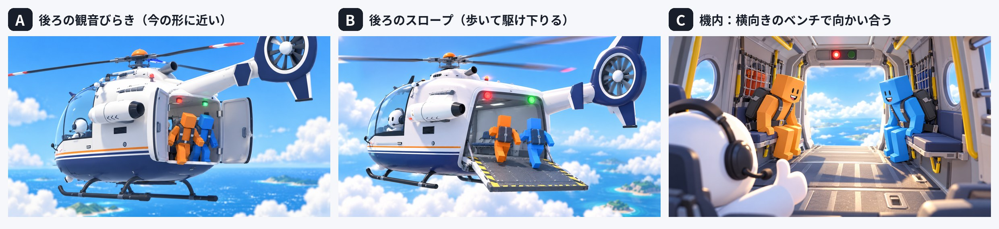

# サドンデスの3人乗りヘリと降下（設計メモ）

> **2026-10-19（2）**：降下は巡航の機内の画から切らずに始まる（巡航の終わりにカメラが操縦席の窓から機内へ入る）。スロープと上のふたは 1.4〜3.6 秒で開き（油圧）、開くにつれて外の昼の光が差し込む（光の筋・ほこり・床の明るい四角・露出）。2.1 秒からベルトを外して立ち、通り道へ一歩出てスロープへ向き直り、3.6 秒の緑のあと 4.05 秒から加速して駆け出す。短い版（ROUND 2 から）は、迎えのあと座ってベルトを締めたまま雲の層から上へ抜け、2.0 秒からスロープが開く。帰還の飛び降りは、勝者がベルトを外して動く機体の床の上をスロープの端まで歩き、端から飛び降りる。詳しくは `c130_float.md` 第10章。

> **2026-10-19**：降下・帰還の飛び降りを作った（`FloatplaneStaging`）。作った時刻（初めの降下 約 7 秒・短い版 約 3.5 秒・帰還）は `c130_float.md` 第8章。

> **2026-10-18 の変更**：機体はヘリではなく、C-130 をモデルにした水上機に変えた（`c130_float.md`）。この文書のうち、降り方（第2章）・座り方・降下の時刻・飛ばし方・作業の分け方の考え方は引き続き使う。ヘリの形と寸法（第7章の下絵・図）は使わない。

2026-10-18作成。サドンデス「つきやぶれ！スカイゲート」（`sky_gate.md`）で使う、1機の3人乗りヘリと、後ろのスロープから駆け下りて飛び出す降下（Call of Duty: Warzone の降下のような）を決める。ユーザーと一緒に決めた内容と、この文書の提案を分けて書く。

**ユーザーの指示（2026-10-18）**：サドンデスでは、それぞれ専用のヘリではなく、今のヘリの3人乗り（後ろのハッチが開き、そのまま歩いて降下のアニメーションに入れる）を使う。Warzone のような降下のアニメーションを入れる。サドンデスの制作・ヘリ・降下のアニメーションを並行して行う。作業の前に一緒にデザインを決める。



> 作り方（並行で作るための分け方と受け渡しの約束）は `skygate_build_plan.md`。

## 1. 決まったこと（ユーザーと決定）

| 項目 | 決定 |
| --- | --- |
| ヘリの数 | サドンデスでは1機だけ（2人とハテナが一緒に乗る） |
| 形 | 今のヘリ（`helicopter_boarding`）の顔と作りのまま、胴体を後ろへ約2m延ばし、尾を屋根の上から出す。**後ろは床ごと下りるスロープ**（案B） |
| 座り方 | 前の操縦席にハテナ1人。後ろの客室で、2人は**左右の壁のベンチに横向きに座って向かい合う**（案C） |
| 乗り込み | サドンデスの頭で、ヘリが低く下りてきてスロープを下ろし、**2人が走って駆け込む**（縄ばしごはやめる） |
| 飛び出し方 | **ふだんは基本の降り方**（走ってきて端で踏み切り、前へ飛び出して腹ばいへ）。**まれに、かっこいい系とおもしろ系をまぜた8種類の特別な降り方**のどれかになる（ランダム） |
| タイミング | **順番に、0.4秒ずらす**（どちらが先かはランダム） |
| カメラ | **機内から背中を追う**（赤いランプの機内 → スロープが開いて光が差す → 2人の背中を追って機外へ → そのまま下を向いて本戦の見下ろしへ。切らない） |
| 色 | **白に、オレンジと青の細い線**（2人共用）。底と尾翼は今のヘリと同じ濃紺 |
| 飛ばす | 降下の演出は**いつでも Space キーで飛ばせる**（初めの降下も。2026-10-18、乗り込みとそろえて Enter から Space に変えた） |
| ROUND 2 以降 | 降下は**短い版（約3秒）**：スロープが開いたところから |
| 帰還 | 勝者は、ゴールの床の上を低く通るヘリの**スロープから飛び降りて**、自分の台へ着地する |

## 2. 降り方

### 2.1 基本の降り方（ふだん）

スロープを走ってきて、端で片足で強く踏み切り、両腕を広げながら前へ飛び出す。0.6秒で腹ばい（ボックスの姿勢）になり、少し揺れて落ち着く。Warzone の降下のいつもの飛び出しに近い、きびきびした動き。2人とも基本の降り方でも、踏み切る足と腕の広げ方を少し変えた2通りを持たせ、2人が同じ動きに見えないようにする（提案）。

### 2.2 特別な降り方（まれに・8種類）

1人ごとに **15%**（決定）で、下の8種類のどれかになる。どの降り方も、スロープの端を離れてから1.2秒以内に共通の腹ばいに落ち着く（そのあとの本戦は同じ形で始められる）。

| # | 系統 | 名前 | 動き |
| --- | --- | --- | --- |
| 1 | かっこいい | スーパーマン | 走ってきて両腕を前へ伸ばし、頭から一直線にダイブ |
| 2 | かっこいい | 後ろ宙返り | 端でくるっと振り返り、背中から宙返りして腹ばいへ |
| 3 | かっこいい | スピンダイブ | 踏み切って体をひねり、1回転半しながら飛び出す |
| 4 | かっこいい | 大の字 | 両手両足を大きく広げて、大の字のまま飛び出す |
| 5 | おもしろ | つまずき | 端でつまずいて前へ転がり落ちる。あわてて手足をばたつかせる |
| 6 | おもしろ | ドボン | ひざを抱えた体育座り（キャノンボール）で飛び込む |
| 7 | おもしろ | 敬礼 | 振り返ってビシッと敬礼し、棒のように後ろ向きに倒れていく |
| 8 | おもしろ | ためらい | 端で下をのぞいて足踏み → 目をつぶって「えいっ」と飛ぶ（少し遅れる） |

- 選び方：1人ごとに、85% は基本の降り方、15% は8種類から1つ。2人とも特別になったときは別の降り方にする。直前の回と同じ特別な降り方は避ける。
- 「ためらい」は0.5秒ほど長いので、2人目にだけ出す（後ろがつかえないように）。

### 2.3 帰還の飛び降り（決定）

帰還では、ヘリがゴールの床の上を低く（床から約4m）ゆっくり通り、勝者がスロープの端から飛び降りて自分の台へ着地する。空の降下の飛び方（腹ばいへ落ち着く）は4mの高さに合わないので、飛び降り専用の動きを作る：踏み切ってから、着地は **片ひざのヒーロー着地・前転・両足でピタッ（決めポーズ）** の3通りからランダム（決定）。

## 3. 全体の流れ（提案）

```
DRAW! → 大型ビジョンで種目発表 → ヘリ1機が床の後ろへ低く下りてスロープを下ろす
→ 2人が走ってスロープを駆け上がり、ベンチに座る（ベルト）→ スロープが閉じて上昇 → 雲
→ 空のセットで巡航（問題の生成と準備）
→ 降下：機内（赤いランプ）→ ハテナが振り返って親指 → スロープが開く（風・光）→ 緑のランプとブザー
   → 2人がベルトを外して立ち、スロープへ歩く → 1人目が走って飛ぶ（ランダムの飛び方）→ 0.4秒後に2人目
   → カメラは背中を追って機外へ出て、下を向く → 本戦の見下ろし
→ 図解ルールカード → 3・2・1 → ゲート（sky_gate.md）
→ 2人とも着地台へ着いたら：ヘリが着地台の横に下りてスロープを下ろし、2人が駆け込む → 上昇 → 2回目の降下（短い版）
→ 決着：勝者は着地台でダンス → ヘリがスロープを下ろして迎えに来て、勝者が駆け込む → 帰還
→ 帰還：ヘリがゴールの床の上を低く通り、勝者がスロープから飛び降りて自分の台へ着地。敗者は幽霊で帰る
```

### 3.1 降下の時刻（初めの1回）

| 時刻 | 内容 | カメラ |
| --- | --- | --- |
| 0.0–1.0 | 機内。赤いランプ。2人はベンチで揺られる（向かい合ってそわそわ） | 客室の前（ハテナの後ろ）から後ろを見る |
| 1.0–1.6 | ハテナが振り返って親指を立てる | 同じ（少し寄る） |
| 1.6–2.8 | スロープが開く（1.2秒）。光が差し込み、風で体が揺れる。雲と海が見える | 同じ |
| 2.8 | 緑のランプとブザー | |
| 2.8–3.6 | 2人がベルトを外して立ち、スロープの付け根へ歩く | 2人の後ろへ下がりながら付いていく |
| 3.6–4.6 | 1人目が走り出し、端で飛ぶ（ランダムの飛び方）。0.4秒後に2人目 | 背中を追ってスロープを進み、機外へ出る |
| 4.6–6.0 | 2人が腹ばいに落ち着く。カメラは下を向き、本戦の見下ろしの位置へ | 機外 → 見下ろし（切らない） |

- 2回目以降（ROUND 2〜）の降下は短い版：機内のスロープが開いたところから始める（約3秒）。
- 飛ばす：降下のどこでも Space キーで飛ばせる（乗り込みと同じキー）。飛ばすと、2人が腹ばいで落ちている本戦の見下ろしの画へすぐ移る（0.3秒の白い閃光でつなぐ）。

## 4. 3つの作業を並行して行う分け方（提案）

| 作業 | 中身 | 主に触るところ |
| --- | --- | --- |
| ① ヘリ | 3人乗りの新しいヘリを Blender で作る（今のヘリから派生。胴体を延ばす・尾を上へ・スロープとその軸・客室の内装（ベンチ・ベルト・手すり・赤と緑のランプ・丸窓・網）・白と2色の線の塗装）。Godot のクラス（スロープの開閉・ランプ・座る位置・ローター） | `assets/vehicles/helicopter_dropship/`（新規）、`scripts/world/sudden_death/dropship/`（新規） |
| ② 降下のアニメーション | 基本の降り方（2通り）と8種類の特別な降り方、帰還の飛び降りと着地（3通り）、ベンチの座り・ベルトを外して立つ・スロープへ歩く・スロープを駆け上がる・腹ばいの落下のループを、Blender のキーフレームで作る（プレイヤーの今の骨組み＝UAL のクリップと同じ形で書き出し、本物のアバターと人形の両方で再生できるように）。ランダムの選び方。仮のスロープ（箱）で確かめる場 | `assets/characters/drop_anims/`（新規）、`scripts/world/sudden_death/drop/`（新規） |
| ③ サドンデス本体 | 「つきやぶれ！スカイゲート」のルール・見せ方（見下ろしのカメラ・空中で動く操作・ゲート）・HUD・ルールカード。問題のボードとドローン（Blender）、紙が破れる・爆発してブロックにばらける効果。導入はつなぐまで仮の降下 | `scripts/core/sudden_death/`、`scripts/world/sudden_death/games/`、`scripts/ui/sudden_death/`、`assets/sudden_death/sky_gate/`（新規） |
| ④ つなぐ（このセッション） | ①②③がそろったら、監督の流れ（1機の乗り込み・降下・ROUND 2 の迎え・帰還）をつなぐ | `heli_sudden_death_director.gd`、`common.md` |

### 4.1 受け渡しの約束（並行して作るために、先に決める）

- **ヘリのマーカー**（①が書き、②④が読む）：`MK_SeatPilot`、`MK_BenchL`・`MK_BenchR`（座る位置と向き）、`MK_StandL`・`MK_StandR`（立つ位置）、`MK_RampHinge`・`MK_RampEdge`（スロープの付け根と端。開いたとき）、`MK_CabinCam`（機内のカメラの初めの位置）、`MK_JumpLight`。原点は今のヘリと同じ（メインローターの軸 × スキッドの下）、機首は −Z。
- **ヘリの操作**（①が作る）：`set_ramp(t)`（0 閉じる〜1 開く）、`set_jump_light(state)`（off・red・green）、`set_rotor(speed)`、`seat_transform(name)`。
- **飛び方のクリップ**（②が作る）：名前は `Drop_Jump_Superman` などの英語の名前。1本ごとに「端を離れるフレーム」と「腹ばいに落ち着くフレーム」を書いた表（JSON）。根の動きはクリップに入れる（スロープの端を基準にした移動）。
- **降下の再生**（②が作る）：`DropSequence` のような部品が、ヘリのマーカーと2人の人形を受け取り、時刻に沿って座る → 立つ → 歩く → 飛ぶを再生する。③④はこれを呼ぶだけにする。
- **Blender は1つ**：ライブの Blender は1台なので、①②③が同時には使えない。使う前に `artifacts/sudden_death_v2/BLENDER_IN_USE.txt` を見て、空いていれば自分の名前を書いてから使い、`.blend` を保存したら消す（ほかの作業は、その間 Godot 側を進める）。

## 5. 今のものへの影響

- 本編・メニュー・オンラインのヘリ（`helicopter_boarding`）は変えない。新しいヘリはサドンデス専用の別の素材にする。
- 「ひらけ！パラシュート」（`parachute.md`）の2機の流れは、スカイゲートに入れ替えるときに外す（着地台・パラシュート一式・水柱・ダンスは使う）。
- `common.md` の「2機が並んで飛ぶ」「縄ばしごで迎え・帰還」は、1機とスロープに書き直す（④）。

## 6. 次に詰めること

- 3つの作業を始める前に、デザインをもう少し詰める（2026-10-18、ユーザーの指示）。
