# サドンデス「ひらけ！パラシュート」仕様書

2026-10-18作成。ローカル2P「10問」の引き分けのあとに行う、ただ1つのサドンデスの種目（ルーレットはしない。2026-10-18、ユーザーの指示）。共通の流れ（分岐・ヘリの迎え・雲・空のセット・帰還・敗者の幽霊）は `common.md` に従い、この文書は種目そのものを決める。

**ユーザーの指示（2026-10-18）**：アニメーションとカメラワークを高品質にする。ルールの説明は画像つきで、わかりやすくする。着地台は細部まで作り込む。着地して勝った方はエモートを踊れるようにする。

> 画像はすべて Godot で本物のプレイヤー（ブロックマン）・ヘリ・ハテナ・海・空を使って撮った（`tests/sudden_death_v2/parachute_storyboard.gd`）。**着地台は本制作の素材**（`assets/sudden_death/parachute/landing_float/`、6.5節）。**パラシュート・ハンカチ・水柱も本制作の素材**（`assets/sudden_death/parachute/chute/`、6.4節。2026-10-18）。HUD は見本として後から描き足したもの（`artifacts/sudden_death_v2/parachute/make_parachute_storyboard.py`）。ダンスのコマ（13）は本物のエモートの動き（`ResultWinnerDance`）で撮った。

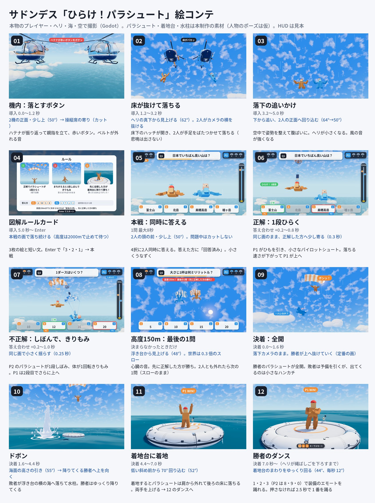

## 1. ひとことで

ヘリの床が抜けて、2人は高度2000mから海へ向かって落ちていく。落ちている間に4択クイズに2人同時に答え、正解するとパラシュートが1段ずつ開く。先に3段（全開）になった方がふわりと着地台に降りて勝ち。勝った方は着地台の上で、装備したエモートを踊って勝利をアピールできる。負けた方は予備のパラシュートを引くが、出てくるのは小さなハンカチで、そのまま海へドボン。

本編と似た要素（自動で前へ走る・正解の扉へ移動する・後ろから迫る刃・押し合い）は使わない。落ちていく時間そのものが制限時間になるので、だらだら長引かない。

## 2. 決定事項

「決定」はユーザーが決めたこと、「提案」はこの仕様書で決めたことで、ユーザーの確認を待つ。

| 項目 | 既定 | 状態 |
| --- | --- | --- |
| 種目 | 「ひらけ！パラシュート」だけ。ルーレットはしない | 決定 |
| 品質 | アニメーションとカメラワークを高品質に。ルールは画像つきで説明する | 決定 |
| 種目の識別名 | `parachute`（`QuizGameState.SUDDEN_DEATH_GAMES`） | 提案 |
| 画面の名前 | 日本語「ひらけ！パラシュート」、英語「OPEN THE CHUTE!」。大型ビジョンの種目発表で出す。画面に大きなカットインは出さない（common.md 第2章） | 提案 |
| 場所 | 空のセット（common.md 第6章）からそのまま。着地は空のセットの海に浮かべた着地台。地上の舞台（島）は作らない | 提案 |
| 問題 | 4択、2人同時に答える。1問の回答時間は8秒 | 提案 |
| 勝ち方 | 先にパラシュートが3段（全開）になった方の勝ち | 提案 |
| 正解 | 1段開く。2人とも正解なら2人とも1段 | 提案 |
| 不正解 | 1段しぼむ（0段ならそのまま）。体が1回転きりもみ | 提案 |
| 答えない | 変化なし（わからなければ答えない、という作戦がとれる） | 提案 |
| 同時に3段 | 同じ問題で2人とも3段目に届いたら、先に正解を押した方の勝ち（押した時刻は common.md 8.2節の方法で測る） | 提案 |
| 最後の1問 | 高度150mまでに決まらなければ、世界を0.3倍のスローにして「最後の1問」。先に正解した方の勝ち。2人とも外れたら次の1問（スローのまま） | 提案 |
| 本戦の長さ | 最短約28秒（3問）、ふつう35〜50秒、最長でも約60秒＋最後の1問 | 提案 |
| 敗者の退場 | 予備を引くとハンカチが出る → 海へドボン（水柱）→ 共通の幽霊で帰還（common.md 10.1） | 提案 |
| 着地台 | 細部まで作り込んだ海に浮かぶ台（6.5節）。2026-10-18 に本制作した | 決定 |
| 勝者のダンス | 着地したあと、勝者は装備したエモートを踊れる | 決定 |
| ダンスの操作 | エモートのキー（P1 は 1・2・3、P2 は 8・9・0。本編と同じ）で装備の 3 つから選ぶ。いつでも別の踊りに替えられる。2.5秒押さなければ 1 番を踊る（6.6節） | 提案 |
| ダンスの長さ | 6.0秒（決着 7.0〜13.0 秒）。最後の1.2秒はヘリが縄ばしごを下ろしながら近づく。縄ばしごが下りきったら踊りを止めて飛びつく | 提案 |
| 勝者の帰還 | 着地台からヘリの縄ばしごに飛びつく（common.md 10.1 の地上の種目と同じ流れ） | 提案 |

## 3. ルール

### 3.1 図解ルールカード（ゲームの画面）

導入の最後に、文字だけのカードではなく **3枚の絵** でルールを見せる。絵は本物のプレイヤー・パラシュート・着地台・水柱で撮った静止画（`tests/sudden_death_v2/parachute_storyboard.gd` の r1〜r3 が、画面の真ん中を 4:3 で切り抜いて 960×720 で `assets/sudden_death/parachute/rule_card/` に書く）。3枚とも同じ 1P（オレンジ）で「正解で開く → まちがえるとしぼむ → 全開で着地」の話にし、どれも水平線を入れて体が空に埋もれないようにした。

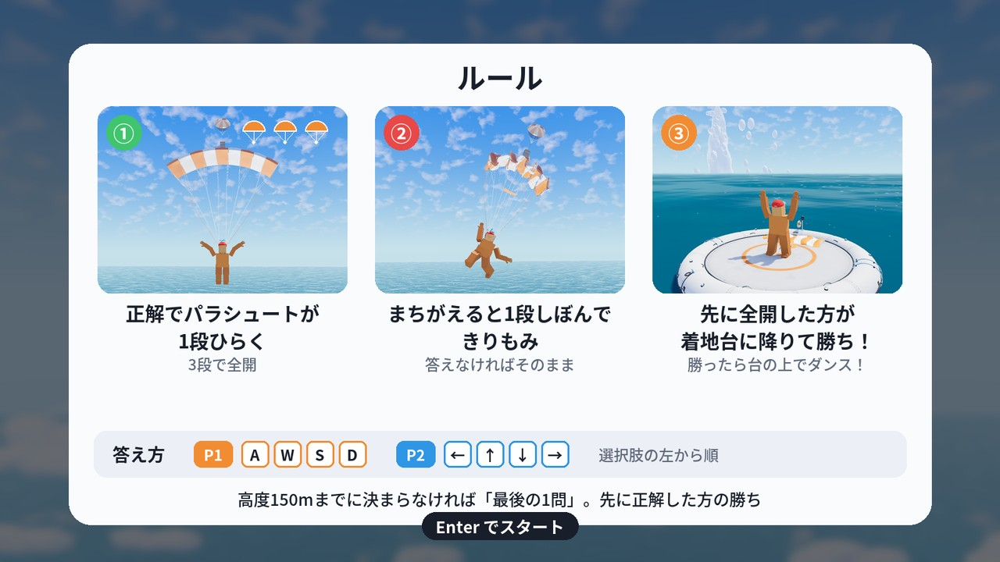

| 場所 | 中身 |
| --- | --- |
| ①（緑） | 正解でパラシュートが1段ひらく。小さく「3段で全開」。段の印（パラシュートの形）3つ |
| ②（赤） | まちがえると1段しぼんで、きりもみ。小さく「答えなければそのまま」 |
| ③（オレンジ） | 先に全開した方が着地台に降りて勝ち！ 小さく「勝ったら台の上でダンス！」 |
| 下の帯 | 答え方：P1 は A・W・S・D、P2 は ←・↑・↓・→（選択肢の左から順）。キーは実際のキーの形の札で見せる |
| 一番下 | 「高度150mまでに決まらなければ『最後の1問』。先に正解した方の勝ち」 |
| 閉じ方 | 「Enter でスタート」。出てから0.6秒は受け付けない（common.md 第7章） |

- カードの出し方：3枚の絵が左から0.12秒ずつずれて、下から浮き上がる（0.35秒、少し行き過ぎて戻る）。①の段の印は0.4秒ごとに1つずつ灯る。出たあとは絵も文字も動かさない（2026-10-18：②の絵の揺れと③の文字の弾みは「作りが甘く見える」とのユーザーの指示でやめた）。
- 絵は角の丸い四角（半径16）に切り抜いて描き、白いふち（5）は絵の外側へ同じ丸みで重ねる（以前は四角い絵の上に丸いふちを描いていて、角から絵がはみ出していた。1枚目は切り出しの上に黒い帯もあった）。縮めて描くのでミップマップを使う。
- 英語表示（`use_english_ui`）では文を英語に替える（例：①「Correct → chute opens 1 step」②「Wrong → it shrinks and you spin」③「Fully open first → land on the float and win!」「Winner dances on the float!」）。
- 背景は本戦の画（落ち続けている2人）をぼかして暗くしたもの。カードを閉じるとぼかしが0.4秒で戻り、そのまま「3・2・1」。

### 3.2 細かい決まり

| 項目 | 内容 |
| --- | --- |
| 答える | 1問につき1人1回。最初に押したキーで確定し、取り消せない |
| 答え合わせ | 2人とも答えたとき、または8秒たったとき |
| 段 | 0（背中の袋だけ）→ 1（パイロットシュート）→ 2（半分ひらく）→ 3（全開＝勝ち） |
| 高度 | 2000mから毎秒40mで減る（画面の高度計）。ルールカードの間は2000mで止める。答え合わせの間も減る |
| 最後の1問 | 高度が150mになった問題の次から。そのときの段は関係なく、先に正解した方が勝ち。外したらその問題は答えられない |
| 問題の数 | 8問を確保する（`QUESTION_COUNT`）。足りなければ算数の自動生成で足す（common.md 第9章） |
| 一時停止 | Esc で止められる。止めている間は問題を隠し、再開したらその問題の残り時間から続ける |
| フォーカスを失ったとき | 一時停止と同じ |

## 4. 全体の流れ

```
（共通）DRAW! → 大型ビジョンで種目発表 → 縄ばしごに飛びつく → 雲 → 空のセットで2機が並んで飛ぶ
→ 導入：ハテナが赤いボタン → 床のハッチが開いて落ちる → 腹ばいに整える → 図解ルールカード → 3・2・1
→ 本戦：落ちながら同時に4択（正解で1段ひらく／不正解でしぼむ）
→ （高度150mで決まらなければ）スローで最後の1問
→ 決着：勝者が全開で上へ抜ける／敗者はハンカチ → 敗者が海へドボン → 勝者が着地台に着地してポーズ
→ 勝者のダンス（エモートのキーで踊る。6秒）→ ヘリが縄ばしごを下ろす
→ （共通）ヘリの縄ばしごで勝者が帰る／敗者は幽霊で帰る → 判定から勝者の演出
```

### 4.1 導入（空のセットの巡航が終わってから）

時刻は導入の頭から。

| 時刻 | 内容 | 絵コンテ |
| --- | --- | --- |
| 0.0–0.5 | 2機の正面の画。ハテナ（操縦席）が振り返って、後ろの席のプレイヤーへ親指を立てる | 01 |
| 0.5–1.2 | 操縦席の寄り（カット）。ハテナが計器盤のカバーを跳ね上げて、赤いボタンを押す。ベルトが外れる（`set_belt("L", 0)`、ベルトの音） | 01 |
| 1.2–1.6 | 床下のハッチが開く（`set_hatch`、0.4秒）。プレイヤーは一瞬宙に浮いて、ハテナを見る（「え？」の間） | 02 |
| 1.6–3.2 | 2人が手足をばたつかせて落ちる。カメラはヘリの真下から見上げていて、2人がカメラの左右を抜けていく。P2 は0.15秒遅れて落ちる | 02 |
| 3.2–5.0 | カメラが2人を追って落ち、下から正面へ回り込む。2人は空中でもがいてから腹ばい（ボックスの姿勢）に整える。ヘリは小さくなって雲に隠れる | 03 |
| 5.0– | 図解ルールカード（3.1節）。2人は本戦の画で落ち続ける | 04 |
| Enter | 「3・2・1」（各0.6秒）。カメラが本戦の画へ0.9秒で寄る → 本戦 | |

### 4.2 本戦の1問

時刻は問題の頭から。

| 時刻 | 内容 | 絵コンテ |
| --- | --- | --- |
| 0.0–0.25 | 問題パネルが上から下りてくる。4択が下から0.05秒ずつずれて出る | 05 |
| 0.25–8.25 | 回答時間。答えた方の上に「回答済み」の札。プレイヤーは答えた瞬間に小さく顎を引いてうなずく。残り3秒から問題パネルの帯が赤くなり、時計の音 | 05 |
| 答え合わせ +0.0 | 正解の選択肢が緑の枠、外した選択肢が赤い枠。選んだ選択肢に P1／P2 の札 | 06・07 |
| +0.2–0.8 | 正解した人：右手で胸のハンドルを引く → 段が上がる（第6章）。落ちる速さが下がるので、画面の中で上へ動く | 06 |
| +0.2–1.0 | 外した人：段が下がる（しぼむ）→ 1回転きりもみ → 腹ばいに戻る | 07 |
| +1.6 | 次の問題（間に別の画をはさまない。真上からの高度の画は 2026-10-18 にやめた） | |

- 2人とも正解のときは、先に押した方から0.15秒ずらして引く（同時に動くと単調になるため）。
- 段が上がったときの「上へ動く」量：1段で1.2m、2段で2.4m。高度計の2人の印も同じだけずれる。

### 4.3 最後の1問（高度150m）

- 高度が150mになったら、そのとき出ている問題の答え合わせのあとに入る。
- 0.4秒で世界を0.3倍のスローにする（UI と入力は実時間）。HUD に赤い札「高度150m！ 最後の1問（先に正解した方の勝ち）」。心臓の音。BGM は低域だけ残す。
- カメラは着地台から見上げる画（絵コンテ08）にカット。2人がこちらへ落ちてくる。
- 先に正解した方の勝ち。外した方は、その問題はもう答えられない（選択肢が灰色になる）。2人とも外したら、次の問題をスローのまま出す。

### 4.4 決着

時刻は決着（勝者が決まった瞬間）から。この長さ（common.md 10.1 の D）は11.8秒（ダンスの6秒を含む）。

| 時刻 | 内容 | 絵コンテ |
| --- | --- | --- |
| 0.0–0.35 | 勝者のパラシュートが全開になる（第6章の「開く衝撃」）。体が腹ばいから縦へ振られ、両手でブレークのひもをつかむ | 09 |
| 0.0–1.6 | カメラは落ちる速さのまま。勝者が画面の上へ抜けていく（スカイダイビングの定番の画）。「ボンッ！」の文字は出さず、音で見せる | 09 |
| 0.6–1.0 | 敗者があわてて予備のハンドルを引く。出てくるのは小さなハンカチ（ポンッという軽い音）。敗者はハンカチを2度見して、手足をばたつかせる | 09 |
| 1.6 | カット。海面の高さの引きの画 | 10 |
| 1.6–2.2 | 敗者が着地台の横の海へ頭から落ちて水柱（12m）。水の輪が広がる | 10 |
| 2.2–4.4 | カメラが上へ振れて、ゆっくり降りてくる勝者を映す。勝者は左右に小さく揺れながら着地台へ向かう | 10 |
| 4.4–5.2 | 着地の直前にブレークを引いてふわっと止まり（フレア）、着地台の中心（オレンジの輪の真ん中）に両足で着地（`Jump_Land`）。着地台が0.15m沈んで戻り、波紋が広がる | 11 |
| 5.2–6.4 | パラシュートは肩から外れ、空気が抜けて、勝者の後ろの床（着地台の上）へ落ちる。布は小さな山になり、つり索・スライダー・ライザーも床に寝る（ライザーのつけ根が体にめり込まない） | 11 |
| 6.2–7.0 | 両手を上げてポーズ。カメラは低い斜め前から70°回り込む | 11 |
| 7.0–13.0 | 勝者のダンス（6.6節）。HUD にエモートのキーと装備の名前、残り秒数。中継カメラの赤い灯が点く。カメラは着地台のまわりをゆっくり回る | 12 |
| 11.8 | D。共通の帰還（common.md 10.1）。勝者の機が着地台の上に下りてきて、踊っている勝者の横へ縄ばしごを下ろす（1.2秒） | |
| 13.0– | 縄ばしごが下りきったら踊りを止め（0.25秒で戻す）、縄ばしごへ走って飛びつく。敗者は海から幽霊になって帰る | |

## 5. 絵コンテ

1コマずつ。コマの下の帯に、時刻・カメラ・動きを書いた。

### 01 機内：落とすボタン
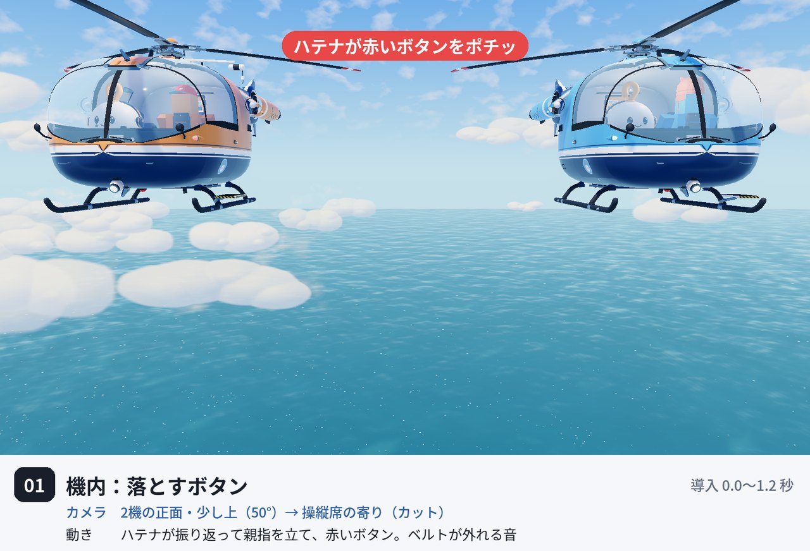

### 02 床が抜けて落ちる
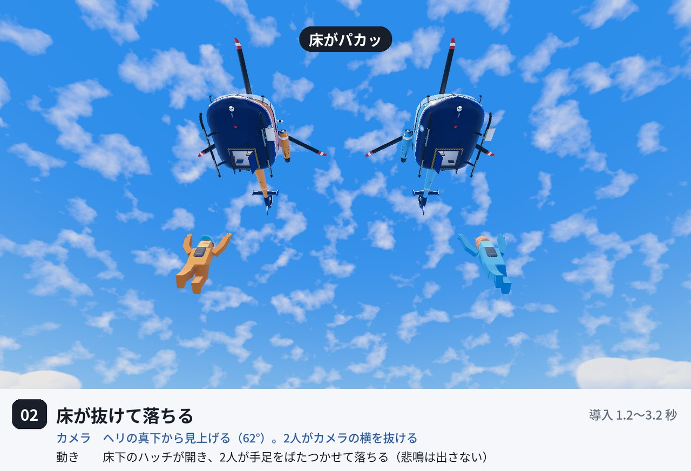

### 03 落下の追いかけ
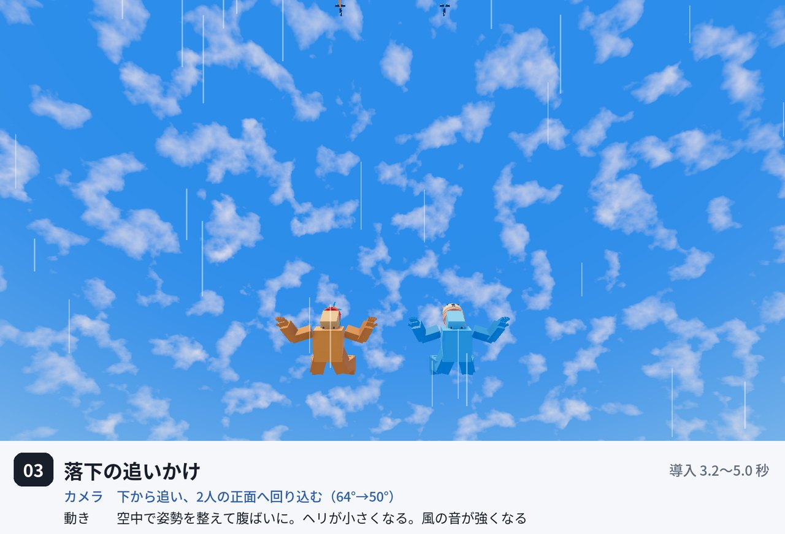

### 04 図解ルールカード
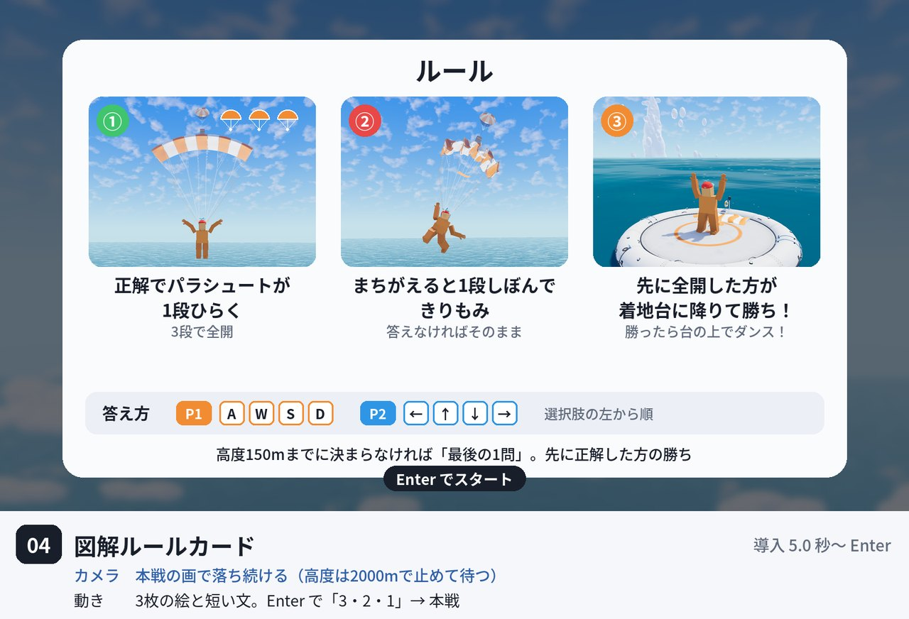

### 05 本戦：同時に答える
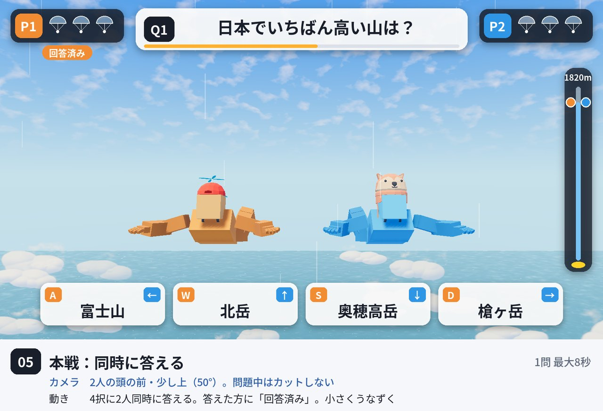

### 06 正解：1段ひらく
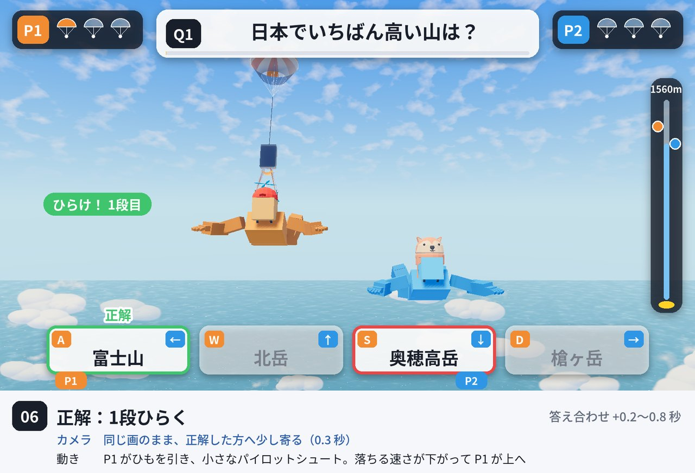

### 07 不正解：しぼんで、きりもみ
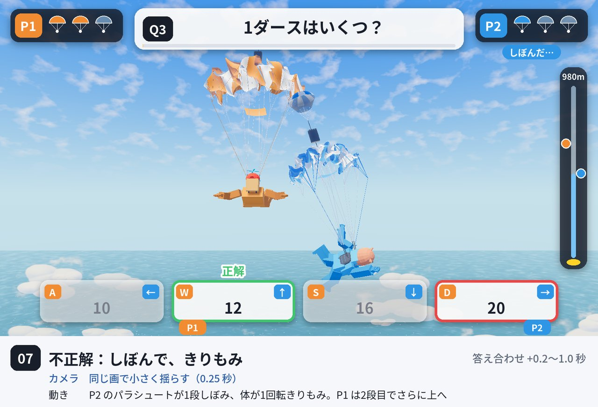

### 08 高度150m：最後の1問
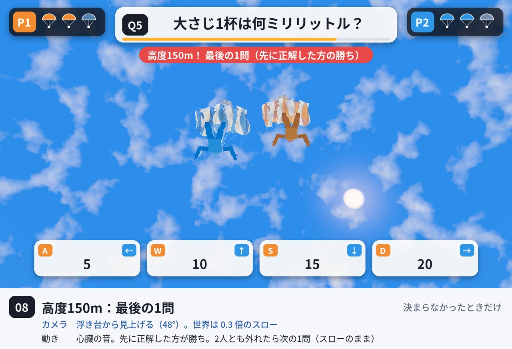

### 09 決着：全開
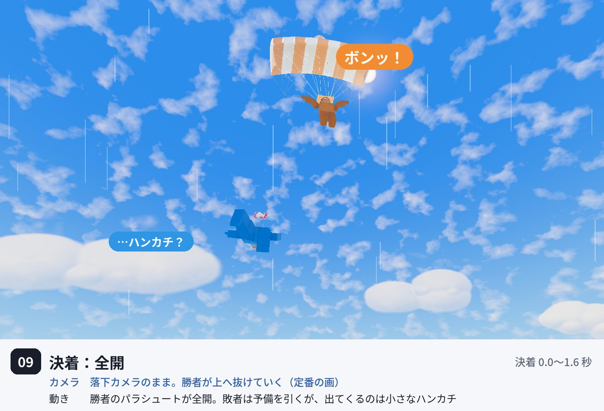

### 10 ドボン
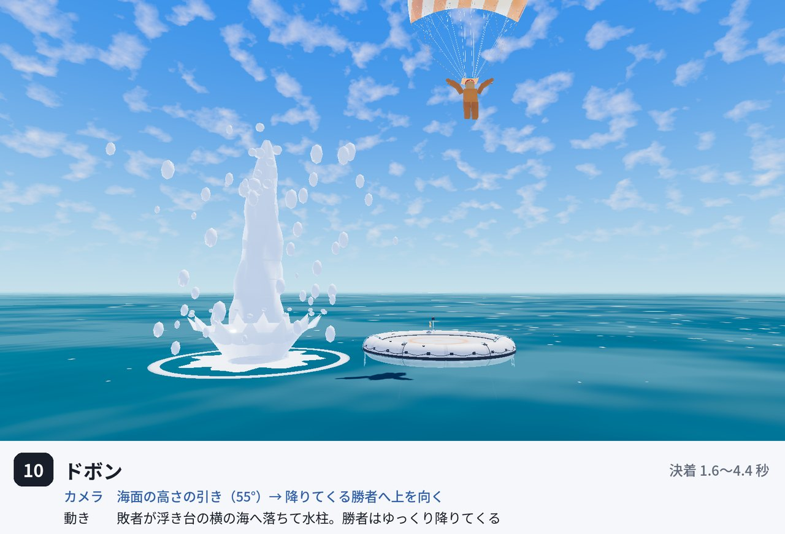

### 11 着地台に着地
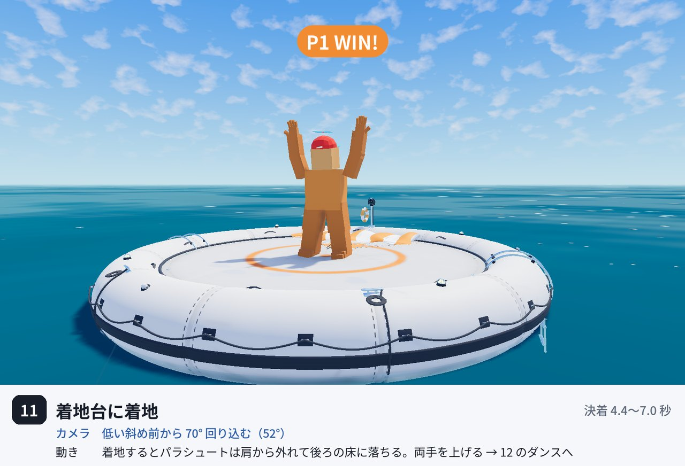

### 12 勝者のダンス
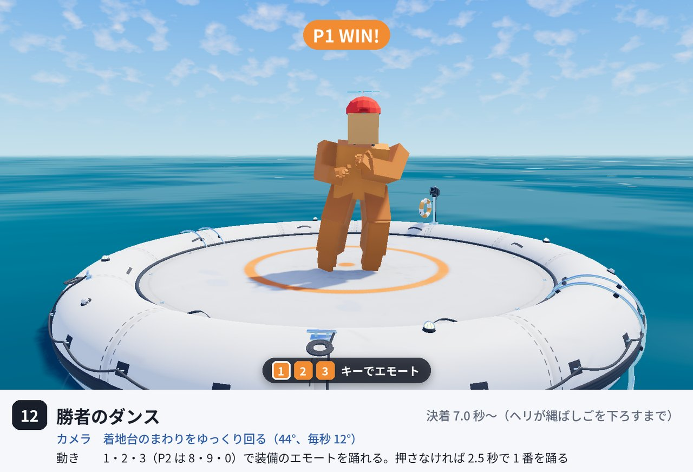

真上から見下ろす「高度の画」（もとの08）は 2026-10-18 にやめた。どれだけ落ちたかは右の高度計で見せる。

## 6. アニメーション

### 6.1 品質の基準

- **ポーズの間で止めない**：どの動きも、きっかけの前に0.06〜0.12秒の予備動作（ため）を入れ、終わりは行き過ぎてから戻す（オーバーシュート）。
- **落ちている間は止まらない**：腹ばいの姿勢も、手足・胴を風で小さく揺らす（周期の違う揺れを3つ重ねる。腕は0.7秒、脚は1.1秒、胴は1.9秒）。2人で揺れの位相をずらす。
- **重さと風**：段が上がると落ちる速さが下がるので、体は上へ引かれて一瞬遅れてからついていく（ばね、減衰比0.6）。帽子の飾り（プロペラ・耳）は風下へなびく（`AnimationRig` の帽子の追従に風の向きを足す）。
- **混ぜ方**：動きの切り替えは0.12〜0.25秒の重ね合わせ（`StagingPuppet.begin_blend` と同じ方式）。腕は「向き」と「ねじれ」を分けて混ぜる（`docs/falling_idle.md` で腕が胴を通り抜けた問題の対策と同じ）。
- **フレームの速さによらない**：見た目の動きは本戦の時計（`SuddenDeathGame` の時刻）から決め、30／60／120fps で同じ位置になる。

### 6.2 プレイヤーの動き（新規。Blender で作る）

`Falling Idle` と同じ骨組み（65本、Mixamo 互換）で作り、新しいアニメの枠（`AnimationRig` の SLOT）に入れる。ライブの Blender で作り、`.blend` は上書き保存する（AGENTS.md）。

| 名前 | 長さ | 中身 |
| --- | --- | --- |
| `SD_Drop_Flail` | 1.0秒・ループ | ハッチから落ちた直後。バンザイで手足をばたつかせる。左右で非対称 |
| `SD_Box_Settle` | 1.2秒 | ばたつきから腹ばいへ。腕を横へ広げてひじを曲げ、胸を反らせ、ひざを曲げる |
| `SD_Box_Loop` | 2.0秒・ループ | 腹ばい（ボックスの姿勢）。頭を上げて前（カメラ）を見る。手と脚が風で揺れる |
| `SD_Box_Nod` | 0.35秒・重ねる | 答えた瞬間の小さなうなずき（上半身だけに重ねる） |
| `SD_Pull` | 0.6秒 | 右手で胸のハンドルをつかんで引き抜く。引いた手を上へ振り上げる |
| `SD_Spin` | 0.8秒 | 外したとき。体が縦軸で1回転し、腕を振り回して腹ばいに戻る |
| `SD_Snatch` | 0.35秒 | 全開の衝撃。腹ばいから縦へ振り上げられ、脚が前へ振れる |
| `SD_Canopy_Loop` | 2.4秒・ループ | パラシュートの下。両手でブレークのひもを持ち、脚がぶらぶら揺れる。勝ってうれしそうに体を揺らす |
| `SD_Flare_Land` | 0.8秒 | 着地の直前にひもを引いて止まり、両足で着地（`Jump_Land` へつなぐ） |
| `SD_Land_Pose` | 1.8秒 | 着地の衝撃をひざで受けてから、両手を上げる（パラシュートは後ろの床に落ちる） |
| `SD_Panic` | 1.0秒・ループ | 敗者。頭が下がり、手足をばたつかせる |
| `SD_Hanky_Look` | 0.8秒 | 敗者がハンカチを2度見する（頭を2回振る） |

- 体の位置（落ちる速さ・上へ引かれる量・きりもみの回転）は Godot で付け、Blender の動きは体の向きと手足だけにする。
- Mixamo に近い動き（スカイダイビング・ぶら下がり）があれば使ってよい。その場合はユーザーにファイルを用意してもらう（`Falling Idle.fbx` と同じ扱い）。

### 6.3 ハテナ（操縦士）

| 名前 | 中身 |
| --- | --- |
| `Pilot_TurnThumb`（新規） | 座ったまま後ろの席へ振り返り、親指を立てる（0.5秒） |
| `Pilot_PressButton`（新規） | 計器盤のカバーを跳ね上げ、赤いボタンを押す（0.7秒）。押す前にためを入れる |
| `wave`（既存） | 決着のあと、勝者の機のハテナが手を振る |

`mascot_pilot.glb` に足す（`assets/characters/aiquiz_mascot/source/` の原本で作る）。ボタンとカバーはヘリの計器盤に足す小道具。

### 6.4 パラシュート（新規。Blender で作る）

| 段 | 見た目 | 開く動き |
| --- | --- | --- |
| 0 | 背中の袋（コンテナ）。フタにプレイヤーの色 | — |
| 1 | 袋からパイロットシュート（小さな丸いかさ）が飛び出し、ひもの先で風を受ける | 0.3秒。ポンッと飛び出し、ひもがぴんと張る |
| 2 | 本体が半分ふくらんだ状態。セルがしわになってばたつく | 0.4秒。袋が引き抜かれてひもが伸び、布が広がる |
| 3 | 9セルのラムエアの四角いパラシュートが全開 | 0.35秒。「スナッチ」：布が一気にふくらみ、少し行き過ぎてから形が決まる |
| しぼむ | 1段下の形へ戻る | 0.3秒。布がしぼんで風下へ流れ、袋の方へ引き込まれる |

**パラシュート・ハンカチ・水柱は本制作した（2026-10-18）。** `assets/sudden_death/parachute/chute/`（作り方と Godot 側の約束は同じフォルダの `README.md`）。ライブの Blender で手続きで作った。生成AIは使っていない。

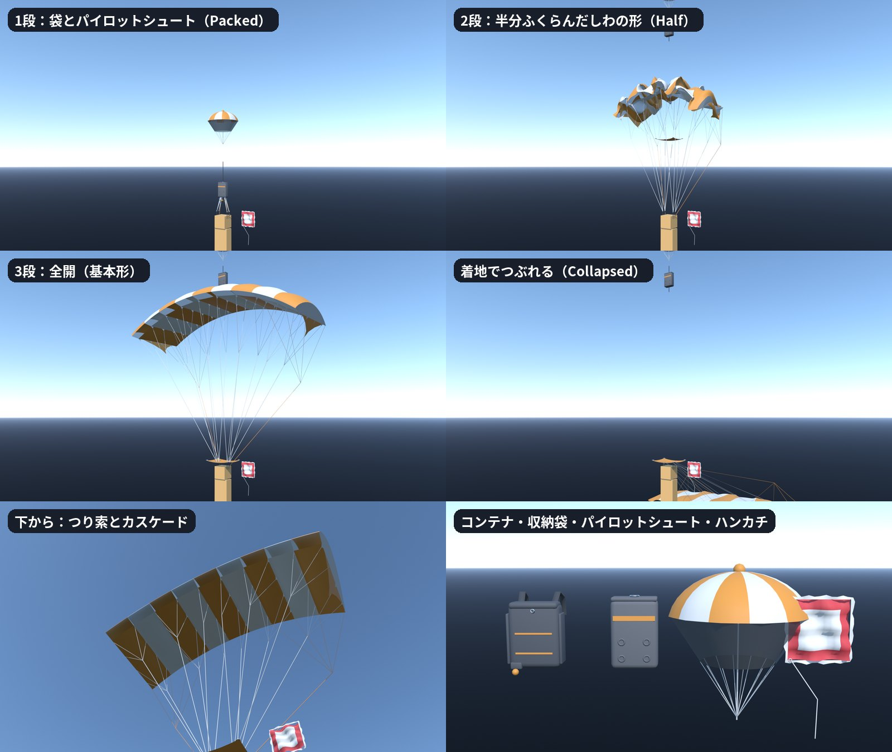

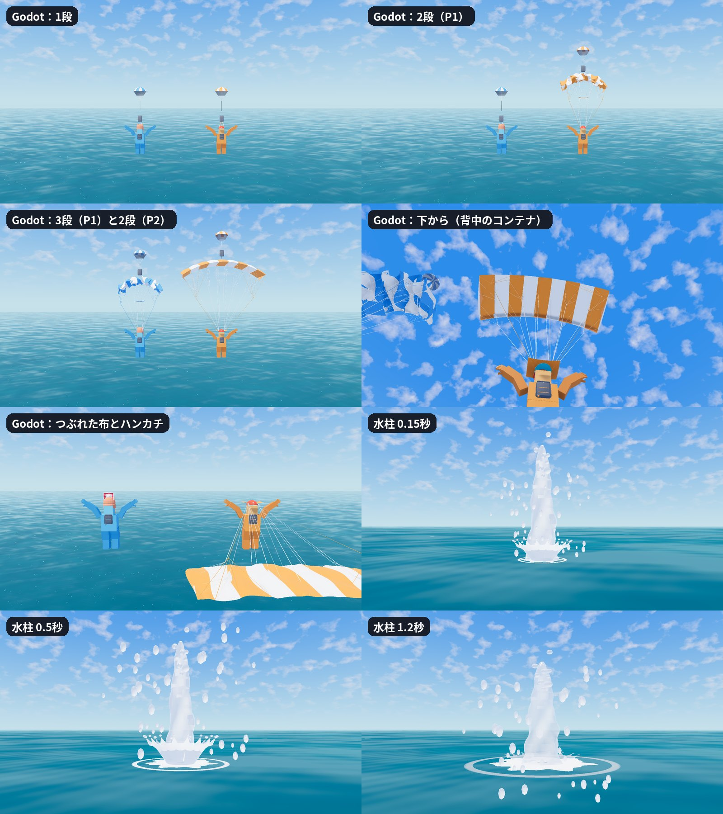

- 作り：9セルのラムエア（翼形の断面、前縁の取り込み口、セルの間のふくらみ、リブ、安定板）、A〜D の4列のつり索とカスケード、ブレーク索とトグル、ライザーとリンク、スライダー、パイロットシュート（網のすそ）、ブライドル、収納袋、背中のコンテナ（引き手）。三角形 1.0 万。
- 段ごとの形は形の切り替え（シェイプキー＝glTF のモーフターゲット）：`Packed`（袋の中）・`Half`（半分のしわ）・`Collapsed`（後ろへつぶれる。今は使っていない）・`Breath`（ばたつき）・`Grounded`（着地のあと床に落ちた形）。基本形が全開。布の揺れとばたつきは `Breath` の重みを揺らして付ける（布のシミュレーションも頂点シェーダーも使わない。重く、フレームの速さで結果が変わるため）。最初の案のボーンは使わなかった。
- 開く動き：段が上がると重みを少し行き過ぎながら寄せる。全開になる瞬間（スナッチ）は 0.35 秒で `Half` の重みが一度 −0.1 まで下がってから 0 に決まる。しぼむときは 0.3 秒。
- パイロットシュートと袋：1段は肩の上の袋から出たパイロットシュート。2・3段は布の上で風を受け続ける（ブライドルでつながる）。
- 色：P1 はオレンジと白、P2 は青と白の交互（材質 `PC_Accent` を Godot で塗り替える）。最初の案の真ん中のセルの「？」は入れていない（着地台と同じくシンプルにした）。
- 敗者のハンカチ：白に赤い縁取りとレースのふち（0.45m 角）。ひもで背中につながり、風でぱたぱた揺れる。
- 着地のあと（2026-10-18）：以前は肩に付けたままつぶしていたので、ライザーとスライダーのつけ根が踊る体にめり込み、布は人の前の海の上に浮いていた。いまは `ParachuteCanopy.drop_to()` で床の置き場所（人の0.45m後ろ）を渡し、`collapse`（1.2秒）に合わせて置き場所を肩から床へ移しながら `Grounded` の重みを上げる。`Grounded` は布・つり索・スライダー・ライザーにあり、布は後ろの床に寝た山、つり索は床をはって山の下へ、スライダーとライザーも床に寝る。パイロットシュートと袋は消える。
- 向き：パラシュートの前（+Z）は体の前に合わせる（以前は見せ方で裏返しに付けていて、つぶれた布が人の前へ落ちていた）。

### 6.5 着地台と水

**着地台は本制作した（2026-10-18）。** `assets/sudden_death/parachute/landing_float/`（作り方と Godot 側の約束は同じフォルダの `README.md`）。ライブの Blender で手続きで作り、テクスチャは別のスクリプトで描いた。生成AIは使っていない。
同じ日に「デザインが奇抜すぎる」とのユーザーの指示で、シンプルに作り直した：オレンジと白の部屋・「？」の印・紺の帯・市松・目盛り・矢じり・中心のクッション・旗をやめ、明るいグレーの浮き輪とグレーのマットに、着地の目印のオレンジの輪1本と中心の小さな丸だけにした。はしご・ロープ・空気弁・係留の金具・中継カメラなど、実物らしい部品の作り込みは残した。

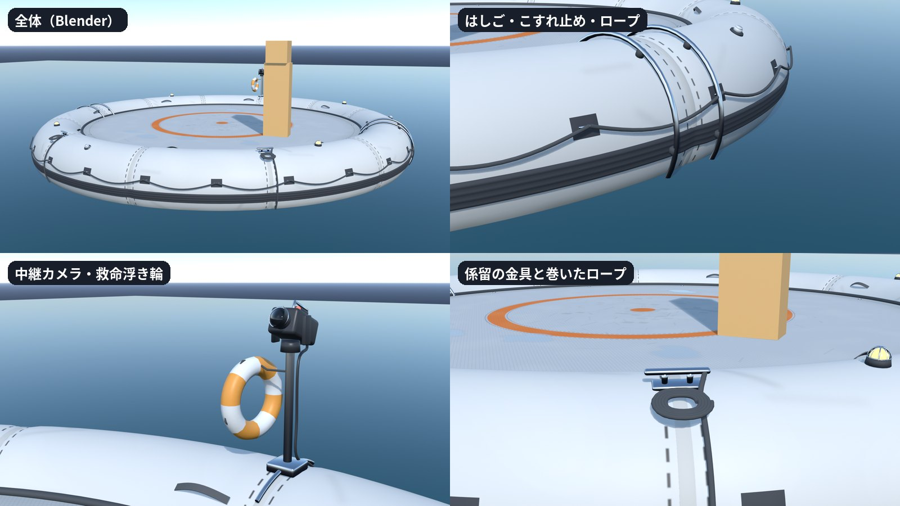

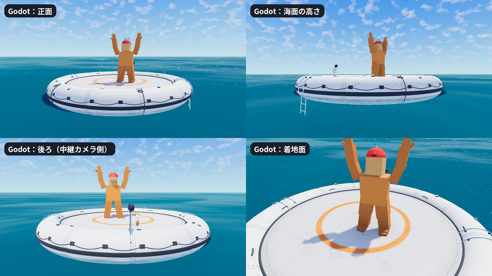

| 部品 | 作り込み |
| --- | --- |
| 浮き輪 | 外径8.13m、喫水線から上面まで0.80m。明るいグレー1色の12の部屋。部屋の境目で3%くびれ、溶着テープと点線の縫い目。しわ、喫水線の汚れ、日焼けのむら |
| 着地面 | 半径3.15m、平ら（喫水線から0.57m）。グレーのマットに着地の目印のオレンジの輪（半径1.45〜1.62m）と中心の小さな丸。すべり止めの菱形の溝、縫い目、すり傷、足あと、水たまり（そこだけつやがある） |
| まわりの部品 | こすれ止めの帯（溝3本）、当て布とDリング24か所と垂れたロープ、空気弁3つ、内側の取っ手8つ、黄色い標識灯4つ、はしご2本（水の中に踏み板）、係留の金具2つと巻いたロープ・海へ下りるロープ、濃いグレーのパイピング、水抜きのはとめ12個 |
| 中継カメラ | 奥の管の上。クランプ・柱・雲台・本体・レンズとフード・赤い灯・ケーブル。柱に救命浮き輪。ダンスの間だけ赤い灯が点く |
| 数 | 三角形75,022、メッシュ15（材質ごとにまとめた）、テクスチャ4枚 |

真上からはオレンジの輪が目印として読める。

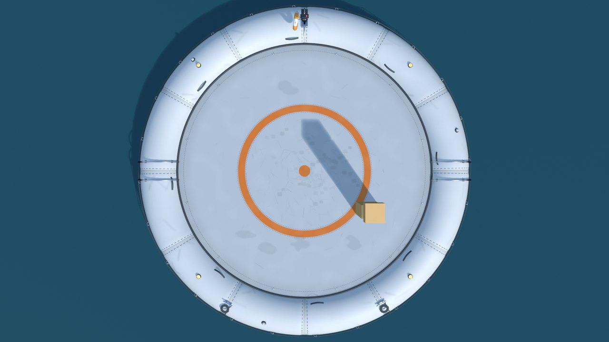

- 海に浮かべる：原点が喫水線なので、`position.y` を海面の高さにする。波に合わせて上下・傾く（`OceanDetail` の波の高さを4点で読む）。着地の瞬間に0.15m沈んで戻る。
- 標識灯は2秒ごとに点滅する。
- 水柱：本制作した（`splash.glb`、`WaterSplash`）。柱（高さ11m）・クラウン・水滴・泡の輪・波紋。2.4秒で、柱が伸びて崩れ、クラウンが開いて沈み、水滴が飛んで落ち、泡と波紋が広がって消える。
- 着地したパラシュートは、肩から外れて勝者の後ろの床へ落ちる（6.4節の `Grounded`）。布は着地面の上に小さな山になり（幅2.9m・奥行き1.6m、着地面の半径に収まる）、海にはかぶさらない。

### 6.6 勝者のダンス（エモート）

着地して両手を上げたあと（決着 7.0 秒）から、勝者は装備しているエモートを自分で選んで踊れる。

| 項目 | 内容 |
| --- | --- |
| キー | 本編と同じ。P1 は 1・2・3、P2 は 8・9・0（テンキーの 7・8・9 も）。装備の 3 つ（`p1_emote_slots` / `p2_emote_slots`）に対応する（`GameWorld._emote_key_mask` / `_emote_for_keys`） |
| 選び方 | 押した瞬間に、その踊りへ0.25秒で切り替える。踊りはループし、別のキーでいつでも替えられる。同じキーをもう一度押すと頭から踊り直す |
| 押さないとき | 2.5秒押さなければ、1 番（決着演出と同じ `get_result_winner_emote`）を踊る。棒立ちで終わらせない |
| 長さ | 6.0秒（決着 7.0〜13.0 秒）。ヘリが縄ばしごを下ろしきったら、踊りを0.25秒で止めて縄ばしごへ走る |
| 動き | 決着演出で勝者を踊らせている `ResultWinnerDance`（装備のエモートの FBX を時計で読む）を使う。床の高さは着地面の中心（`MK_LandCenter`）。踊りの時計は押した時刻から数える |
| 顔の向き | `ResultWinnerDance` と同じく、体と顔をカメラへ向ける（カメラが回っても追う） |
| 敗者 | 踊らない（海に落ちたあと、共通の幽霊で帰る） |
| 記録 | 踊った踊りの番号を `record["sudden_death"]["detail"]["dance"]` に残す（試合の記録のハイライトで使える） |

## 7. カメラ

### 7.1 決まり

- 全てのショットは監督が `CameraController.set_director_pose(pose, fov)` で決める（common.md 第12章）。画角は縦。
- **P1 は常に画面の左**。
- **問題を出している間はカットしない**。カットするのは、導入の機内の寄り・最後の1問に入るとき・決着のドボンのときだけ。
- **真上から見下ろす画は使わない**（2026-10-18、ユーザーの指示で「高度の画」C5 をやめた。2問ごとの1.0秒の間もルールからなくした）。どれだけ落ちたかは高度計と、近づいてくる海で見せる。
- **中身に合わせて収める**（M2、2026-10-18）：本戦の画は、2人の体（上下0.75m・左右1.1m の余白）と、パラシュートの一番上（パイロットシュートの頂点）・布の両端を、実際のカメラの向きで画面に投影し、**問題パネルの下（画面の高さの17%）と4択の上（83%）の間、横は84%の幅**に収まる距離と注視点の高さを、毎フレーム8回の繰り返しで求める（`ParachutePresenter._fit_main`）。距離は7.2mより近づかない。引くときは毎秒5、寄るときは毎秒1.6の指数で寄せる。パラシュートは体の向きでカメラ側へ傾くので、同じ奥行きとみなす近似では足りない。
- 本戦の画は自分で寄せ方を持つので、監督の追いかけ（毎秒2.6の指数）を重ねない（重ねると、開いた直後にパラシュートの上が問題パネルの裏へはみ出していた）。
- **揺れ**：本戦の画は、ゆっくりした漂い（0.15m、0.2Hz と 0.33Hz の重ね合わせ）だけ。出来事の揺れは0.08m以下・0.25秒以下（外したとき）。問題を読む邪魔をしない。
- **速さの見せ方**：雲の板（`StagingClouds`）を毎秒40mで下から上へ流し、ときどき雲がカメラの前を抜ける（問題の頭と答え合わせの間だけ。回答中は抜けない）。細い風の筋の粒を画面の端に少し。
- 新しいショットへは毎秒2.6の指数で寄せる（common.md と同じ）。ただし本戦の画は上のとおり。
- カットの瞬間に HUD で消すものは、見せ方が `instant` を渡せば同じフレームで消せる（`ParachuteHud.set_state`）。
- 確かめ方：`tests/sudden_death_v2/parachute_runtime.gd` が、問題の頭と答え合わせの終わりに、2人の体とパラシュートの一番上・両端を画面に投影し、問題パネルの下と4択の上の間・画面の左右の内側に収まることを毎回確かめる（`_check_framing`）。絵コンテとの比べは `artifacts/sudden_death_v2/parachute/make_camera_compare.py` が並べる。

### 7.2 ショット

絵コンテ（左）と実ゲーム（右）の比べ（M2 のあと）：

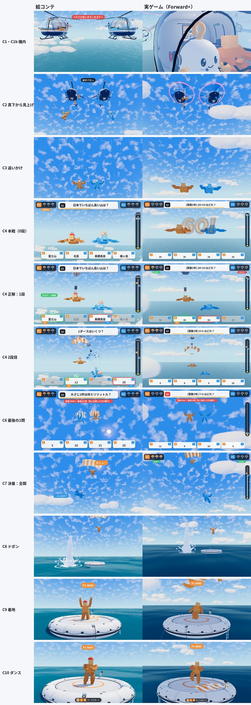

| 名前 | 場面 | 位置・向き | 画角 |
| --- | --- | --- | --- |
| `C1_Formation` | 導入 0.0–0.5 | 2機の正面・少し上。13m 前 | 50° |
| `C1b_Cockpit` | 導入 0.5–1.2 | 操縦席の斜め前の寄り。ハテナの手とボタン | 40° |
| `C2_Under` | 導入 1.2–3.2 | 2機の真下15m・少し前から見上げる。2人がカメラの左右を抜ける | 62° |
| `C3_Chase` | 導入 3.2–5.0 | 2人と同じ速さで落ちながら、下から正面へ1.8秒で回り込む | 64°→50° |
| `C4_Main` | 本戦 | 2人の頭の前。距離と注視点の高さは中身に合わせて求める（7.1節。0段で7.2m、1段で約10m、2段で約18m）。目は注視点より距離の8%上。背景は海と水平線 | 50° |
| `C4_Punch` | 正解のとき | C4 のまま、正解した方へ0.3秒だけ0.6m寄る | 48° |
| `C6_FinalLook` | 最後の1問 | 着地台の手前（−Z の側）の上から見上げる。落ちてくる2人（P1 が左） | 40° |
| `C7_Release` | 決着 0–1.6 | 敗者と同じ速さで落ちる（落ちる点の10m前・5m下から見上げる）。勝者が上へ抜ける | 62° |
| `C8_SeaWide` | 決着 1.6–4.4 | 海面の高さ・着地台の24m 手前。水柱のあと、降りてくる勝者へ上を向く | 55° |
| `C9_Landing` | 決着 4.4–7.0 | 着地台の斜め前9.6m・着地面の1.9m上から、勝者のまわりを70°回り込む（絵コンテに合わせて引き、着地台の全体を入れる） | 46° |
| `C10_DanceOrbit` | 決着 7.0–13.0 | C9 の続き。着地台の中心から8.6m・高さ2.1mの円の上を毎秒12°で回り、勝者の胸を見る。踊りを替えた瞬間に0.3秒だけ0.5m寄る。最後の1.2秒は少し引いて、下りてくるヘリと縄ばしごを画面の上に入れる | 44° |

## 8. HUD

common.md 第11章の `SuddenDeathHud` に、この種目の層を足す（`ParachuteHud`）。見本は絵コンテ05〜08。

| 部品 | 場所 | 内容 |
| --- | --- | --- |
| 問題パネル | 上の真ん中 | 「Q1」の札と問題文。下に残り時間の帯（残り3秒で赤） |
| 4択 | 下 | 4枚のカード。左上に P1 のキー（オレンジ）、右上に P2 のキー（青）。答え合わせで正解は緑の枠と「正解」、外れは赤い枠、ほかは薄くする。選んだカードの下に P1／P2 の札 |
| プレイヤーの段 | 左上（P1）・右上（P2） | 「P1」の札とパラシュートの形の印3つ。灯ると段が上がる。下に「回答済み」「しぼんだ…」の札 |
| 高度計 | 右の端 | 縦の帯。上に高度（m）、下に着地台。2人の印（オレンジと青）が段の差だけずれる |
| 最後の1問 | 問題パネルの下 | 赤い札「高度150m！ 最後の1問（先に正解した方の勝ち）」 |
| ダンスのキー | 下の真ん中（勝者のダンスの間） | 小さく1行で「[1][2][3] キーでエモート」（P2 が勝ったら 8・9・0 と青の札）。踊っている札は白いふち。踊りの名前と残り秒数は出さない（2026-10-18、ユーザーの指示でシンプルにした） |
| 勝者 | 上の真ん中 | 「P1 WIN!」（共通の `show_winner`） |

- 文字は日本語と英語を切り替える（`use_english_ui`）。
- 種目名は大きく出さない（common.md 第2章）。

## 9. 音

| 場面 | 音 | 音源 |
| --- | --- | --- |
| ボタン・ハッチ | カバー、ボタン、ベルト、ハッチ | ボタンとカバーは新規。ベルト・ハッチは既存（`HelicopterSound`） |
| 落下 | 風（落ちる速さで強さと高さが変わる） | 新規 |
| パラシュート | パイロットシュートのポンッ、布が広がるバサッ、全開のボンッ、しぼむシュルッ | 新規 |
| 答え | 正解・不正解・時間切れ・時計 | 既存のクイズの音を使う |
| 最後の1問 | 心臓の音、スローに入る音 | 新規 |
| 決着 | ハンカチのポンッ、水柱のドボン、着地、布が床に落ちる | 新規（ドボンは既存の水の音があれば使う） |
| 勝者のダンス | 短い勝利のジングル（ループ、BGM の上に −6 dB）、踊りを替えたときの軽い音 | 新規 |

新しい音は出典のある音源ファイルにする（common.md 第13章）。ダウンロードは、ファイル名・入手元・大きさをユーザーに確認してから行う。

## 10. 実装の構成

| ファイル | 役割 |
| --- | --- |
| `scripts/core/sudden_death/parachute_game.gd`（新規） | ルール（`SuddenDeathGame` を継承）。段・高度・答え・最後の1問・勝者。出来事：`question`・`answered`・`reveal`・`stage_up`・`stage_down`・`final`・`decided` |
| `scripts/world/sudden_death/games/parachute_presenter.gd`（新規） | 見せ方（`SuddenDeathPresenter` を継承）。導入・本戦・決着の動きとカメラ |
| `scripts/world/sudden_death/games/parachute_canopy.gd`（新規） | パラシュート1つ分（段の形・開く／しぼむ動き・ひも・ばたつき） |
| `scripts/world/sudden_death/games/landing_float.gd`（新規） | 着地台（`landing_float.glb` を置き、波に浮く・着地で沈む・標識灯の点滅・中継カメラの赤い灯） |
| `scripts/world/sudden_death/games/parachute_presenter.gd` の勝者のダンス | `ResultWinnerDance` を勝者に使う（6.6節）。共通の監督の `pose_winner_waiting(player, t)` の口で毎フレーム当てる |
| `scripts/world/game_world.gd` | サドンデスの間もエモートのキーを読む（今は `STATE_SUDDEN_DEATH` で読まない）。`_emote_key_mask` の結果を監督へ渡す（幽霊ザメの乗り手へ渡しているのと同じ形） |
| `scripts/ui/sudden_death/parachute_hud.gd`（新規） | 第8章の HUD と図解ルールカード |
| `scripts/world/sudden_death/heli_sudden_death_director.gd` | 空の種目のために「舞台へ降りる」（DESCEND）を飛ばす口を足す：見せ方に `descent_mode()`（`"ladder"`／`"skydive"`）を足し、`"skydive"` のときは空のセットの巡航のあと、縄ばしごで降ろさずに見せ方へ渡す。決着後の迎え（EXTRACT）は今のまま使う（`extract_point` が着地台） |
| `scripts/core/game_state.gd` | `SUDDEN_DEATH_GAMES = ["parachute"]`、`_create_sudden_death_game`。種目が1つなので、大型ビジョンはルーレットではなく種目発表だけ（今のまま） |
| `scripts/world/online_heliport/online_heliport_helicopter.gd` | 計器盤のボタンとカバー |
| `scripts/world/animation_rig.gd` | 新しいアニメの枠（6.2節） |
| `assets/sudden_death/parachute/landing_float/` | 着地台（作成済み。`README.md`） |
| `assets/sudden_death/parachute/`（新規） | パラシュート・ハンカチの GLB、Blender の原本、ルールカードの絵 |

- 空のセットの雲（`StagingClouds`）は、横に流すだけでなく、下から上へ流せるようにする（今は進む向き `FORWARD` だけ）。
- 着地台は空のセットの海（`SuddenDeathSkySet.ocean`）に浮かべる。落ちていく間の「実際の高さ」は動かさず（海は70m 下のまま）、高度計の数字と雲の流れで落ちているように見せる。最後の1問から海へ近づける（海と着地台を下から上へ動かす）。

## 11. 検証

common.md 第17章に従う。結果は `artifacts/sudden_death_v2/parachute/` に置く。

| 検証 | 内容 |
| --- | --- |
| ルール（ヘッドレス） | 正解で1段・不正解で1段下がる・0段で下がらない・答えないと変化なし・1問1回・8秒で締める・2人とも3段で先に押した方・高度150mで最後の1問・最後の1問の外れ・2人とも外れて次の問題・一時停止・30／60／120fps で同じ結果 |
| 実ゲーム（Forward+） | F9 の引き分けから通しで：`chute_p1`（P1 が3連続正解）・`chute_p2`・`chute_tie3`（同じ問題で2人とも3段）・`chute_final`（高度150mまで決まらない）・`chute_none`（2人とも答えない）・`chute_pause`・`chute_dance`（勝者が 1→3→2 と踊りを替える／P2 の勝ちで 8・9・0／押さないと 2.5 秒で 1 番）・`load_fail` |
| 着地台 | `tests/sudden_death_v2/landing_float_check.gd`：部品・テクスチャ・粗さ・発光・両面・マーカーを確かめ、本物の海に浮かべて撮る（2026-10-18：失敗 0 件） |
| 見た目 | 絵コンテと同じショットの画面を実ゲームから撮って並べる。パラシュートが問題パネルに隠れないこと、P1 が左にいること、文字が読めること |
| 動き | 6.2〜6.4節の動きを連続写真で確かめる（切り替えで腕が胴を通り抜けない、止まって見える間がない） |
| 性能 | 本戦と決着で p95 16.6ms 以下（高画質）。パラシュート2つ・着地台・水柱を足しても、空のセットの描画の呼び出しが大きく増えないこと |
| 回帰 | common.md 第17章の回帰と同じ |

## 12. 制作の手順

| 段階 | 内容 |
| --- | --- |
| M1 ルールと仮の見せ方 | ルール・HUD・図解ルールカード（いまの絵）・監督の `skydive` の口を作り、仮のパラシュート（この絵コンテの形）で通して動かす。ユニットと実ゲームのテストの入口。**2026-10-18 に完成** |
| M2 カメラ | 第7章のショットと決まりを入れ、絵コンテと並べて調整する。**2026-10-18 に完成**（本戦の画を中身に合わせて収める方式にした） |
| M3 パラシュートと着地台（Blender） | 6.4・6.5節の素材。ライブの Blender で作り、`.blend` を保存。**2026-10-18 に完成**（着地台、パラシュート一式・ハンカチ・水柱） |
| M4 プレイヤーとハテナの動き（Blender） | 6.2・6.3節。連続写真で確かめる |
| M5 音・仕上げ | 第9章。ルールカードの絵を M4 の人物のポーズで撮り直す（本物の素材での撮り直しは 2026-10-18 に済んだ） |
| M6 仕上げの検証 | 第11章。`sudden_death_available = true` にする |

## 13. 未決事項とリスク

- 落ちている間に問題を読めるか（画面が動き続けるため）。M1 で実際に遊んで、揺れと雲の流れを弱める余地を残す。
- 4択のキーの並び（A・W・S・D、←・↑・↓・→ を左から）が直感的か。横一列のカードに上下のキーを割り当てているので、カードの札で補う。
- 「答えない」を罰しないので、2人とも答えずに高度150mまで進むことがある。そのときは最後の1問で決まるので終わりはする。
- 腹ばいで顔をカメラへ向けるには頭を大きく反らせる必要がある（絵コンテでは首を64°反らせた）。ブロックマンの首で不自然に見えないか、M4 で確かめる。
- 水柱の見た目の品質（海のシェーダーとの合わせ方）。着地台の喫水線のまわりに泡の輪を足すか（今は海の面で切れているだけ）。
- 着地台は三角形 7.5 万。品質「低」では軽い版（ロープ・Dリング・ガードを省く）を作るか、M6 の重さの計測で決める。
- ダンスでジャンプの多い踊り（ヘッドスピンなど）が着地台のふちから見切れないか。`ResultWinnerDance` の横のずれの制限（±0.16m）で足りるか、実ゲームで確かめる。
- スリラー（何部かに分かれた踊り）は6秒では途中で終わる。それでよいか。
- 効果音の入手方法（common.md 第13章）。

## 14. 実装状況（2026-10-18、M1）

**M1（ルール・HUD・図解ルールカード・監督の skydive の口・勝者のダンス・仮のパラシュートで通し）を作った。** 引き分けから操作可能まで、本物のキー入力で通して動く。同じ日に M3（着地台・パラシュート一式・ハンカチ・水柱）も作った。人物の動きは仮（M4 で作る）。

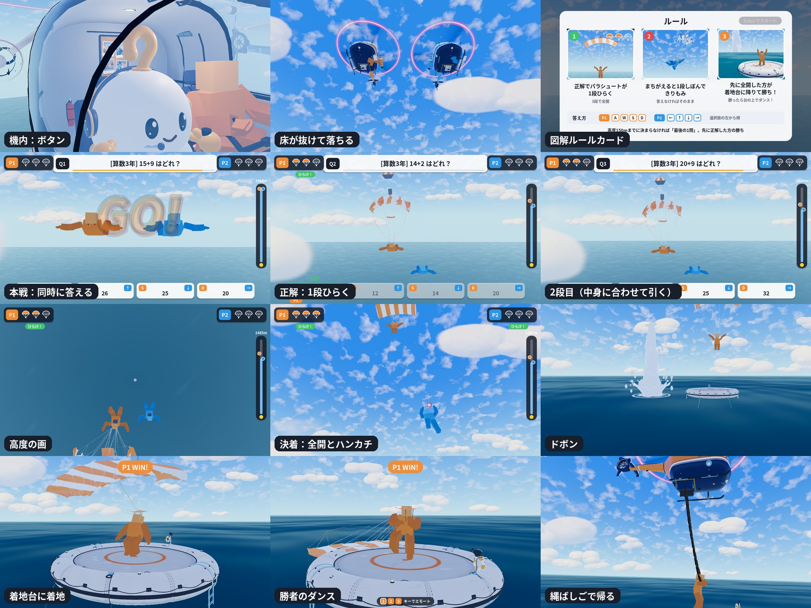

### 有効にする範囲

- `QuizGameState.sudden_death_available` は `OS.is_debug_build()`。エディタから動かすデバッグ版ではサドンデスが有効（F9 で引き分け → サドンデス）。書き出した製品版では今までどおり切ってある（M6 で true にする）。
- 既存の実ゲームの引き分けのテスト（`result_ceremony_runtime.gd`・`surface_hole_runtime.gd`）は自分で `sudden_death_enabled = false` にしているので変わらない。

### 構成（新規）

| ファイル | 役割 |
| --- | --- |
| `scripts/core/sudden_death/parachute_game.gd` | ルール `ParachuteGame`（第3章）。段・高度・答え・最後の1問・勝者 |
| `scripts/world/sudden_death/games/parachute_presenter.gd` | 見せ方 `ParachutePresenter`。導入・本戦・決着・ダンスの動きとカメラ（第4・7章） |
| `scripts/world/sudden_death/games/parachute_canopy.gd` | パラシュート一式（`chute.glb`）。段ごとの形の切り替えの重み、開く・しぼむ・着地で床に落ちる（`drop_to`）、パイロットシュートと袋の置き場所、色の塗り替え、背中のコンテナ、ハンカチ |
| `scripts/world/sudden_death/games/water_splash.gd` | 水柱（`splash.glb`）の時間に沿った広がり |
| `scripts/world/sudden_death/games/landing_float.gd` | 着地台を海に浮かべる（上下・傾き・着地の沈み・標識灯・赤い灯） |
| `scripts/world/sudden_death/games/fall_clouds.gd` | 落下中に下から上へ流れる雲 |
| `scripts/ui/sudden_death/parachute_hud.gd` | HUD と図解ルールカード（第8章・3.1節） |
| `assets/sudden_death/parachute/rule_card/*.png` | ルールカードの3枚の絵（960×720。`parachute_storyboard.gd` の r1〜r3 が本物のパラシュート・着地台・水柱で撮り、4:3 に切り抜いて書く。人物のポーズは M4 で撮り直す） |
| `tests/sudden_death_v2/parachute_unit.gd` | ルールのユニットテスト |
| `tests/sudden_death_v2/parachute_runtime.gd` | 通しの実ゲームテスト（`case=p1 / p2 / final / dance`） |

既存の変更：`game_state.gd`（種目の登録・問題の数・デバッグ版で有効）、`heli_sudden_death_director.gd`（`descent_mode()` が `"skydive"` なら巡航のあと覆いも縄ばしごもなく種目へ渡す・`extract_delay()` の間ヘリを待たせる・`shows_winner_banner()`・エモートのキー・空のセットを帰還まで出す・種目発表の寄りの直し）、`sudden_death_presenter.gd`（上の3つの口）、`game_world.gd`（サドンデス中もエモートのキーを監督へ渡す）。

### 仕様から変えた点・決めた点

- 人物：落ちている間と着地台の上は、プレイヤーの見た目を写した人形（決着演出の人形と同じ `build_player_skeleton`）を関節の角度で動かす。本物のアバターは機内の座席と、迎えの縄ばしごへ走るときだけ。ダンスの `ResultWinnerDance` が人形の根を動かすので、2人目まで一緒に動く本物のアバターには当てられないため。
- 落下：2人は空のセットの26m 下の「落ちる点」に留め、雲（`FallClouds`）を下から上へ流し、空のセットの海と着地台を高度に合わせて上下させる（2000m で390m 下、150m で140m 下、最後の1問と着地で着地台の上面が20m 下）。
- カメラの距離：M1 では段ごとの決め打ち（7.2・9.6・16.5m）だったが、2段目でパイロットシュートが問題パネルにかかったので、M2 で「中身に合わせて収める」方式にした（7.1節）。
- 勝者の表示：共通の大きな「P1 WIN!」はダンスを隠すので出さず、HUD の上に小さく出す。
- ダンスの表示：下の真ん中に小さく「[1][2][3] キーでエモート」だけ（ユーザーの指示）。
- 種目発表：ビジョンへ寄る前のヘリを映す引きの画をなくし、決着演出のカメラから直接ビジョンへ寄る（ユーザーの指示。common.md 4.2節）。寄る頭の1フレームでカメラがヘリの方へ引いていた不具合も直した。
- 着地台：派手すぎたので、明るいグレーにオレンジの輪1本のシンプルなデザインに作り直した（ユーザーの指示。6.5節）。
- 最後の1問の見上げる画は、着地台の手前（−Z の側）から撮る（P1 が画面の左に来る向き）。
- 着地のあと、パラシュートは肩から外れて人の後ろの床に落ちる（ライザーのつけ根が体にめり込んでいたので直した。6.4・6.5節）。着地台は波で上下・傾くので、床の置き場所は毎フレーム渡し直す。
- 真上から見下ろす高度の画（C5）と、2問ごとの1.0秒の間をなくした（ユーザーの指示。7.1節）。
- ルールカードの絵を 4:3 で撮り直し、角を丸く切り抜いて描くようにした。②の絵の揺れと③の文字の弾みはやめた（ユーザーの指示。3.1節）。
- 効果音は今ある音で代用（正解・不正解は扉の音、カウントダウン、着地、水柱は `body_burst`）。新しい音は M5。

### 検証（2026-10-18）

| 検証 | 結果 |
| --- | --- |
| ルール `tests/sudden_death_v2/parachute_unit.gd`（ヘッドレス） | 29項目成功（正解・不正解・無回答・2人とも全開で先に押した方・時間切れ・1問1回・問題の間に高度の画をはさまない・高度150mの最後の1問・最後の1問の外れと2人とも外れ・30／60／120fps で同じ結果・用意した問題のあとの補充） |
| 実ゲーム `tests/sudden_death_v2/parachute_runtime.gd`（Forward+、60fps 固定、本物のキー入力） | `p1`（P1 が3連続正解、chute で勝ち）・`p2`（P2 の勝ち、押さないと2.5秒で1番を踊る、キーは 8・9・0）・`final`（6問目の最後の1問で P2 が外し P1 が当てて final で勝ち）・`dance`（ダンス中に 3 → 2 と押して踊りが替わる）がすべて成功（2026-10-18 の直しのあと 42・42・49・42項目）。どのケースも、真上から見下ろす画が出ない、着地のあと勝者のパラシュートが人の後ろの床にある（原点が着地面の高さ・体から0.3m以上離れる・Grounded の重み1）、問題の頭と答え合わせの終わりに2人の体とパラシュートの一番上が問題パネルと4択の間に収まる（7.1節）、種目発表の寄りでカメラが遠ざからない（0m）、本戦と最後の1問で P1 が画面の左、帰還で空のセットと海の高さが元に戻る、判定から勝者の演出・操作可能・結果文「サドンデスで P1 …」・記録の game が parachute、を確かめる。画像は `artifacts/sudden_death_v2/parachute/runtime/<case>/` |
| 着地台 `tests/sudden_death_v2/landing_float_check.gd` | 失敗0件（部品・テクスチャ・粗さ・発光・マーカー5つ） |
| パラシュート一式と水柱 `tests/sudden_death_v2/chute_check.gd` | 失敗0件（形の切り替え5つが3つのメッシュにあり Risers にも Grounded がある・段ごとの重み・スナッチで Half が −0.1 まで行き過ぎて0に決まる・色の塗り替え・部品・`drop_to` で原点が床の点に移り Grounded の重みが1） |
| 回帰 | 決着演出のユニット（`tests/result_ceremony_bootstrap.gd`）5,000項目成功 |

### まだ行っていないこと（M2 以降）

- プレイヤーとハテナの動き（M4、今は関節の角度の仮のポーズ）、新しい効果音とルールカードの絵の撮り直し（M5）。
- ハテナの「振り返って親指」「赤いボタン」は、今ある `wave`・`point` で代用している。計器盤のボタンの小道具はまだない。
- 実時間（`realtime`）での重さの計測と、画質「低」での見た目（M6）。
- 一時停止中に問題を隠す（3.2節）。今は止まるだけ。
