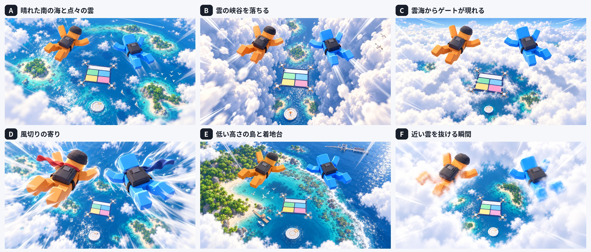

# スカイゲートの空の演出（設計メモ）

2026-10-19作成。サドンデス「つきやぶれ！スカイゲート」（`sky_gate.md`）の本戦の見下ろしの画で見える空（雲・風切り・下の島・鳥・飛行機雲）を決める。作り方は `skygate_build_plan.md` の W7。

**ユーザーの指示（2026-10-19）**：空の雲や風切りの演出、下に浮いている島などを作り込む。見下ろしの画で Codex CLI に何案か描かせて、一緒に詰める。

絵は Codex CLI の画像生成で作った案（`artifacts/sudden_death_v2/sky_fx/`。プロンプトは `make_prompts.py`）。

## 1. 決まったこと（ユーザーと決定）

| 項目 | 決定 |
| --- | --- |
| 構成 | **高さで移り変わる**。降り始めは C の雲海 → F のように雲を抜ける → A の点々の雲と島々 → 最後のゲートのあたりで E の近い島と着地台。1 ラウンドの中で景色が変わる |
| 風切り | **強いが、ゲートが近い間は弱める**。D のような派手な風の筋と速さの線。パネルを選ぶ間（ゲートが近づいてから）は半分ほどにして、ボードを見やすくする |
| マフラー | **付ける**。P1 はオレンジ（赤み）、P2 は青。風ではためく。サドンデスの間だけ |
| 鳥・飛行機雲 | **両方入れる**。低い所で海鳥の群れが横切る（ぶつからない）。高い所で遠くに飛行機雲 |

## 2. 高さの帯（提案）

1 ラウンドの落下を 0（降下が終わったところ）〜1（着地台）として、景色を帯で移す。帯の境目はなめらかにつなぐ（雲を抜けるところは画面が一瞬白くなる）。

| 帯 | 進み | 見えるもの | 元の案 |
| --- | --- | --- | --- |
| 雲海 | 0.00–0.15 | 足もとに日の当たる雲海（でこぼこと穴）。2人の影が雲に落ちる。遠くに飛行機雲。1 枚目のゲートは雲海の穴から現れる | C |
| 雲を抜ける | 0.15–0.25 | 近い雲の中を抜ける（白いもや、渦、真ん中に下の海が開ける） | F |
| 点々の雲と島々 | 0.25–0.85 | 3 層の雲（カメラの近くを抜ける雲・ゲートの高さの雲と海に落ちる影・はるか下の薄い雲）。下に環礁とラグーン、緑の島、帆船の小さな航跡 | A |
| 近い島と着地台 | 0.85–1.00 | 島の細部（木・ヤシ・白い砂浜・サンゴ・波打ち際の白波・桟橋と小舟）、礁の外の着地台、遠くにスタジアム。海鳥の群れ | E |

- ROUND 5 のあとの「着地しないで 1 枚ずつ続くゲート」の間は、「点々の雲と島々」の帯をくり返す。
- 島は着地台のまわりに置き、どのラウンドでも着地台が礁の外の深い青の上に見える位置にする。
- 風切りの強さ：ふだん 1.0、ゲートが近づいてから（ゲートの頭から残り時間の半分を過ぎてから）通過まで 0.5、通過の瞬間に一度強く（1.4）。

## 3. 部品（提案）

| 部品 | 中身 |
| --- | --- |
| 雲 | 立体に見える雲の塊（ふちに光、下に影）。近い雲・中の雲・遠い雲の 3 層と雲海。今の `FallClouds`（平らな板 56 枚）を作り直す |
| 雲を抜ける | 画面全体の白いもや（シェーダー）と、カメラのまわりの雲のかけら |
| 風切り | 画面のふちの速さの線（シェーダー）、手足と頭から出る白い風の筋（トレイル）、上へ流れる小さな雲のかけらと水滴 |
| マフラー | 首に巻いたマフラー（2 色）。風ではためく（骨で揺らす）。人形（`build_player_skeleton`）と本物のアバターの両方に付けられる |
| 島 | 見下ろしで見る島（スタジアムの遠景と同じ作りの木・砂浜・浅瀬）。環礁 1・緑の島 2〜3・小島。高い所では軽い作り、近づくと細かい作りに替える |
| 海鳥・飛行機雲 | 海鳥の群れ（羽ばたく板の群れ）、飛行機雲（細長い板が伸びて薄れる） |
