# サドンデス「つきやぶれ！スカイゲート」仕様書（下書き・絵コンテ）

2026-10-18作成。「ひらけ！パラシュート」（`parachute.md`）の遊び方を全部変えた案。ローカル2P「10問」の引き分けのあとに行う、ただ1つのサドンデスの種目（ルーレットはしない）。共通の流れ（分岐・ヘリの迎え・雲・空のセット・帰還・敗者の幽霊）は `common.md` に従う。

**ユーザーの指示（2026-10-18）**：
- 遊び方を全く変える。
- スカイダイビングで、カメラは見下ろす。
- ドローンで吊った問題のボード（上に問題文、下に 2×2 の選択肢。手描きの見本 `artifacts/sudden_death_v2/sky_gate/refs/user_sketch_gate.png`）を、次々に突破していく。
- 間違った選択肢に入ったら、その時点で爆散してアウト。
- 2人とも地上にたどり着いたら、第2ラウンド以降へ進む。
- まずは Codex CLI で絵コンテを作る。

> 絵は Codex CLI の画像生成で作ったイメージ（`artifacts/sudden_death_v2/sky_gate/`。プロンプトは `make_prompts.py`、生成は `run_panels.sh`）。実装は Godot の 3D と UI で作る。HUD と説明の文字は、あとから描き足した見本（`make_storyboard.py`）。

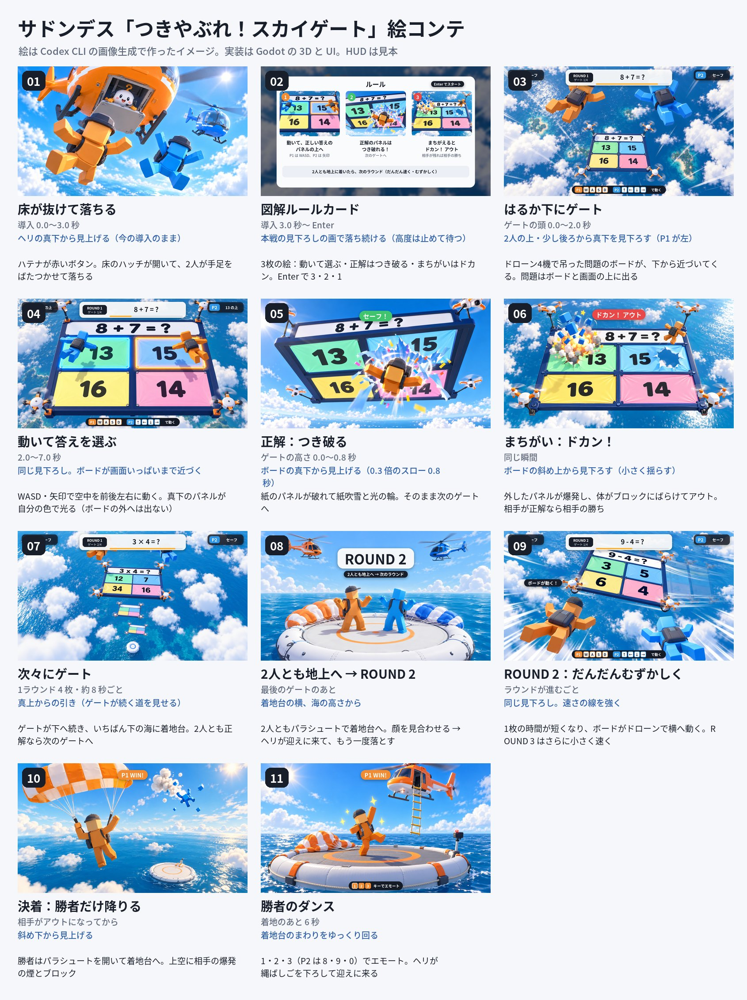

> 作り方（並行で作るための分け方と受け渡しの約束）は `skygate_build_plan.md`。

## 1. ひとことで

ヘリの床が抜けて、2人は空から海へ落ちていく。下から、ドローン4機で吊った横向きの問題のボードが近づいてくる。ボードの選択肢は紙のパネルで、落ちながら空中を動いて、正しい答えのパネルの上へ行く。正解のパネルはつき破れて次のゲートへ。まちがえたパネルはドカンと爆発して、その人はアウト。相手が残れば相手の勝ち。2人とも最後まで残って地上（海の着地台）にたどり着いたら、ヘリがもう一度2人を落として次のラウンド。ラウンドが進むほど速く、むずかしくなる。

## 2. 決定事項

「決定」はユーザーが決めたこと、「提案」はこの下書きで決めたことで、ユーザーの確認を待つ。

| 項目 | 既定 | 状態 |
| --- | --- | --- |
| 遊び方 | 落ちながら、ドローンで吊った問題のボードの正しいパネルをつき破って進む | 決定 |
| カメラ | 見下ろす（2人の上・少し後ろから真下を見る） | 決定 |
| ボード | 上に問題文、下に 2×2 の4択。四隅をドローンが吊る | 決定 |
| 問題文の出し方 | **ボードだけ**（画面の HUD には出さない）。遠くからでも読めるよう、問題文の帯は**ボードより大きな看板**にして、ドローンを足して吊る（2026-10-19）。作った：17 × 6 m の看板、ドローン 6 機（`assets/sudden_death/sky_gate/README.md`） | 決定 |
| まちがい | まちがったパネルに入った時点で爆散してアウト | 決定 |
| 2人とも地上へ | 第2ラウンド以降へ進む | 決定 |
| 画面の名前 | 日本語「つきやぶれ！スカイゲート」、英語「SKY GATE BREAK!」 | 提案 |
| 種目の識別名 | `sky_gate`（`parachute` と入れ替える） | 提案 |
| ボードの向き | 海と平行（横向き）。2人は上から真下へ落ちてつき破る。大きさ 14m × 10m。奥の長い辺に、ボードより大きな問題文の看板 | 提案 |
| 動かし方 | P1 は W・A・S・D、P2 は ↑・←・↓・→ で空中を前後左右に動く。ボードの外へは出られない（動ける範囲はボードの内側） | 提案 |
| 答えの決まり方 | ボードの高さを通りすぎた瞬間に、体の中心の真下にあるパネルが答え。真下のパネルは自分の色の枠で光る（P1 オレンジ、P2 青。2人が同じパネルなら2色） | 提案 |
| 同じパネル | **2人とも同じパネルを選べる**。体が重ならないよう軽く押し合う。2人とも正解なら2人ともつき破る（2026-10-19） | 決定 |
| 正解 | 紙が破れて紙吹雪と光の輪。そのまま次のゲートへ | 提案 |
| まちがい | パネルが爆発し、体がブロックにばらけてアウト（血や怖さはなし。ブロックが飛び散る漫画の爆発） | 提案 |
| 1人だけアウト | 残った方の勝ち。勝者はパラシュートを開いて着地台へ降り、ダンス | 提案 |
| 2人とも同じゲートでアウト | **その場で復活**：ばらけたブロックがその場で体に戻り（1.0 秒）、次のゲートから続ける。そのゲートは2人とも「なし」。ラウンドの最後のゲートだったら、2人とも着地台へ降りて次のラウンド（2026-10-19） | 決定 |
| アウトの帰り方 | **ばらけたブロックが集まって幽霊になり**、勝者の横をふわふわついていく。帰還は共通の幽霊（common.md）（2026-10-19） | 決定 |
| 1ラウンド | ゲート4枚。2人とも4枚とも正解したら、2人ともパラシュートで着地台に降りて次のラウンド | 提案 |
| むずかしさ | ROUND 1：1枚 8 秒。ROUND 2：6.5 秒、ボードがドローンで横へ動く。ROUND 3 以降：5 秒、ボードが小さく（10m × 7m）、動きも速い | 提案 |
| 終わらないとき | **ROUND 5 まで決まらなければ、着地せずにゲートが1枚ずつ続く**（時間は 5 → 4 → 3 秒と短くなり、以後 3 秒）。1人だけ外れたら決着。**3 秒のゲートで2人とも正解なら早い者勝ち**：正解のパネルの上に入って、そのまま通過まで出なかった時刻が早い方の勝ち（同じ時刻ならもう1枚）（2026-10-19） | 決定 |
| 問題 | 4択（ボードに出す）。1ラウンド4問、5ラウンド分を確保する。足りなければ算数の自動生成（common.md 第9章） | 提案 |
| ROUND 2 からのカウントダウン | ROUND 1 と同じく「3・2・1・GO」のあとで始める。その前に「ROUND n」の見出し（1枚の秒数・むずかしさ）を 1.4 秒（2026-10-20） | 決定 |
| ラウンドの間 | 輸送機が着地台へ迎えに来る演出はなし。着地したら暗転し、次のカットは輸送機の機内から降りるところ（2026-10-20） | 決定 |
| 選ぶ間のカメラ | ゲートの終わり（残りがゲートの時間の 3 割、最大 2.4 秒）から、ボードと看板を画に収めるのをやめて2人へ寄る（8.5 m まで）。ボードが下から画いっぱいに迫る。判定のあと元の距離へ戻す（2026-10-20）。ただし全員が正解のパネルの上なら寄らず・減速せず、画の距離を変えずに突破する（2026-10-23） | 決定 |
| 着地台・パラシュート・ダンス | 「ひらけ！パラシュート」で作った着地台・パラシュート一式・水柱・勝者のダンスをそのまま使う | 提案 |

## 3. ルール

### 3.1 図解ルールカード

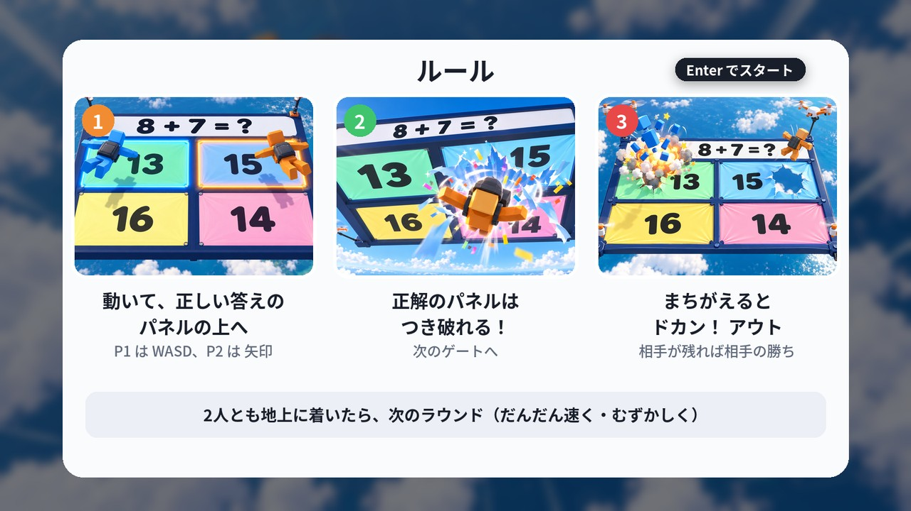

| 場所 | 中身 |
| --- | --- |
| ①（オレンジ） | 動いて、正しい答えのパネルの上へ。小さく「P1 は WASD、P2 は 矢印」 |
| ②（緑） | 正解のパネルはつき破れる！ 小さく「次のゲートへ」 |
| ③（赤） | まちがえるとドカン！ アウト。小さく「相手が残れば相手の勝ち」 |
| 一番下 | 「2人とも地上に着いたら、次のラウンド（だんだん速く・むずかしく）」 |
| 閉じ方 | 「Enter でスタート」（今のパラシュートと同じ。出てから0.6秒は受け付けない） |

### 3.2 1枚のゲート

| 時刻（ゲートの頭から、ROUND 1） | 内容 |
| --- | --- |
| 0.0 | 次のボードが、はるか下（約 320m）に見える。問題文はボードの大きな看板だけ（HUD には出さない） |
| 0.0–8.0 | 2人は動いて、正しいと思うパネルの上へ。真下のパネルが自分の色で光る。HUD の帯が残り時間を見せる |
| 8.0 | ボードの高さ。0.3 倍のスロー（0.8 秒）で、正解はつき破り、まちがいはドカン |
| 8.8 | スローが戻る。2人とも残れば次のゲート、1人だけ残れば決着、2人ともアウトならその場で復活して次のゲート |

- ボードは時間どおりに来る（落ちる速さは一定。動いても速さは変わらない）。
- 動きの速さ：ボードの端から端（14m）を約1.4秒で動ける。止めればすぐ止まる（ふわっと減速）。
- 2人がぶつかったら、軽く押し合う（重ならない）。

## 4. 全体の流れ

```
（共通）DRAW! → 大型ビジョンで種目発表 → 縄ばしごに飛びつく → 雲 → 空のセットで2機が並んで飛ぶ
→ 導入：ハテナが赤いボタン → 床のハッチが開いて落ちる → 図解ルールカード → 3・2・1
→ ROUND 1：ゲート4枚を次々に（正解はつき破る／まちがいはドカン）
   ├ 1人だけアウト → 決着：勝者がパラシュートで着地台へ → ダンス → 帰還
   ├ 2人とも同じゲートでアウト → その場で復活して次のゲートから
   └ 2人とも4枚突破 → 2人とも着地台へ → 「ROUND 2」→ 暗転 → 輸送機（水上機）の機内から、もう一度落ちる → 「ROUND 2」の見出し → 3・2・1
→ ROUND 2 以降：速く・むずかしく（ボードが動く・小さくなる）
→ ROUND 5 のあと：着地せずにゲートが1枚ずつ（5→4→3 秒）。3 秒のゲートで2人とも正解なら早い者勝ち
```

## 5. 絵コンテ

1コマずつ。コマの下の帯に、時刻・カメラ・動きを書いた。

### 01 床が抜けて落ちる
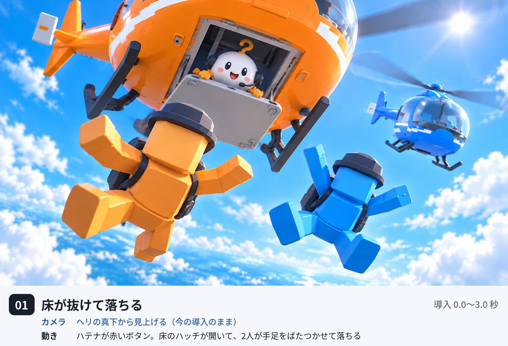

### 02 図解ルールカード
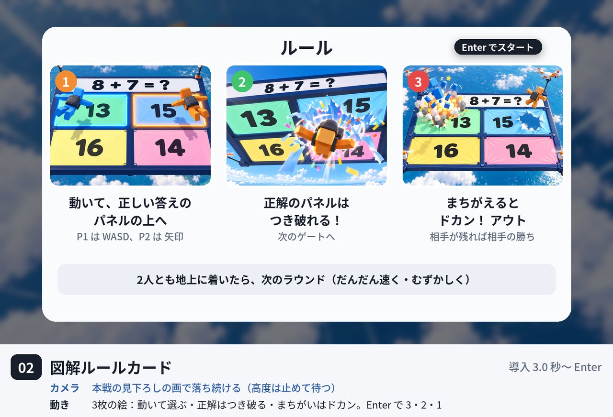

### 03 はるか下にゲート
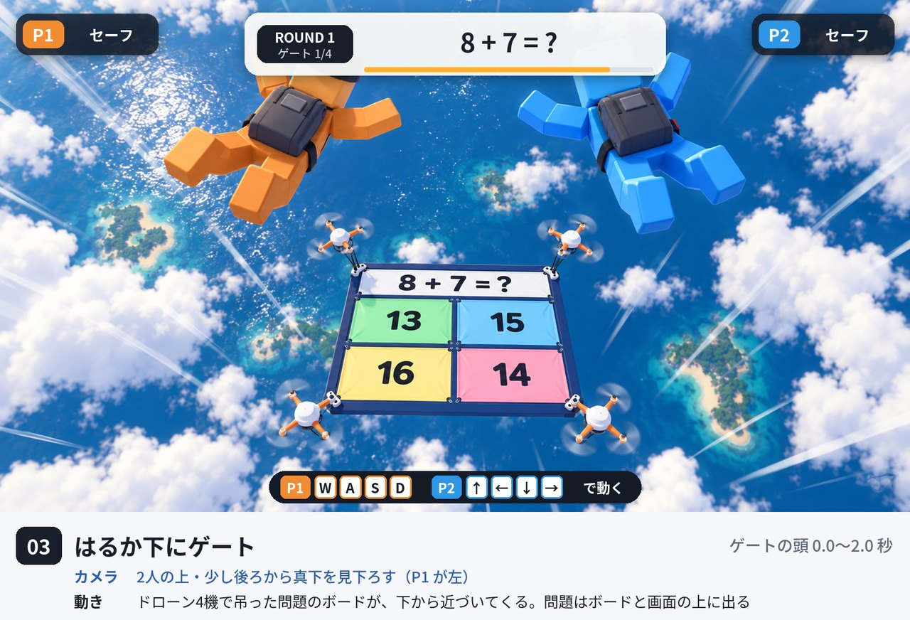

### 04 動いて答えを選ぶ
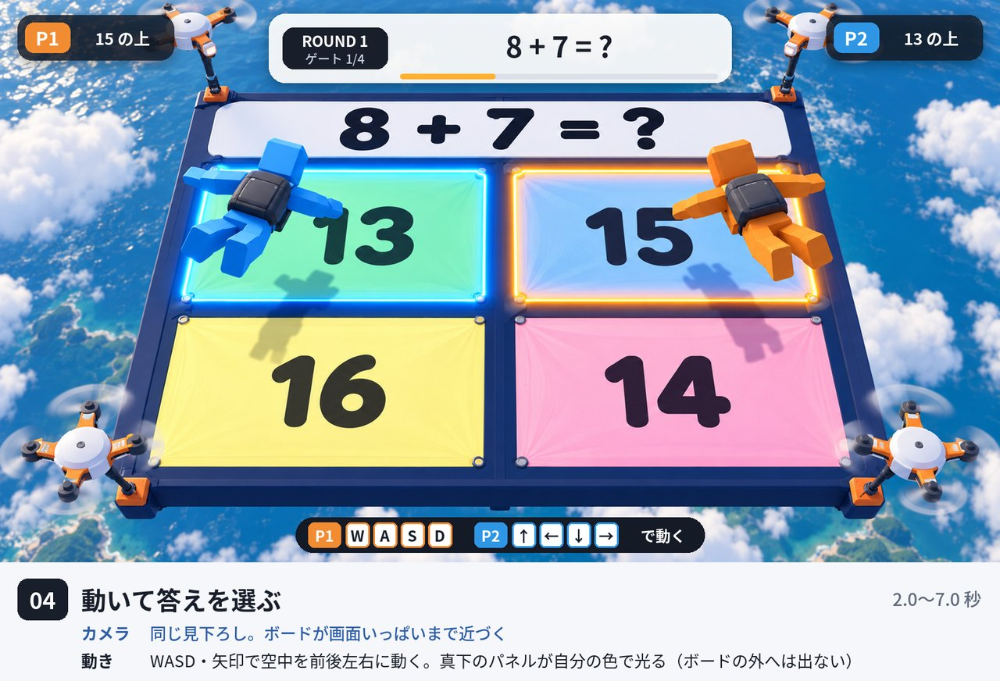

### 05 正解：つき破る
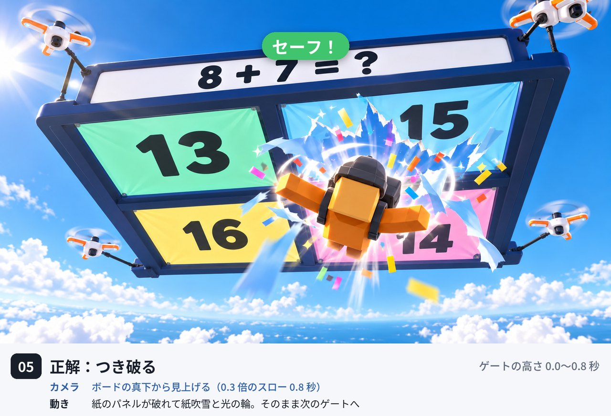

### 06 まちがい：ドカン！
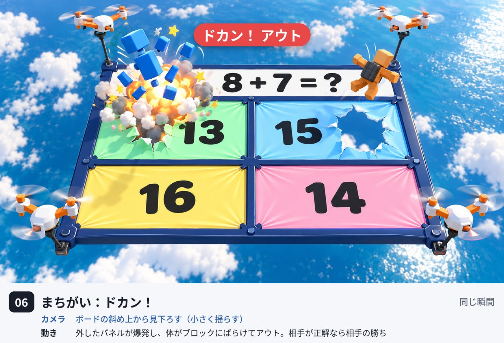

### 07 次々にゲート
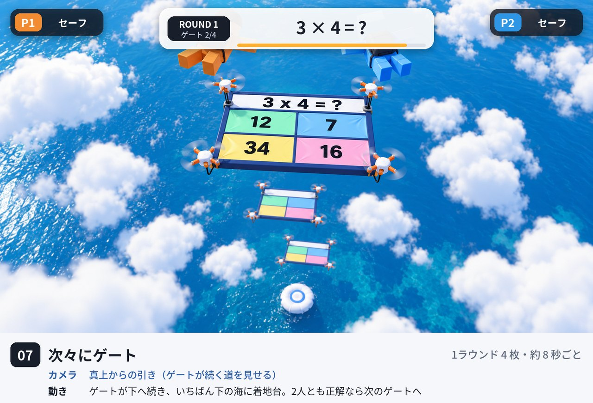

### 08 2人とも地上へ → ROUND 2
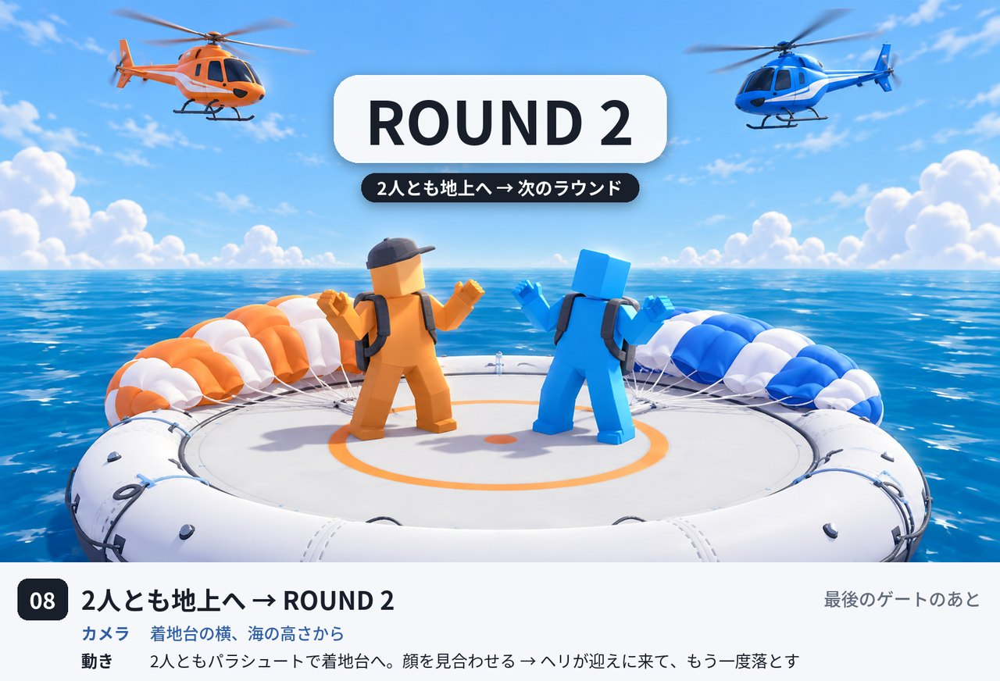

### 09 ROUND 2：だんだんむずかしく
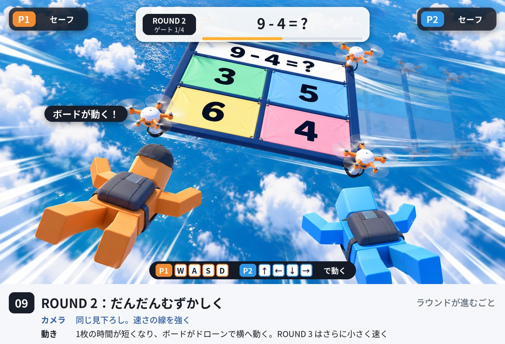

### 10 決着：勝者だけ降りる
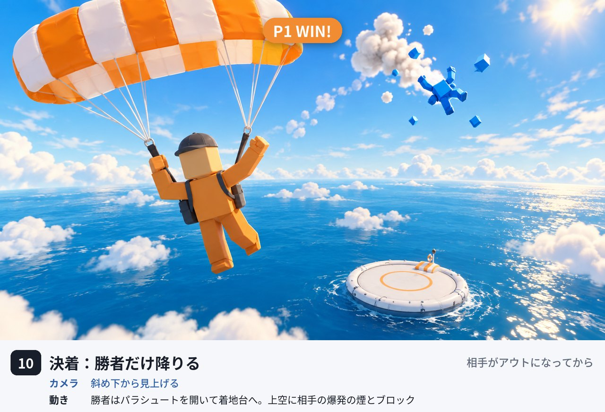

### 11 勝者のダンス
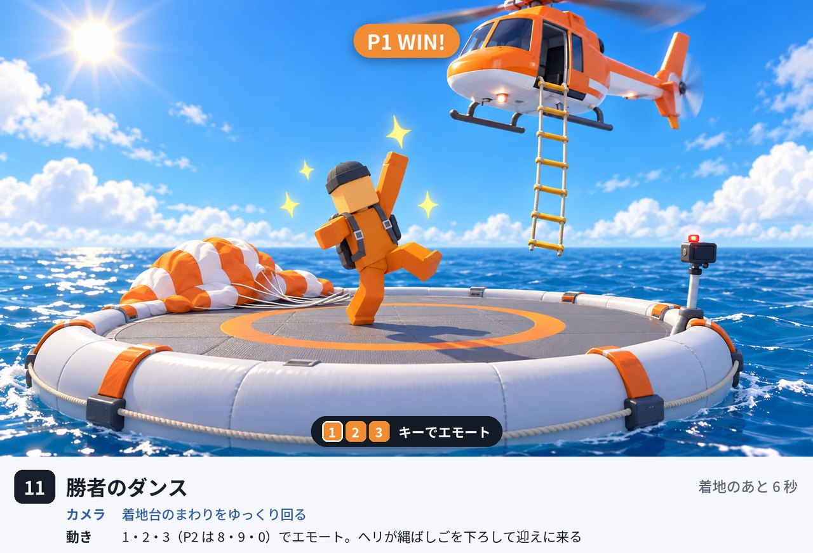

## 6. カメラ（案）

| 名前 | 場面 | 位置・向き |
| --- | --- | --- |
| `G1_Drop` | 導入 | ヘリの真下から見上げる（今の導入をそのまま使う） |
| `G2_TopDown` | 本戦 | 2人の上 6m・少し後ろから、ほぼ真下（75°）を見下ろす。2人とボードが入るように高さを寄せる。P1 は常に画面の左 |
| `G3_Through` | ゲートの高さ（0.8秒） | ボードの真下から見上げる（スロー）。1人だけアウトのときは、爆発が見えるボードの斜め上から |
| `G4_Chain` | 2枚目以降の頭 | 一瞬だけ真上から引いて、下へ続くゲートを見せる（0.6秒）→ G2 へ戻る |
| `G5_Landing` | 着地・ROUND 2・決着 | 「ひらけ！パラシュート」の着地と同じ（海の高さの引き → 着地台のまわりを回る） |

## 7. 今のパラシュートの種目から使うもの

| 使う | もの |
| --- | --- |
| そのまま | 導入（ハテナのボタン・ハッチ・落ちる）、空のセットと海、雲（`FallClouds`）、着地台（`LandingFloat`）、パラシュート一式（`ParachuteCanopy`、着地のあと床に落ちる）、水柱、勝者のダンス（`ResultWinnerDance`）、帰還、エモートの HUD |
| 作り直す | ルール（`ParachuteGame` → `SkyGateGame`：ゲート・ラウンド・アウト）、見せ方（本戦のカメラ・動かし方）、HUD（問題文・ラウンドとゲートの数・2人の札）、ルールカードの絵 |
| 新しく作る | 問題のボード（枠・紙のパネル・数字や文字）とドローン4機（Blender）、紙が破れる・爆発してブロックがばらける効果、空中で動く操作 |

## 8. 決めたこと（2026-10-19、ユーザーと決定）

前の版でここに挙げていた4つは、すべて決めた（第2章の表に書いた）。

| 項目 | 決定 |
| --- | --- |
| 終わらないとき | ROUND 5 のあとは着地せずにゲートが1枚ずつ（5→4→3 秒）。3 秒のゲートで2人とも正解なら早い者勝ち |
| 同じパネル | 選べる（軽く押し合う） |
| 問題文 | ボードだけ。問題文の帯はボードより大きな看板にして遠くから読めるようにする |
| アウトの帰り方 | ばらけたブロックが幽霊になって勝者についていく → 共通の幽霊で帰る |
| 2人とも同じゲートでアウト | その場で復活して次のゲートから（ほかの案：ラウンドを頭から・次のラウンドへ） |

## 9. 着地台のまわりの観客船（2026-10-21）

ユーザーの指示：「サドンデスの着地地点の回りにいくらかの観客がいる船を浮かべて、クラッカーや打ち上げ花火をぶちまけるように」。同じ日に「もっと近づけて」で、船を着地台へ寄せた（34〜40 m → 20〜28 m）。

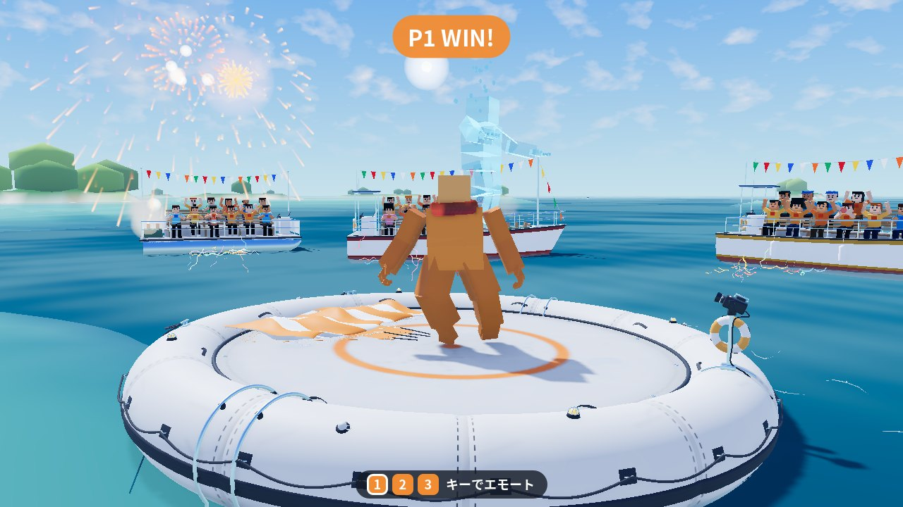

| 項目 | 内容 |
| --- | --- |
| 船 | 2 種類 6 隻。観覧船（白い船体・ベンチ 2 列 12 席・操舵台と T トップ・船首のマスト）4 隻と、パーティー船（アルミの浮き筒 2 本・柵・ベンチ 2 列 12 席）2 隻。どれも旗の綱の小旗と、打ち上げ筒の箱（観覧船 6 本・パーティー船 4 本）を積む。色帯は船ごとに紺・えんじ・青緑・からし色。素材は `assets/sudden_death/sky_gate/spectator_boats/`（ライブの Blender で作った。README） |
| 並び | 着地台のまわり、横の 4 隻は 20〜21 m、前の 2 隻は 26〜28 m。横腹（観客の正面）を着地台へ向ける。水上機が着地台に寄って離水する道すじ（`FloatplaneStaging.P_DOCK_ANGLE` の向き、翼の幅 24 m）と、着地台を回るカメラ（半径 11 m まで）には掛からない（`SkyGateFlotilla.corridor_clearance`・`nearest_edge` で確かめる） |
| 観客 | ゴールの観客と同じ座った観客（`SeatedSpectatorKit`）を、座席の 9 割に座らせる（69 人）。P1 のファン（オレンジのシャツ）・P2 のファン（青）・どちらでもない人（踊る人・自撮り・双眼鏡・ポップコーン）、各船の前の列の真ん中に応援団長（メガホンか太鼓）。船は波で上下・傾き、小旗ははためく |
| 着地の前 | 降りてくる人の着地の 2.4 秒前から、観客が身を乗り出す |
| 着地した | 観客が歓声をあげ（決着は勝者のファンが喜び、相手のファンはがっかり → 4 秒で勝者のファンの歓声とほかの人の拍手へ）、1 隻 4 人がクラッカーを着地台の方の上へ鳴らす（紙テープ 9 本・紙吹雪 18 枚・小さな煙） |
| 花火（決着） | 着地の 0.5 秒後に 3 発、そのあと 0.5〜0.85 秒ごとに 1 発（3 割は 2 発）、5.4 秒で 5 発の連発、3.0 秒でもう一度クラッカー。勝者のダンスの間ずっと続け、水上機の迎えが来たら止める（上がっているものは最後まで）。色は半分が勝者の色（P1 オレンジ・P2 青）、あとは金・白・桃・緑・紫・赤 |
| 花火（ROUND のあと） | 2 人とも着地台に着いたら、クラッカーと 5 発（0.55〜2.25 秒）。次のラウンドの頭で片づける |
| 花火の型 | 牡丹・菊（尾を引く）・柳（金色で垂れる）・輪（カメラの方を向く面）・パチパチ（終わりに光ってはじける）・2 色（芯がもう 1 色）。打ち上げの火の玉と尾、筒のひらめきと煙、はじけるひらめき、昼の花火の薄い煙 |
| 映し方 | 1 発ずつ、はじける所（とその上 3.5 m）がいまのカメラの画に入る船を選ぶ（高い所から 9 m まで 4 段で探す）。はじける所は船の少し向こう（着地台から離れる向き）、海から 9〜17 m |
| 音 | クラッカー・打ち上げ・はじける音は、専用の音が無いので手持ちの音で代用（`docs/sound_effects.md`）。距離の分だけ遅らせて鳴らす |

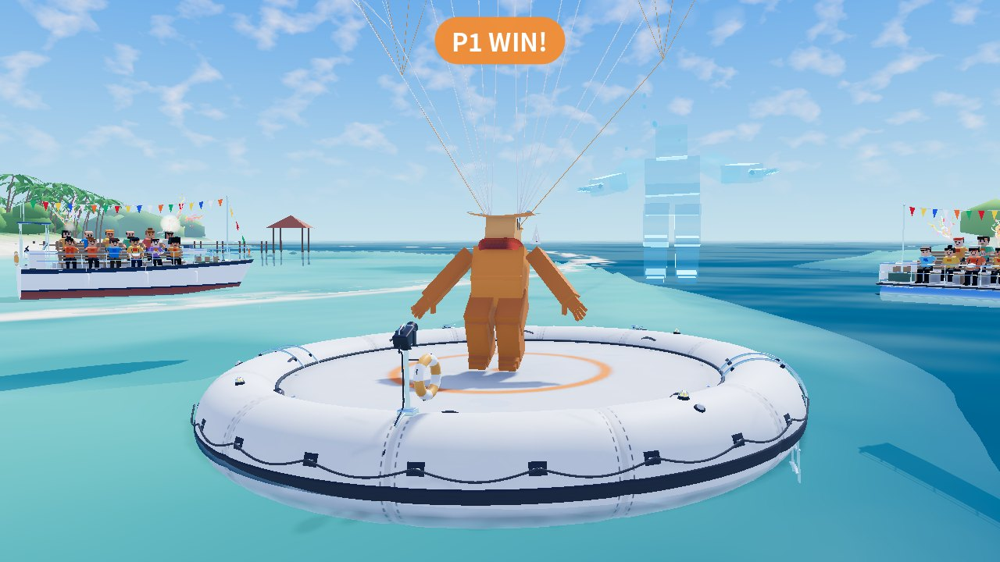

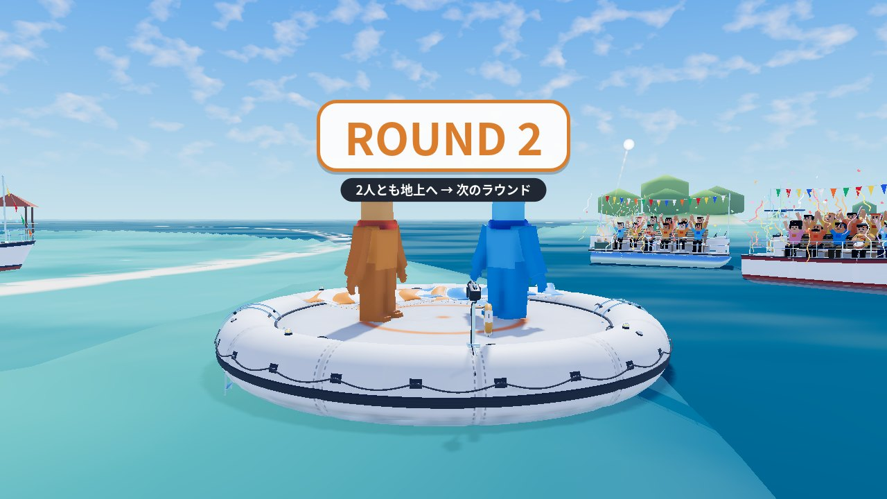

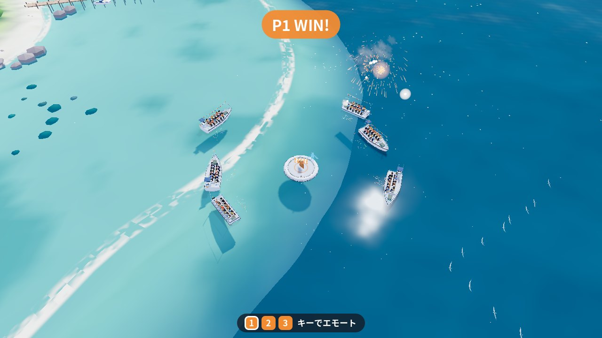

### 作り

| ファイル | 役割 |
| --- | --- |
| `scripts/world/sudden_death/games/sky_gate_flotilla.gd` | `SkyGateFlotilla`：船の並び・観客・波・歓声の切り替え・クラッカーと花火の段取り |
| `scripts/world/sudden_death/games/sky_gate_fireworks.gd` | `SkyGateFireworks`：花火とクラッカー。`SkyGateEffects` と同じく、種類ごとの MultiMesh に「出てからの時間」の式で書く（火の粉・光の玉・煙・紙テープ・紙吹雪の 5 つ）。同じ時刻なら同じ形 |
| `assets/sudden_death/sky_gate/shaders/firework_spark.gdshader`・`firework_smoke.gdshader`・`party_streamer.gdshader`・`boat_flags.gdshader` | 火の粉の筋（昼の空で色が白く飛ばないよう、足し算ではなく重ねて描く）・煙・巻いて揺れる紙テープ・はためく小旗 |
| `scripts/world/sudden_death/games/sky_gate_presenter.gd` | 準備の段 `_build_flotilla`、海の高さ（`_update_sea`）、着地の前と着地（`_update_landing`）、迎え（`release_avatar`）・次のラウンド・片づけで止める |
| `tests/sudden_death_v2/flotilla_check.gd` | 実画面の確認（下） |

### 確かめ（2026-10-21）

`./Godot_v4.7.2-stable_win64_console.exe --path . --resolution 1280x720 --script res://tests/sudden_death_v2/flotilla_check_bootstrap.gd -- case=finale|round quality=high`（画は `artifacts/sudden_death_v2/sky_gate_flotilla/`）。

| ケース | 結果 |
| --- | --- |
| `finale`（高） | 24 項目成功。6 隻・69 人、観客が船の箱の中で着地台を向く、水上機の道すじから余裕 0.46 m 以上・着地台の中心から一番近い船のふちまで 18.6 m、着地の前に身を乗り出す、着地の画に船が 2 隻、クラッカー 36 回、花火 18 発すべてでカメラの画に入る船を選べた、ダンスの間の歓声、迎えのあと新しい花火が上がらず全部消えて歓声も落ちつく |
| `round`（高） | 14 項目成功。クラッカー 24 回と花火 5 発、ひとりでに終わり、次のラウンドで片づく |
| 回帰 | `tests/sudden_death_v2/sky_gate_runtime.gd`（`case=main`）45 項目成功 |
| 重さ | 見せ方の 1 フレームの CPU の時間：花火の間 2.1 ms、ふだん 1.76 ms（このPC）。同時に描く粒は最大で火の粉 806・紙テープ 324・紙吹雪 432・煙 109 |

（`quality=low` は試験の場面の空と光だけが変わり、見せ方はゲームの画質の設定を読むので、画質「低」での粒の数はまだ確かめていない。）

まだしていないこと：クラッカーと花火の専用の効果音（効果音ラボの「クラッカー」「花火」などを入れるなら、ファイル名・入手元・大きさを確かめてからダウンロードする）。監督つきの通し（水上機の迎えの場面）での見た目は、デバッグの入口とテストの画だけで確かめた。
